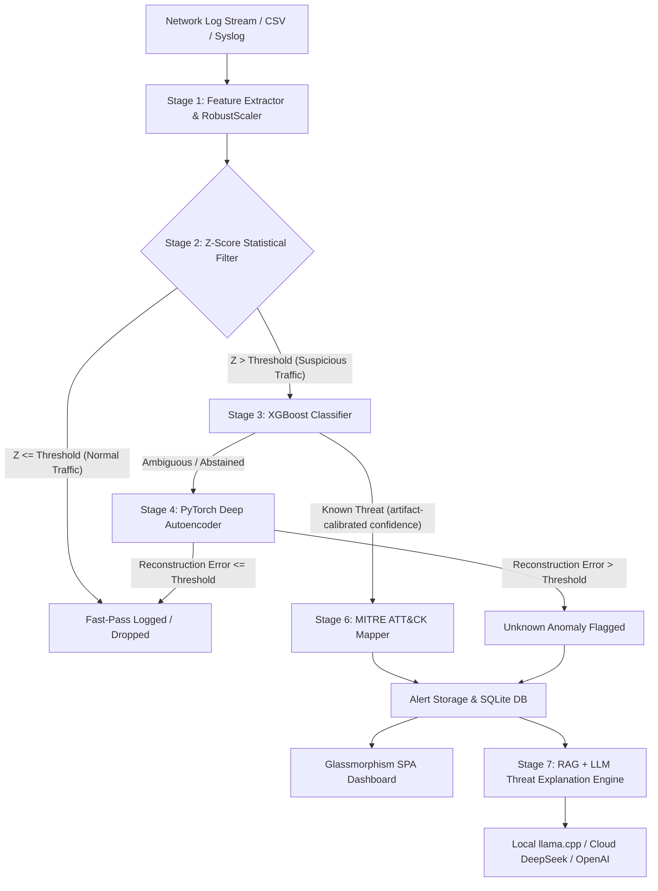

# CyberGuard — Defensible Hybrid Intrusion Detection & Threat Review System

[](https://opensource.org/licenses/MIT)
[](https://www.python.org/)
[](https://fastapi.tiangolo.com/)
[](https://xgboost.readthedocs.io/)
[](https://pytorch.org/)
[](https://attack.mitre.org/)

> **Architectural Philosophy:** *"The 4-stage deterministic algorithmic pipeline detects and filters network threats first; the AI Large Language Model explains selected alerts second. Never rely on an LLM for direct line-rate packet or log inspection."*

> **Smart Decision:** Difficult/unknown alerts now produce a versioned Smart Log and may receive structured AI decision support behind a deterministic policy gate. AI never executes block or quarantine. See [Smart Log architecture](docs/SMART_LOG_ARCHITECTURE_AR.md) and [next-agent implementation prompt](NEXT_AGENT_PROMPT.md).

---

## 📜 Copyright & Research Attribution

* **Project Developer & Author:** Sajjad Raad ([@sajjadraad2006-sys](https://github.com/sajjadraad2006-sys)) — `sajjadraad2006@gmail.com`
* **Academic Baseline Reference:** Evolved from the 2025 Master's research thesis by Zainab Salem Aziz at the **University of Basra**.
* **License:** [MIT License](LICENSE) — Open source for academic, security research, and production security operations.

---

## 📑 Table of Contents

1. [Executive Summary & Problem Statement](#-executive-summary--problem-statement)
2. [Critical Architectural Solutions](#-critical-architectural-solutions)
3. [System Architecture & Dataflow](#-system-architecture--dataflow)
4. [The 4-Stage Algorithmic Pipeline](#-the-4-stage-algorithmic-pipeline)
5. [MITRE ATT&CK® & TAXII 2.1 Synchronization](#-mitre-attck--taxii-21-synchronization)
6. [Local AI & RAG Threat Explanation Engine](#-local-ai--rag-threat-explanation-engine)
7. [Project Structure & File Organization](#-project-structure--file-organization)
8. [Installation & Setup Guide](#-installation--setup-guide)
9. [Usage & Operational Workflow](#-usage--operational-workflow)
10. [REST API Documentation](#-rest-api-documentation)
11. [Performance Benchmarks](#-performance-benchmarks)
12. [Testing & Quality Assurance](#-testing--quality-assurance)
13. [Keyboard Shortcuts](#-keyboard-shortcuts)
14. [License & Citation](#-license--citation)

---

## 🛸 Executive Summary & Problem Statement

Modern Security Operations Centers (SOCs) face unprecedented volumes of network traffic logs. Recent trends attempting to feed raw log strings directly into Large Language Models (LLMs) suffer from fatal operational flaws: extreme latency (2–5 seconds per log record), prohibitive compute costs, context window truncation, and hallucinations regarding security indicators.

**CyberGuard** addresses this bottleneck with a local-first hybrid architecture:
1. **Deterministic detection path:** Statistical filtering, gradient-boosted trees, and an autoencoder process numerical flow features. Throughput is measured for each upload and must be benchmarked on the deployment workload.
2. **The 10% Qualitative Analysis (RAG-Driven Security Assistant):** Local fine-tuned LLMs (e.g., *Foundation-Sec*, *RedSage*, or API-backed models like DeepSeek) only generate human-readable threat explanations, root cause analysis, and remediation playbooks when explicitly requested by an analyst or triggered by high-severity alerts.

---

## ⚡ Critical Architectural Solutions

CyberGuard systematically resolves all 8 major limitations identified in preliminary LLM-first security research:

| # | Original Weakness | CyberGuard Architectural Fix | Technical Standard / Impact |
|---|---|---|---|
| **1** | **LLM Latency Bottleneck** (2–5s per log entry) | **Stage 2 Z-Score Statistical Filter** operating pre-ML | Vectorized; actual throughput is reported from the current workload. |
| **2** | **Flawed Metric Evaluation** (BERTScore on small samples) | Per-class precision/recall/F1, confusion matrix, PR-AUC, FPR and calibration | Candidate training refuses test partitions smaller than 10,000; the bundled legacy fixture has no valid independent metrics. |
| **3** | **Lack of Baselines** (No standard ML comparison) | Multi-model benchmark suite | Benchmark comparison against **Isolation Forest** and statistical filters. |
| **4** | **Unstructured Text Input** (Raw log feeds to LLM) | **32 numerical flow features** | Normalized via `RobustScaler`; this is flow telemetry, not payload inspection. |
| **5** | **LLM Metric Hallucinations** | **Isolated Evaluation & Inference Pipeline** | Metrics calculated strictly via deterministic Python math modules. |
| **6** | **Unknown behavior** | **Stage 4 PyTorch Deep Autoencoder** | Flags an unknown anomaly signal via calibrated reconstruction error; it does not prove a zero-day exploit. |
| **7** | **Missing Standard Threat Taxonomy** | **Automated MITRE ATT&CK Matrix Mapping** | Maps classified attacks directly to ATT&CK Technique IDs (e.g., T1498, T1046). |
| **8** | **Static / Stale Knowledge Base** | **TAXII 2.1 Live Synchronization Engine** | Auto-fetches latest ATT&CK v19.1 STIX 2.1 data with offline fallbacks. |

---

## 🏗️ System Architecture & Dataflow



---

## 🧪 The 4-Stage Algorithmic Pipeline

### Stage 1: Feature Extraction & Scaling (`backend/detection/features.py` & `normalizer.py`)
- Extracts **32 numerical features** from network packet flow records based on the benchmark **CICIDS2017** dataset structure (e.g., Flow Duration, Total Fwd Packets, Packet Length Std, FIN/SYN/RST/ACK Flag Counts, Bwd Packet Length Mean, Header Length, Flow Bytes/s).
- Applies `RobustScaler` using median and interquartile range (IQR) to prevent outlier distortion during machine learning model training and inference.

### Stage 2: Z-Score Statistical Filter (`backend/detection/statistical.py`)
- Computes multi-variate statistical anomaly scores ($Z$) against baseline normal traffic profiles:
  $$Z_i = \frac{|x_i - \mu_i|}{\sigma_i}$$
- Immediately bypasses normal background network traffic operating within standard standard deviation thresholds ($\le 3.0\sigma$).
- Vectorized for high throughput; benchmark the full pipeline on your own hardware and traffic mix before setting capacity targets.

### Stage 3: XGBoost Supervised Classifier (`backend/detection/classifier.py`)
- The code can normalize several CICIDS2017 labels, but the **bundled artifact only exposes** `Benign`, `Bot`, `DDoS`, and `PortScan`.
- Evaluates $P(y|x)$ and uses the abstention threshold stored in the verified artifact manifest. Other labels are unsupported until a validated dataset and independent per-class metrics prove them.

### Stage 4: PyTorch Deep Autoencoder Anomaly Detector (`backend/detection/autoencoder.py`)
- Symmetrical encoder-decoder: 32 $\rightarrow$ 64 $\rightarrow$ 32 $\rightarrow$ 16 $\rightarrow$ 32 $\rightarrow$ 64 $\rightarrow$ 32.
- Calculates mean squared error (MSE) reconstruction loss:
  $$L(x, \hat{x}) = \frac{1}{d} \sum_{j=1}^{d} (x_j - \hat{x}_j)^2$$
- When reconstruction loss exceeds the held-out benign threshold, the sample is flagged as an **unknown anomaly requiring analyst review**.

---

## 🛡️ MITRE ATT&CK® & TAXII 2.1 Synchronization

CyberGuard correlates raw classified attack labels into structured threat intelligence aligned with the **MITRE ATT&CK Matrix (Enterprise v19.1)**:

- **Automatic Mapping Engine (`backend/mitre/mapper.py`):** Translates attack signatures into official Technique IDs, Tactics, and Sub-techniques:
  - `DoS / DDoS` $\rightarrow$ **T1498 (Network Denial of Service)** & **T1499 (Endpoint Denial of Service)**
  - `PortScan` $\rightarrow$ **T1046 (Network Service Discovery)**
  - `BruteForce` $\rightarrow$ **T1110 (Brute Force)**
  - `Infiltration` $\rightarrow$ **T1068 (Exploitation for Privilege Escalation)**
  - `Botnet` $\rightarrow$ **T1071 (Application Layer Protocol)**
- **TAXII 2.1 Sync Engine (`backend/mitre/taxii_sync.py`):** Features a resilient 3-tier fallback chain:
  1. Live TAXII 2.1 server connection (`cti-taxii.mitre.org`).
  2. Official MITRE CTI GitHub repository raw JSON feed.
  3. Local cached STIX 2.1 bundle database (`data/mitre/enterprise-attack-v19.1.json`).

---

## 🧠 Local AI & RAG Threat Explanation Engine

CyberGuard includes a Retrieval-Augmented Generation (RAG) assistant designed specifically for cybersecurity analysts:

```
[Analyst Prompt] ──> [Local TF-IDF MITRE Index] ──> [Context Ingestion: ATT&CK DB + Alert Log]
                                                                │
                                                                ▼
                                                [Local GGUF LLM / Cloud API]
                                                                │
                                                                ▼
                                                [Structured Incident Analysis]
```

- **Vector Knowledge Base (`backend/llm/rag.py`):** Embeds MITRE ATT&CK techniques, detection mitigations, and detection strategies using a deterministic local TF-IDF index.
- **Dynamic Provider Switch (`backend/llm/provider.py`):**
  - **Local Mode:** Connects to `llama.cpp` hosting specialized local GGUF models (*Foundation-Sec*, *RedSage*, *Mistral-7B-Instruct*).
  - **API Mode:** Integrates with cloud LLM providers (*DeepSeek-V3/R1*, *OpenAI GPT-4o*) via secure API keys.
- **Strict Guardrails (`backend/llm/prompts.py`):** Restricts LLM output to technical remediation playbooks, IOC analysis, and impact assessment, preventing off-topic responses or hallucinated confidence scores.

### Smart Log and guarded decisions

Every persisted alert receives a minimal Smart Log with a SHA-256 evidence fingerprint. High-confidence known attacks are resolved by deterministic policy without calling an LLM. Ambiguous and autoencoder alerts may be enriched by a JSON-only AI decision, then pass through a non-bypassable policy gate. Analyst feedback is stored for later offline validation; uploads never retrain the active model directly.

---

## 📂 Project Structure & File Organization

```
project/
├── .gitignore                   # Comprehensive rules for excluding venv, models, cache & databases
├── LICENSE                      # MIT License file with copyright attribution
├── README.md                    # System documentation & technical specification
├── requirements.txt             # Python dependencies (FastAPI, PyTorch, XGBoost, scikit-learn TF-IDF, etc.)
├── run.sh                       # Unified bash startup script (Backend + Frontend server launch)
├── verify.py                    # Verification script testing component initialization
├── verify_setup.py              # Environment sanity check script
│
├── backend/                     # FastAPI core backend application
│   ├── main.py                  # FastAPI application entrypoint, CORS setup & static file mounts
│   ├── config.py                # Environment configuration, confidence gates & threshold parameters
│   ├── api/                     # REST API endpoints & route handlers
│   │   ├── detection.py         # Ingestion, log analysis & batch prediction endpoints
│   │   ├── chat.py              # RAG-enabled security analyst chat endpoint
│   │   ├── mitre.py             # MITRE ATT&CK matrix browser & sync endpoints
│   │   └── settings.py          # System settings & provider toggle API
│   ├── db/                      # Database models & persistence
│   │   ├── init_db.py           # SQLite database schema creation & connection management
│   │   └── models.py            # Pydantic & ORM alert data models
│   ├── detection/               # 4-stage algorithmic detection pipeline
│   │   ├── features.py          # 32-feature vector extraction logic
│   │   ├── normalizer.py        # RobustScaler feature normalization wrapper
│   │   ├── statistical.py       # Z-Score statistical anomaly filter
│   │   ├── classifier.py        # XGBoost multi-class threat classifier
│   │   ├── autoencoder.py       # PyTorch Deep Autoencoder anomaly detector
│   │   ├── pipeline.py          # Master orchestrator combining stages 1-4
│   │   └── trainer.py           # Dataset training script with metric evaluations
│   ├── mitre/                   # MITRE ATT&CK knowledge & STIX parser
│   │   ├── attack_db.py         # SQLite technique browser interface
│   │   ├── mapper.py            # Label-to-Technique mapping tables
│   │   └── taxii_sync.py        # TAXII 2.1 live & fallback sync engine
│   └── llm/                     # Threat explanation & RAG engine
│       ├── provider.py          # LLM client factory (Local vs API)
│       ├── local_client.py      # llama.cpp server HTTP client interface
│       ├── api_client.py        # DeepSeek & OpenAI API client integration
│       ├── prompts.py           # Cybersecurity system prompts & instruction templates
│       └── rag.py               # local TF-IDF MITRE retrieval index
│
├── frontend/                    # Single Page Application (SPA) dashboard
│   ├── index.html               # Main HTML5 UI shell with SVG icons & navigation tabs
│   ├── css/
│   │   └── style.css            # Custom CSS3 dark theme, glassmorphism UI & responsive layout
│   └── js/                      # Modular JavaScript engine (No external frameworks)
│       ├── api.js               # Centralized HTTP API client helper
│       ├── app.js               # SPA router & application state controller
│       ├── charts.js            # Chart.js visual analytics & timeline rendering
│       ├── chat.js              # Analyst AI chat UI controller
│       ├── dashboard.js         # Real-time metrics dashboard controller
│       ├── mitre.js             # Interactive MITRE ATT&CK matrix viewer
│       └── settings.js          # System threshold & provider settings controller
│
├── cyberguard/                  # Research pipeline module & benchmark tools
│   ├── config.py                # Pipeline parameter constants
│   ├── download_data.sh         # Dataset downloader script
│   ├── setup.sh                 # Environment setup script
│   ├── layer1_ingest/           # CSV flow log ingestion helpers
│   ├── layer2_normalize/        # Feature scaling & normalization
│   ├── layer4_ml/               # Baseline isolation forest & statistical ML scripts
│   ├── layer6_mitre/            # TAXII STIX parser tools
│   ├── datasets/                # Sample datasets & generator scripts
│   └── tests/                   # Research pipeline tests
│
├── data/                        # Dynamic application data directory (Git-ignored)
│   ├── mitre/                   # Cached MITRE ATT&CK STIX 2.1 JSON files
│   └── models/                  # Trained PyTorch & XGBoost model checkpoints
│       └── trained/             # Active detection model binaries (.pt, .pkl)
│
└── tests/                       # Unit & Integration test suite (pytest)
    ├── test_api.py              # FastAPI endpoint integration tests
    ├── test_autoencoder.py      # PyTorch Autoencoder loss & threshold tests
    ├── test_classifier.py       # XGBoost classifier accuracy & output shape tests
    ├── test_features.py         # Feature extractor vector format tests
    ├── test_mitre.py            # TAXII sync & technique mapper unit tests
    └── test_pipeline.py         # End-to-end 4-stage pipeline execution tests
```

---

## 💻 Installation & Setup Guide

### Prerequisites
- **Operating System:** Linux (Ubuntu 20.04+, Debian 11+, Arch), macOS 12+, or Windows Subsystem for Linux (WSL2).
- **Python:** Python `3.10` or higher.
- **Node.js / Modern Browser:** Google Chrome, Mozilla Firefox, or Brave (supporting HTML5, CSS Grid, ES6 JS).

### 1. Clone Repository & Setup Virtual Environment

```bash
# Clone the repository
git clone https://github.com/sajjadraad2006-sys/CyberGuard.git
cd CyberGuard

# Create Python virtual environment
python3 -m venv venv

# Activate virtual environment
source venv/bin/activate
# Windows: venv\Scripts\activate

# Upgrade pip and install dependencies
pip install --upgrade pip
pip install -r requirements.txt
```

### 2. Dataset integrity and candidate training
The bundled CSV files and model weights are deterministic fixtures for tests/demos only. They are manifest-verified but `production_approved: false`. A production dataset entry must include an immutable source URL, license, SHA-256, schema, row/label inventory, and capture/time grouping in `cyberguard/datasets/manifest.json`.

```bash
# Download an operator-selected immutable object; no synthetic fallback exists
python cyberguard/datasets/download_full.py --url https://example/dataset.csv \
  --sha256 <expected-64-hex-digest> --output /path/to/captures/capture-01.csv

# Train a shadow-only candidate; never overwrite the active directory directly
python -m backend.detection.trainer /path/to/captures data/models/candidates/v1 \
  --manifest /path/to/dataset-manifest.json
```

---

## 🚀 Usage & Operational Workflow

### Starting the Server

Execute the unified bash startup script or run Uvicorn directly:

```bash
# Option A: Using the startup script
bash run.sh

# Option B: Direct Uvicorn command
source venv/bin/activate
uvicorn backend.main:app --host 127.0.0.1 --port 8000 --reload
```

Access the Web Dashboard in your browser:
📍 **`http://127.0.0.1:8000`**

---

## 🌐 REST API Documentation

FastAPI automatically serves interactive OpenAPI documentation at **`http://127.0.0.1:8000/docs`**.

| Method | Endpoint | Description | Request Payload | Response |
|---|---|---|---|---|
| `POST` | `/api/detect/upload` | Ingest a CSV/JSON log and run the verified pipeline | Multipart file | Alerts, measured throughput, operational mode |
| `POST` | `/api/chat` | Query the constrained analyst assistant | session ID + message | RAG-assisted explanation |
| `GET` | `/api/mitre/techniques` | List MITRE ATT&CK techniques | Query params (`tactic`, `search`) | List of ATT&CK Techniques & ID mappings |
| `POST` | `/api/mitre/sync` | Force TAXII 2.1 sync update | None | Sync status & added technique counts |
| `GET` | `/api/settings` | Get LLM provider settings | None | Sanitized provider configuration |
| `POST` | `/api/settings` | Update the LLM provider | Provider configuration | Updated settings status |
| `GET` | `/api/decision/smart-log/{alert_id}` | Read the minimal structured evidence record | Path alert ID | Versioned Smart Log |
| `GET` | `/api/decision/queue` | List cases requiring analyst review | Optional `limit` | Review summaries |
| `GET` | `/api/decision/case/{alert_id}` | Smart Log, decision, feedback and audit trail | Path alert ID | Review-safe case details |
| `POST` | `/api/decision/evaluate/{alert_id}` | Run policy and, only when uncertain, guarded AI analysis | `{"refresh": false}` | Smart Log + guarded decision |
| `POST` | `/api/decision/feedback/{alert_id}` | Store analyst verdict for offline learning | verdict + notes | Server-stamped identity; no online training |
| `GET` | `/api/decision/export-reviewed` | Export reviewed, non-conflicting Smart Logs | Optional conflict flag | Offline/shadow dataset |
| `GET` | `/api/decision/audit/verify` | Verify the append-only audit hash chain | None | Chain validity and event count |
| `POST` | `/api/decision/simulate-response/{alert_id}` | Build an allowlisted dry-run response plan | action, asset, TTL, approvals, idempotency key | Simulation only; `executed_action=none` |
| `GET` | `/api/detect/health` | Artifact integrity and evaluated coverage | None | Readiness, mode, classes, missing classes |

---

## 📊 Performance and model status

No production accuracy table is published because the bundled artifacts were produced from synthetic fixture-shaped data and have no independent split. `/api/detect/health` therefore reports `operational_mode: evaluation_only`. Candidate training now emits measured per-class metrics, PR-AUC, FPR, probability calibration, split provenance, dataset hashes and artifact hashes. Promote nothing until those results pass separately defined quality/security gates and shadow evaluation.

An official CSE-CIC-IDS2018 candidate was evaluated on 18 August 2026 using six
capture-disjoint publisher CSVs (6,291,450 raw rows). Its classifier reached
macro F1 0.9067 on 1,063,406 independent final rows, but the complete four-stage
pipeline failed both baseline gates because the statistical front gate suppressed
almost every attack. The candidate remains `failed_gates`,
`production_approved: false`, and was not activated. See
[the Arabic candidate report](docs/CANDIDATE_EVALUATION_AR.md). Health now
reports this candidate separately from the still-active legacy fixture bundle.

Reproducible workflow:

```bash
python -m cyberguard.datasets.acquire_catalog
python -m cyberguard.datasets.audit_dataset
python -m backend.detection.candidate_workflow \
  --audit data/datasets/cse-cic-ids2018/dataset_audit.json \
  --output data/models/candidates/cse-cic-ids2018-v1-seed42
python -m backend.detection.shadow \
  data/models/candidates/cse-cic-ids2018-v1-seed42 \
  --audit data/datasets/cse-cic-ids2018/dataset_audit.json \
  --output data/models/candidates/cse-cic-ids2018-v1-seed42/shadow_report.json
# Dry-run by default; this candidate is expected to be rejected.
python -m backend.detection.promote \
  data/models/candidates/cse-cic-ids2018-v1-seed42
```

---

## 🧪 Testing & Quality Assurance

CyberGuard includes automated unit and integration tests powered by `pytest`. To execute all test suites:

```bash
# Run pytest suite
pytest -v tests/
```

Individual component test validation:
```bash
pytest tests/test_features.py       # Test 32-feature numerical extraction
pytest tests/test_classifier.py     # Test XGBoost model inference & probability gating
pytest tests/test_autoencoder.py    # Test PyTorch Deep Autoencoder MSE threshold calculation
pytest tests/test_pipeline.py       # Test end-to-end 4-stage pipeline execution
pytest tests/test_api.py            # Test FastAPI REST endpoints
```

---

## ⌨️ Keyboard Shortcuts

The SPA Frontend supports hotkeys for fast SOC analyst navigation:

| Hotkey | Destination / Action |
|---|---|
| `Ctrl` + `1` | **Dashboard View** (Real-time analytics & log timeline) |
| `Ctrl` + `2` | **Analyst AI Chat** (RAG threat explanation assistant) |
| `Ctrl` + `3` | **MITRE ATT&CK Matrix** (Technique explorer & TAXII status) |
| `Ctrl` + `4` | **Models & Pipeline** (Stage breakdown & evaluation metrics) |
| `Ctrl` + `5` | **Settings** (Threshold configuration & LLM provider switch) |

---

## 📄 License & Citation

Distributed under the **MIT License**. See [`LICENSE`](LICENSE) for details.

### Academic Citation
If you utilize CyberGuard or its 4-stage algorithmic pipeline in your academic research, security publication, or thesis, please cite:

```bibtex
@misc{cyberguard2026,
  author       = {Sajjad Raad},
  title        = {CyberGuard: Defensible Hybrid Intrusion Detection and Threat Review System},
  year         = {2026},
  publisher    = {GitHub},
  howpublished = {\url{https://github.com/sajjadraad2006-sys/CyberGuard}},
  note         = {Based on academic research baseline by Zainab Salem Aziz, University of Basra (2025)}
}
```

---
<p align="center">
  Developed with ❤️ by <b>Sajjad Raad</b> (@sajjadraad2006-sys)
</p>


## Security deployment

CyberGuard is localhost-only by default. Do not expose Uvicorn directly to the Internet. For remote access, place it behind a TLS reverse proxy and set `CG_ALLOWED_HOSTS`, a strong random `CG_API_TOKEN`, and `CG_ANALYST_ID`; the browser keeps the API token only in session storage. Outbound LLM URLs are allowlisted with `CG_ALLOWED_API_HOSTS`, local llama ports with `CG_LOCAL_LLM_PORTS`, and request/upload limits are configurable through `CG_MAX_HEADER_BYTES`, `CG_MAX_URL_BYTES`, `CG_MAX_REQUEST_BODY_MB`, `CG_MAX_UPLOAD_MB`, and `CG_MAX_UPLOAD_ROWS`. The response simulator accepts only assets in `CG_SIM_ASSETS` (default: `lab-host`) and contains no actuator integration.

The bundled classifier artifact currently contains only `Benign`, `Bot`, `DDoS`, and `PortScan`. It must be retrained and independently evaluated on a valid, representative dataset before production use; the autoencoder is anomaly detection, not proof of full zero-day or MITRE coverage. CyberGuard detects and explains—it does not block traffic unless integrated with a separately controlled firewall/IPS response layer.
