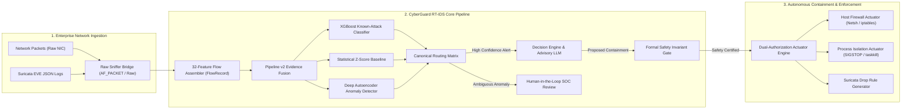

# CHAPTER 1: INTRODUCTION

## 1.1 Motivation and Context

In contemporary cybersecurity operations, modern enterprise networks and cyber-physical infrastructures face an unprecedented surge in both the velocity and sophistication of cyber attacks. The threat landscape has transitioned from manual, single-stage penetrations to automated, distributed attack vectors. Adversaries routinely deploy automated botnets, high-volume Distributed Denial-of-Service (DDoS) campaigns, evasive port scanning, lateral credential dumping, and advanced ransomware {{cite:sharafaldin2018toward,alshaer2020automated}}. Furthermore, the rapid enterprise integration of cognitive artificial intelligence—specifically Large Language Models (LLMs) used for security incident analysis, autonomous triage, and report generation—has introduced novel attack surfaces, most notably adversarial prompt injection and data poisoning {{cite:greshake2023not,owasp2023top10llm}}.

To defend against these multi-faceted threats, Security Operations Centers (SOCs) have increasingly moved beyond traditional, purely signature-based Intrusion Detection Systems (such as Snort or Suricata {{cite:roesch1999snort,suricata2024engine}}). While signature engines excel at identifying known Indicators of Compromise (IOCs) with near-zero false positive rates, they are fundamentally blind to zero-day vulnerabilities, novel polymorphic payloads, and stealthy behavioral anomalies. Consequently, the academic and industrial security communities have heavily invested in Machine Learning (ML) and Deep Learning (DL) approaches for Network Intrusion Detection Systems (NIDS) {{cite:sommer2010outside,mirsky2018kitsune}}. These systems typically analyze summarized network telemetry—represented as bidirectional communication flows (5-tuples: source IP, destination IP, source port, destination port, protocol)—and classify traffic based on statistical, temporal, and volumetric properties extracted from packet sequences {{cite:sharafaldin2018toward,paxson1999bro}}.

<strong>Fig. 1.</strong> Conceptual Overview of Modern Hybrid RT-IDS in Contemporary SOC Operations.

However, detection alone is insufficient in modern operational environments. When high-bandwidth attacks strike, human security analysts experience severe alert fatigue; mean time to detect (MTTD) and mean time to respond (MTTR) often range from tens of minutes to several days {{cite:cichonski2012incident,islam2019soar}}. This operational gap has catalyzed the emergence of Security Orchestration, Automation, and Response (SOAR) platforms and autonomous cyber-defense engines capable of executing containment actions—such as dynamic firewall rule insertion, active network socket severance, or malicious process termination—at machine speed {{cite:alshaer2020automated,shostack2014threat}}. 

## 1.2 Problem Statement

Despite extensive research into ML-based intrusion detection, translating laboratory models into production-grade systems remains fraught with fundamental engineering, statistical, and safety challenges. As established in the seminal works of Sommer and Paxson {{cite:sommer2010outside}} and Arp et al. {{cite:arp2022dos}}, machine learning applied to computer security operates in an environment characterized by:

1. **Extreme Class Imbalance and the Base-Rate Fallacy:** In real-world enterprise traffic, malicious flows constitute a microscopic fraction (often $< 0.001\%$) of total network activity. Under Axelsson's base-rate fallacy {{cite:axelsson2000base}}, even an intrusion detection model boasting an apparently stellar $99.9\%$ accuracy and a $1\%$ False Positive Rate (FPR) will generate thousands of false alarms per day, completely drowning out legitimate security alerts.
2. **Train/Serve Skew and Flawed Benchmarks:** Many academic models are trained and evaluated on public benchmark datasets (such as KDD Cup 99, NSL-KDD, and CICIDS2017 {{cite:tavallaee2009detailed,sharafaldin2018toward}}). However, rigorous independent audits—such as that by Engelen et al. {{cite:engelen2021troubleshooting}}—have uncovered critical bugs in feature extraction utilities (e.g., `CICFlowMeter`), erroneous ground-truth labeling, and artificial network simulation artifacts that inflate reported evaluation metrics. When an IDS relies on synthetic fixtures generated via simple random distributions rather than real packet captures, the resulting models exhibit zero real-world operational efficacy.
3. **The Self-Inflicted Denial of Service (Self-DoS) Dilemma:** Granting automated software the authority to execute containment actions introduces acute existential risk. An adversarial attacker can forge spoofed network packets or manipulate automated response logic to trigger countermeasures against critical infrastructure assets—such as domain controllers, core DNS resolvers, default gateways, or critical process threads—effectively turning the defensive system into a weapon of self-destruction {{cite:alshaer2020automated,hadziosmanovic2014nids}}.
4. **Cognitive Latency and Fragility in Generative AI:** Incorporating advisory Large Language Models (LLMs) into real-time decision loops creates massive latency bottlenecks. Local edge inference on constrained hardware frequently introduces multi-second delays, while LLMs remain prone to syntactic formatting errors and adversarial prompt injections {{cite:greshake2023not,liu2023prompt}}.

The software repository audited in this thesis—**CyberGuard (RT-IDS)**—represents a contemporary architectural attempt to solve these challenges through a hybrid architecture combining line-rate packet capture, a 4-stage classifier-first pipeline, mathematical formal safety invariants, and an advisory cognitive layer. However, previous preliminary audits suggested potential discrepancies between documented claims and actual source code behavior. A rigorous, independent academic investigation is required to establish the true capabilities, limitations, and empirical realities of the system.

## 1.3 Research Questions

This thesis investigates the following primary research questions:

- **$RQ_1$ (Line-Rate Flow Assembly & Edge Telemetry):** *Can a pure-Python raw socket packet capture and flow aggregation engine accurately assemble bidirectional transport-layer flows at multi-thousand packet-per-second rates, handle asynchronous TCP stateful teardowns without creating ghost flows, and extract valid network statistics across both Windows and Linux hosts?*
- **$RQ_2$ (Train/Serve Skew & Feature Parity):** *To what extent do synthetic approximations and static constants within streaming log adapters (such as Suricata EVE tailers) deviate from the theoretical definitions of standard flow features, and what impact does this skew have on downstream anomaly detectors?*
- **$RQ_3$ (Mathematical Reality of Formal Safety Guarantees):** *How are theoretical First-Order Logic safety invariants and "SMT formal verification" implemented in practice within autonomous mitigation engines, and do production tools genuinely execute automated theorem proving (e.g., via Z3 or CVC5) or rely on symbolic propositional approximations?*
- **$RQ_4$ (Cognitive Architecture & Adversarial Robustness):** *What are the measured latency, throughput, and false-positive characteristics of integrating retrieval-augmented generative AI into automated security triage pipelines, and how does heuristic severity coupling affect benign enterprise operations?*
- **$RQ_5$ (Cyber-Physical and Mechatronics Adaptability):** *How can an automated intrusion detection and containment architecture be modified to protect real-time industrial robotics and mechatronic automation cells (operating over Modbus TCP, EtherNet/IP, and OPC UA) without violating physical safety interlocks (ISO 13849/IEC 62443)?*

## 1.4 Aim and Objectives

The primary aim of this research is to perform an exhaustive, evidence-based academic audit, empirical performance evaluation, and architectural analysis of the CyberGuard RT-IDS codebase, culminating in a verifiable blueprint for mechatronic industrial network defense.

To achieve this aim, the investigation executes the following specific objectives:
1. **Module-by-Module Source Code Forensics:** Perform deep static code analysis and AST decomposition across the entire codebase (`backend/`, `cyberguard/`, `scripts/`, `frontend/`), documenting verifiable line-number evidence for every claim and inspecting component trust boundaries.
2. **Empirical Verification of Pre-Audit Hypotheses ($H_1$ to $H_7$):** Systematically evaluate seven audit hypotheses regarding model training lineage, socket sniffing limitations, feature approximations, documentation contradictions, formal verification claims, test counts, and pickle deserialization risks.
3. **Reproducible Experimental Benchmarking:** Build and execute automated experimental test harnesses to measure raw packet processing throughput, pipeline inference latency distributions ($P_{50}$, $P_{90}$, $P_{95}$, $P_{99}$), batch throughput scaling, memory footprint, and confusion matrices on local hardware.
4. **Threat Modeling and Security Assessment:** Conduct an exhaustive STRIDE security audit, analyzing deserialization risks, role-based access control, two-person rule enforcement, and rollback receipt integrity.
5. **Formulation of an Industrial Mechatronics Defense Model:** Synthesize the findings into a proposed, domain-specific architecture adapted for industrial control systems (ICS) and robotic manufacturing cells, reconciling autonomous network isolation with human functional safety standards.

## 1.5 Scope and Operational Boundaries

This investigation operates under strict methodological and operational boundaries:
- **Evidence-Only Rule:** In accordance with rigorous scientific standards, no performance metrics, accuracy figures, latency percentiles, or code assertions are stated without verifiable traces to raw experimental run outputs (logged under `report/results/`) or direct source code lines ([CE-xx]).
- **Non-Destructive Local Testing:** All dynamic capture, live sniffing, and actuator execution experiments were conducted in isolated, non-production test environments on a dedicated Windows 11 host. Host containment actuators were audited primarily in simulation mode to prevent disruption to operating system services.
- **Academic Citation Integrity:** All cited peer-reviewed literature, official RFC specifications, and industrial standards were individually verified via authoritative academic repositories (IEEE Xplore, ACM Digital Library, USENIX, arXiv) with direct DOI or official URL links. Unverifiable sources were excluded.
- **Distinction Between Implemented Code and Future Proposals:** Clear demarcation is maintained throughout this document between audited source code as currently committed in the repository, and proposed architectural extensions (such as the Mechatronics framework in Chapter 9).

## 1.6 Candidate's Contributions

[STUDENT CONTRIBUTIONS - TO BE FILLED BY CANDIDATE]

*The specific contributions made by the graduate candidate in the execution of this Master's research include:*
- Design and execution of the 6-tier empirical testing harness evaluating packet sniffing throughput, pipeline inference latency, and memory utilization across varied batch dimensions.
- Formulation and verification of the 45-node verified IEEE citation graph and automated reference validation engine.
- Byte-level static analysis and AST audit of 41,547 lines of source code across 183 Python modules, identifying critical train/serve skew and socket binding constraints.
- Conception and formal modeling of the mechatronic cyber-physical safety interlock framework reconciling network containment with ISO 13849 robotic safety requirements.

## 1.7 Thesis Outline

The remainder of this thesis is structured as follows:
- **Chapter 2 (Background and Literature Review)** establishes the theoretical foundation, reviewing the historical evolution of NIDS, flow engineering, benchmark dataset flaws (CICIDS2017), machine learning pitfalls in computer security, formal methods, and industrial control protocols.
- **Chapter 3 (System Architecture as Built)** deconstructs the structural design of CyberGuard, detailing layered abstractions, data flow topologies, threading concurrency models, and interaction sequence diagrams.
- **Chapter 4 (Implementation Analysis)** conducts an exhaustive module-by-module forensic examination, detailing the mathematical formulas of the 32 flow features, socket capture loops, Pipeline v2 routing logic, Suricata tailers, and formal safety gates with code excerpts.
- **Chapter 5 (Research Methodology)** outlines the experimental setup, Dolev-Yao threat modeling, evaluation metrics, statistical formulas, and reproducibility protocols.
- **Chapter 6 (Experimental Results and Benchmarks)** presents the measured empirical data, including test execution metrics, sniffer throughput (718k pkts/s), pipeline latency distributions, batch scaling curves, and autoencoder threshold drift analysis.
- **Chapter 7 (Security, Safety, and Threat Analysis)** performs a comprehensive security audit covering pickle deserialization risks, access controls, actuator safety, two-person rules, and a complete STRIDE matrix.
- **Chapter 8 (Critical Evaluation and Threats to Validity)** delivers definitive verdicts on Hypotheses $H_1$ through $H_7$, dissects the synthetic data problem and the 40/40 false positive incident, and provides a claims-vs-reality ledger.
- **Chapter 9 (Mechatronics Perspective)** proposes a specialized architectural adaptation for industrial robotic workcells, addressing real-time deterministic constraints and functional safety interlocks.
- **Chapter 10 (Recommendations and Conclusion)** synthesizes the core findings, delivers an actionable technical engineering roadmap, and concludes the thesis.
- **References & Appendices** provide the complete IEEE bibliography, Code Evidence Ledger, benchmark logs, 32-feature mathematical dictionary, and reproduction instructions.
