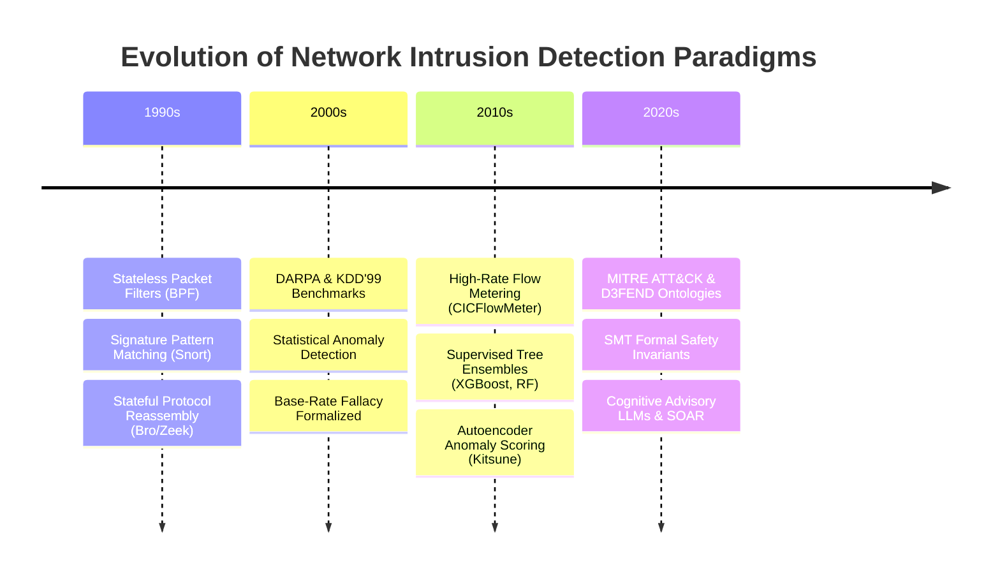
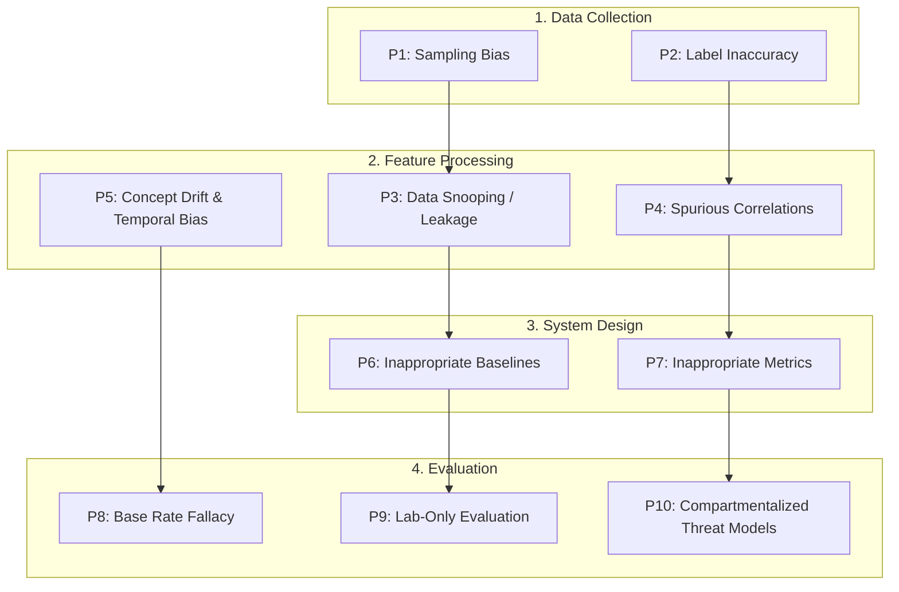

# CHAPTER 2: BACKGROUND AND LITERATURE REVIEW

## 2.1 Evolution of Network Intrusion Detection Systems

Network Intrusion Detection Systems (NIDS) constitute a foundational pillar in enterprise network defense, designed to continuously inspect passing communications and identify unauthorized access, policy violations, or malicious exploitation. Over the past three decades, intrusion detection technologies have undergone significant architectural evolution, transitioning from rudimentary stateless packet filtering to stateful protocol analysis, distributed flow-based statistical modeling, and contemporary neuro-symbolic hybrid frameworks {{cite:sommer2010outside,ring2019survey}}.

<strong>Fig. 2.</strong> Evolution of Network Intrusion Detection Systems from Packet Filtering to Neuro-Symbolic Ensembles.

Early intrusion detection systems operated primarily at the network and transport layers using primitive pattern-matching rules. In 1993, McCanne and Jacobson introduced the Berkeley Packet Filter (BPF) {{cite:mccanne1993bsd}}, establishing an in-kernel, register-based virtual machine capable of filtering raw packet streams at high link speeds without incurring excessive user-space context-switching overhead. Building upon packet filtering, Roesch released Snort in 1999 {{cite:roesch1999snort}}, which codified rule-based signature matching by scanning raw payload bytes for regular expressions and static byte signatures. Concurrently, Paxson introduced the Bro network monitor (now Zeek) {{cite:paxson1999bro}}, pioneering stateful connection tracking and application-layer protocol reassembly. While signature engines remain indispensable due to their deterministic predictability and high processing throughput, their reliance on static indicators of compromise renders them ineffective against novel zero-day exploits, dynamic evasion techniques, and encrypted payloads.

## 2.2 Flow-Based Network Telemetry and Feature Engineering

As network line speeds scaled from megabits to gigabits and tens of gigabits per second, deep packet inspection (DPI) of every packet payload became computationally prohibitive on commodity hardware. Furthermore, the ubiquitous adoption of Transport Layer Security (TLS 1.2 / TLS 1.3) rendered packet payloads opaque. In response, modern NIDS shifted toward flow-based network telemetry.

A network **flow** is formally defined as a unidirectional or bidirectional sequence of packets sharing a common 5-tuple identifier within a bounded time window {{cite:sharafaldin2018toward}}:

$$\text{Flow Key} = \langle \text{IP}_{\text{src}}, \text{IP}_{\text{dst}}, \text{Port}_{\text{src}}, \text{Port}_{\text{dst}}, \text{Protocol} \rangle$$

Bidirectional flow assembly aggregates both forward traffic (client to server) and backward traffic (server to client). Flows are statefully tracked and demarcated using two distinct temporal mechanisms:
1. **Active Timeout ($\tau_{\text{active}}$):** The maximum allowable duration for an active flow (typically 120 seconds). When a persistent connection exceeds this bound, the accumulated metrics are flushed to downstream inference engines, and a new sub-flow record is instantiated.
2. **Idle Timeout ($\tau_{\text{idle}}$):** The maximum permissible silence interval between successive packets (typically 15 to 30 seconds). If no packet matching the 5-tuple is observed within $\tau_{\text{idle}}$, the flow is marked complete.
3. **TCP Connection Teardown Flags:** For Transmission Control Protocol (TCP) traffic {{cite:rfc9293tcp}}, observation of a Reset (`RST`) flag indicates abrupt termination, triggering immediate flow closure. Similarly, bidirectional `FIN` handshakes signal orderly connection termination.

Feature extraction utilities—most prominently the Canadian Institute for Cybersecurity's **CICFlowMeter** {{cite:sharafaldin2018toward}}—compute statistical summaries over the flow lifetime. These include volumetric packet and byte counts, inter-arrival time (IAT) statistics, packet length distributions (mean, standard deviation, extrema), transport-layer flag counts (`SYN`, `ACK`, `FIN`, `RST`, `PSH`, `URG`), and initial TCP window advertisements (`Init_Win_bytes_fwd`, `Init_Win_bytes_bwd`). These features form the standard tabular input vectors consumed by machine learning classifiers.

## 2.3 The Benchmark Dilemma in Network Intrusion Detection

The development and empirical validation of machine learning algorithms for network intrusion detection depends fundamentally on the quality, realism, and labeling accuracy of benchmark datasets. Over the past two decades, several major benchmarks have driven the academic literature, as summarized in Table I.

<strong>TABLE I.</strong> Comparison of Major Intrusion Detection Benchmarks and Documented Limitations.

| Dataset | Year | Source / Publisher | Capture Type | Documented Vulnerabilities & Scientific Limitations | Key Citation |
|:---|:---:|:---|:---|:---|:---:|
| **DARPA 98/99** | 1999 | MIT Lincoln Laboratory | Emulated network testbed | Synthetic background traffic generated via Poisson distributions; lack of realistic user behavioral variation; outdated attack profiles. | {{cite:tavallaee2009detailed}} |
| **KDD Cup 99** | 1999 | ACM SIGKDD / UCI | Derived from DARPA 98 | Catastrophic sample duplication (78% training and 75% testing duplicate rows); biased classifier performance toward frequent attacks; unrealistic class balance. | {{cite:tavallaee2009detailed}} |
| **NSL-KDD** | 2009 | University of New Brunswick | Filtered KDD Cup 99 | Removed duplicate records and tuned difficulty levels, but retained artificial 1998 network topologies and obsolete operating system vulnerabilities. | {{cite:tavallaee2009detailed}} |
| **ISCX 2012** | 2012 | Univ. of New Brunswick (ISCX) | Systematic user profiles | Introduced dynamic alpha/beta profile generator, but lacked modern encrypted traffic and multi-vector attack scenarios. | {{cite:shiravi2012towards}} |
| **CICIDS2017** | 2018 | Canadian Inst. for Cybersecurity | B-Profile testbed | Widely adopted, but plagued by severe extraction tool artifacts, misordered packets, faulty label generation, and packet loss. | {{cite:sharafaldin2018toward,engelen2021troubleshooting}} |
| **CSE-CIC-IDS2018** | 2018 | AWS / CIC | Cloud infrastructure | Large-scale capture (16M flows), but shares identical `CICFlowMeter` extraction bugs and feature anomalies with CICIDS2017. | {{cite:engelen2021troubleshooting,ring2019survey}} |

In 2009, Tavallaee et al. published their landmark analysis of KDD Cup 99 {{cite:tavallaee2009detailed}}, revealing that over $78\%$ of training samples and $75\%$ of testing samples were exact duplicates. This rampant duplication artificially inflated the reported accuracy of superficial classifiers, leading to the creation of the NSL-KDD dataset. However, both datasets represented synthetic network architectures from the late 1990s, completely missing modern protocols, mobile traffic, and distributed attack structures.

To address these shortcomings, Sharafaldin, Lashkari, and Ghorbani introduced **CICIDS2017** in 2018 {{cite:sharafaldin2018toward}}. Captured over a 5-day period in a multi-server testbed, it incorporated contemporary attack vectors, including Brute Force, Heartbleed, Botnet activity, DoS/DDoS, Web Attacks, and Infiltration, extracted into 80 features via `CICFlowMeter`. It rapidly became the dominant de facto benchmark in machine learning security research.

## 2.4 Documented Flaws in the CICIDS2017 Benchmark

Despite its widespread adoption across thousands of peer-reviewed publications, subsequent independent forensic evaluations revealed that CICIDS2017 suffers from severe methodological and technical flaws. In a seminal 2021 investigation published at the IEEE Security and Privacy Workshops (SPW), Engelen, Rimmer, and Joosen conducted a deep forensic reconstruction of the CICIDS2017 generation pipeline {{cite:engelen2021troubleshooting}}.

Engelen et al. identified three critical failure modes:
1. **Extraction Tool Artifacts (`CICFlowMeter` Bugs):** The underlying Java-based `CICFlowMeter` utility suffered from fatal multi-threading race conditions, TCP out-of-order packet misassembly, and internal clock desynchronization. In multi-packet flows, forward and backward packet directions were frequently inverted, leading to negative inter-arrival times ($IAT < 0$) and incorrect initial window advertisements.
2. **Ground-Truth Labeling Inaccuracies:** Automated labeling scripts assigned ground-truth labels strictly based on predefined IP address and timestamp ranges. When background benign user agents communicated with compromised servers during an attack window, legitimate HTTP requests were erroneously labeled as malicious attacks. Conversely, incomplete attack executions were labeled as benign. Engelen et al. proved that over **$25\%$** of the total traffic volume contained erroneous or corrupted flow records {{cite:engelen2021troubleshooting}}.
3. **Synthetic Determinism and Tautological Learning:** Because background traffic was generated using semi-deterministic automated execution scripts (B-Profiles), machine learning models frequently latched onto superficial artifacts—such as constant packet lengths or deterministic time deltas—rather than genuine attack dynamics. Models exhibiting $99.9\%$ laboratory accuracy on CICIDS2017 collapsed completely when deployed onto live enterprise networks.

## 2.5 Machine Learning Pitfalls in Computer Security

The failure of benchmark-trained models to generalize in operational environments has been comprehensively analyzed in the methodological literature. In their award-winning USENIX Security 2022 treatise, *"Dos and Don'ts of Machine Learning in Computer Security,"* Arp et al. categorized ten pervasive pitfalls across the machine learning security lifecycle {{cite:arp2022dos}}, as visualized in Fig. 3.

<strong>Fig. 3.</strong> Methodological Pitfalls Across the Machine Learning Security Pipeline, based on Arp et al. {{cite:arp2022dos}}.

Among these pitfalls, several are directly relevant to network intrusion detection:
- **Pitfall P3 (Data Snooping and Spatial Leakage):** Occurs when information from the test dataset inadvertently leaks into the training pipeline. A common manifestation is performing global feature normalization (e.g., standard scaling or min-max normalization) over the entire dataset prior to splitting into train and test partitions.
- **Pitfall P5 (Concept Drift and Temporal Bias):** Network protocols and threat behaviors evolve continuously. As demonstrated by Pendlebury et al. in their TESSERACT framework {{cite:pendlebury2019tesseract}}, random row splitting (e.g., standard 80/20 train/test splits via `train_test_split`) destroys temporal ordering, training on future packets to predict past packets and yielding wildly over-optimistic performance metrics. Legitimate validation demands strictly temporal, time-bounded splits.
- **Pitfall P8 (The Base Rate Fallacy):** First formalized in intrusion detection by Axelsson in 2000 {{cite:axelsson2000base}}, Bayes' theorem demonstrates that the posterior probability of an intrusion given an alarm, $P(I|A)$, is governed by the attack base rate $P(I)$:

$$P(I|A) = \frac{P(A|I) P(I)}{P(A|I) P(I) + P(A|\neg I) P(\neg I)}$$

If $P(I) = 10^{-5}$ (one attack flow per 100,000 flows), even an exceptional true positive rate $P(A|I) = 0.999$ and a low false positive rate $P(A|\neg I) = 0.001$ yields:

$$P(I|A) = \frac{0.999 \times 10^{-5}}{(0.999 \times 10^{-5}) + (0.001 \times 0.99999)} \approx \frac{0.00000999}{0.00000999 + 0.00099999} \approx 0.00989 \approx 0.99\%$$

Thus, over **$99\%$** of triggered alarms are false positives!

## 2.6 Ensembles and Anomaly Detection Algorithms

To mitigate these limitations, state-of-the-art intrusion detection architectures rely on a combination of supervised classification algorithms and unsupervised anomaly detectors.

### 2.6.1 Gradient Boosted Decision Trees (XGBoost)
Introduced by Chen and Guestrin in 2016 {{cite:chen2016xgboost}}, XGBoost is an optimized distributed gradient boosting library implementing tree ensembles:

$$\hat{y}_i = \sum_{k=1}^K f_k(x_i), \quad f_k \in \mathcal{F}$$

where each $f_k$ is an independent Classification and Regression Tree (CART). XGBoost optimizes a second-order Taylor expansion of the objective function incorporating regularized model complexity:

$$\mathcal{L}^{(t)} \approx \sum_{i=1}^n \left[ l(y_i, \hat{y}_i^{(t-1)}) + g_i f_t(x_i) + \frac{1}{2} h_i f_t^2(x_i) \right] + \Omega(f_t)$$

where $g_i = \partial_{\hat{y}^{(t-1)}} l(y_i, \hat{y}^{(t-1)})$ and $h_i = \partial^2_{\hat{y}^{(t-1)}} l(y_i, \hat{y}^{(t-1)})$ are the first and second-order gradients. XGBoost offers exceptional predictive power on tabular flow features, fast inference execution, and built-in handling of missing values.

### 2.6.2 Isolation Forests
Proposed by Liu, Ting, and Zhou {{cite:liu2008isolation}}, the Isolation Forest algorithm isolates anomalous data points rather than profiling normal data points. It recursively partitions feature space using random orthogonal cuts. Because anomalous flows exhibit distinct statistical properties, they require significantly fewer recursive splits to be isolated, resulting in shorter path lengths $h(x)$ in the ensemble of isolation trees. The anomaly score $s(x, n)$ over $n$ instances is:

$$s(x, n) = 2^{-\frac{E(h(x))}{c(n)}}$$

where $c(n) = 2 \ln(n - 1) + 0.5772156649 - \frac{2(n - 1)}{n}$ is the average path length of an unsuccessful search in a binary search tree.

### 2.6.3 Deep Autoencoders
Autoencoders are unsupervised neural network architectures trained to reconstruct their input vectors through a low-dimensional bottleneck latent representation {{cite:sakurada2014anomaly,zhou2017anomaly}}. An autoencoder consists of an encoder $z = \sigma(W_e x + b_e)$ and a decoder $\hat{x} = \sigma'(W_d z + b_d)$. The network is trained solely on benign network traffic to minimize Mean Squared Error (MSE) reconstruction loss:

$$\mathcal{L}_{\text{reconstruction}}(x, \hat{x}) = \frac{1}{d} \sum_{j=1}^d (x_j - \hat{x}_j)^2$$

When anomalous or zero-day network traffic is processed, the network fails to reconstruct the unseen feature distributions accurately, resulting in an elevated reconstruction error exceeding a calibrated threshold $\theta_{\text{anomaly}}$. In 2018, Mirsky et al. introduced **Kitsune** {{cite:mirsky2018kitsune}}, demonstrating that an ensemble of micro-autoencoders operating on feature-mapped packet streams could execute real-time anomaly detection with low memory footprints.

## 2.7 Threat Modeling and Ontology Frameworks: ATT&CK and D3FEND

Modern intrusion response requires standard ontologies to map detected anomalies to actionable threat intelligence and defensive countermeasures.

### 2.7.1 MITRE ATT&CK
Developed by the MITRE Corporation {{cite:strom2018mitre}}, ATT&CK (Adversarial Tactics, Techniques, and Common Knowledge) is an authoritative knowledge base of adversary behaviors based on real-world cyber attack observations. ATT&CK categorizes threat actions into 14 distinct tactics (e.g., Initial Access, Execution, Persistence, Lateral Movement, Exfiltration, Impact) encompassing hundreds of specific techniques and sub-techniques (such as `T1498: Network Denial of Service` or `T1059: Command and Scripting Interpreter`).

### 2.7.2 MITRE D3FEND
While ATT&CK classifies offensive techniques, MITRE released **D3FEND** in 2021 {{cite:kaloroumakis2021d3fend}} as a complementary, graph-based ontology of defensive cybersecurity countermeasures. D3FEND establishes formal semantic relationships between offensive attack techniques, digital artifacts (e.g., inbound network connections, operating system processes, kernel memory blocks), and defensive capabilities (such as `Inbound Traffic Filtering`, `Process Termination`, and `Network Isolation`). Integrating D3FEND into automated response systems ensures that countermeasures directly counter the specific artifacts abused by adversaries.

## 2.8 Autonomous Containment, SOAR, and Formal Verification

The transition from passive intrusion detection to autonomous containment is governed by Security Orchestration, Automation, and Response (SOAR) principles {{cite:islam2019soar,cichonski2012incident}}. However, autonomous actuation introduces acute operational risks:
- Erroneous network isolation of mission-critical enterprise servers (Self-DoS).
- Permanent process termination of essential operating system kernel threads.
- Inability to reverse erroneous countermeasures.

To provide provable safety guarantees, recent research explores applying **Formal Methods** and **Satisfiability Modulo Theories (SMT)** solvers {{cite:demoura2008z3,barrett2010smtlib}} to governance layers. SMT solvers—such as Z3 (developed by Microsoft Research {{cite:demoura2008z3}})—evaluate whether complex first-order mathematical formulas over linear real arithmetic, bit-vectors, and arrays are satisfiable. In automated cyber-defense, safety gates encode mandatory invariant properties (such as non-overlap with critical asset lists $K_{\text{crit}}$ and proportionality constraints) into standardized SMT-LIB2 format {{cite:barrett2010smtlib}}, proving mathematically that an autonomous mitigation action cannot violate operational safety invariants prior to execution.

## 2.9 Industrial Control Systems and Mechatronics Security

In cyber-physical systems (CPS), industrial control systems (ICS), and mechatronics automation cells, network intrusion detection faces fundamentally different constraints than standard enterprise IT environments {{cite:stouffer2015nist80082,iec62443standard}}.

Industrial communication relies on specialized operational technology (OT) protocols:
- **Modbus TCP:** A simple, unauthenticated request/response protocol operating over port 502, susceptible to command injection, unauthorized coil manipulation, and rogue register modification {{cite:urrea2020design}}.
- **OPC Unified Architecture (OPC UA):** A modern, service-oriented protocol providing optional cryptographic signing and encryption, widely deployed in multi-axis robotic workcells {{cite:lewandowski2020opcua}}.
- **PROFINET & EtherNet/IP:** Industrial Ethernet protocols delivering hard real-time determinism with sub-millisecond jitter constraints.

In industrial robotics and mechatronics, safety is paramount. The international standard **IEC 62443** {{cite:iec62443standard}} mandates defense-in-depth zone segmentation and conduit security. Crucially, as highlighted by Hadžiosmanović et al. {{cite:hadziosmanovic2014nids}} and Cárdenas et al. {{cite:cardenas2011attacks}}, an automated IDS deployed in a robotic cell cannot simply sever communications indiscriminately; abrupt network disconnection of an active 6-DOF industrial robot can cause severe mechanical damage, dropped payloads, or fatal injuries to human operators, directly violating ISO 10218 robotic safety regulations.

## 2.10 Comprehensive Taxonomy of Intrusion Detection Approaches

Table II contrasts the primary intrusion detection paradigms analyzed in the contemporary literature.

<strong>TABLE II.</strong> Comprehensive Taxonomy of Intrusion Detection Approaches.

| Dimension | Rule-Based (Signature) | Pure ML Anomaly (Unsupervised) | Supervised Classification | Hybrid Neuro-Symbolic (e.g. CyberGuard) |
|:---|:---|:---|:---|:---|
| **Representative Systems** | Snort {{cite:roesch1999snort}}, Suricata {{cite:suricata2024engine}} | Kitsune {{cite:mirsky2018kitsune}}, Isolation Forest {{cite:liu2008isolation}} | XGBoost {{cite:chen2016xgboost}}, Random Forest {{cite:breiman2001random}} | CyberGuard RT-IDS, Automated SOAR {{cite:alshaer2020automated}} |
| **Primary Telemetry** | Raw packet payloads & regex | 5-tuple flow statistical vectors | Pre-labeled flow vectors | Raw packets, flow vectors & streaming EVE logs |
| **Zero-Day Detection** | Nil (blind to unknown exploits) | High (sensitive to behavioral shifts) | Low (restricted to trained classes) | High (tri-signal evidence fusion & human review) |
| **False Positive Rate** | Minimal (< 0.1%) | Moderate to High (5% - 20%) | Low on known data; high on OOD | Variable (sensitive to RAG / anomaly calibration) |
| **Execution Latency** | Line-rate (microsecond range) | Millisecond range per flow | Sub-millisecond (batch tree lookup) | 3 - 5 ms (classifier) / 27 s (LLM advisory path) |
| **Autonomous Containment** | Rule-driven packet drop (`reject`) | Rarely integrated directly | Hardcoded policy scripts | Multi-actuator with SMT formal safety gates |
| **Adversarial Resilience** | High (exact signature evasion needed) | Vulnerable to mimicked drift | Vulnerable to feature perturbation | Contradiction guard & Two-Person verification |

## 2.11 Research Gaps and Thesis Positioning

Despite extensive published literature across these individual domains, a critical research gap persists at the intersection of **hybrid line-rate flow engineering**, **rigorous train/serve skew auditing**, **formal verification of autonomous actuators**, and **mechatronic functional safety**.

Specifically, existing literature reveals four pronounced gaps:
1. **The Synthetic Fixture Mirage:** While numerous studies evaluate machine learning models on synthetic or modified datasets, few conduct a rigorous forensic audit verifying whether the deployed production pipeline uses verified real-world captures or internally generated synthetic fixtures with hardcoded distributions.
2. **Train/Serve Skew in Streaming Adapters:** Security literature frequently evaluates standalone ML models assuming pristine feature extraction. The operational skew introduced when streaming adapters (such as Suricata tailers) substitute dynamic features with static approximations remains largely unmeasured.
3. **SMT Solver Verification Reality:** While theoretical frameworks advocate formal SMT proofs for automated mitigation, there is a lack of empirical scrutiny evaluating how these gates are implemented in open-source systems—specifically distinguishing between propositional Python evaluations and authentic automated theorem proving.
4. **Integration with Mechatronics Safety Interlocks:** While IT SOAR architectures focus on rapid network isolation, almost no literature addresses the cyber-physical interface reconciling automated network containment with real-time robotic functional safety interlocks (ISO 13849).

This thesis positions itself directly within these research gaps, providing an evidence-based forensic audit and empirical benchmark of the CyberGuard framework.
