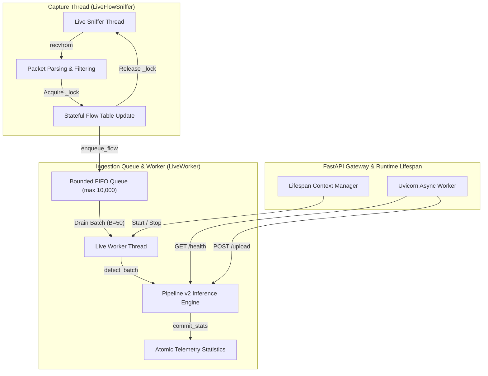
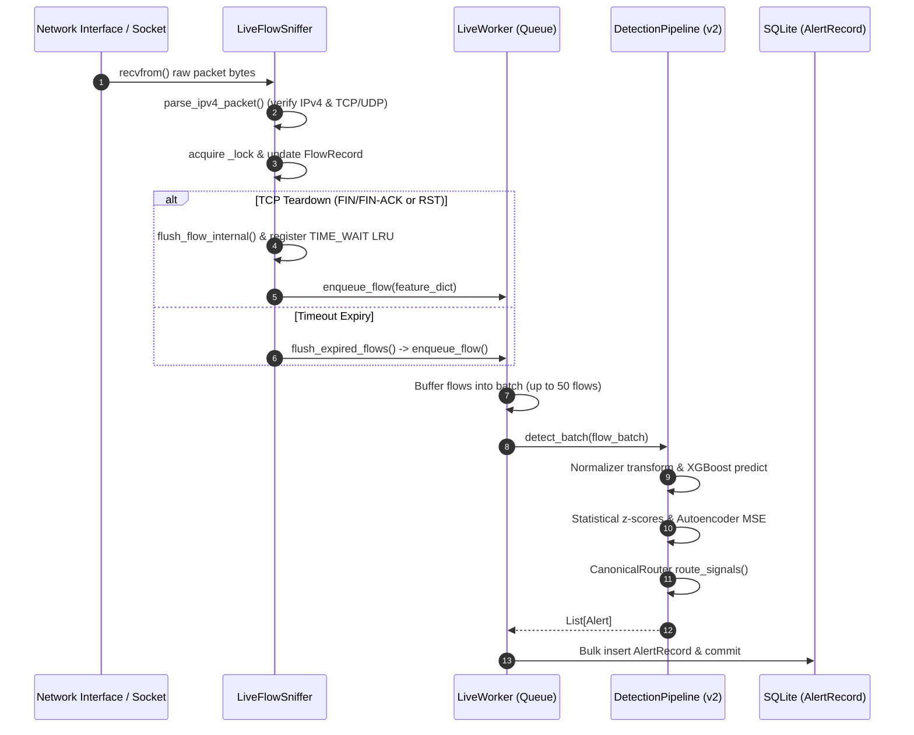
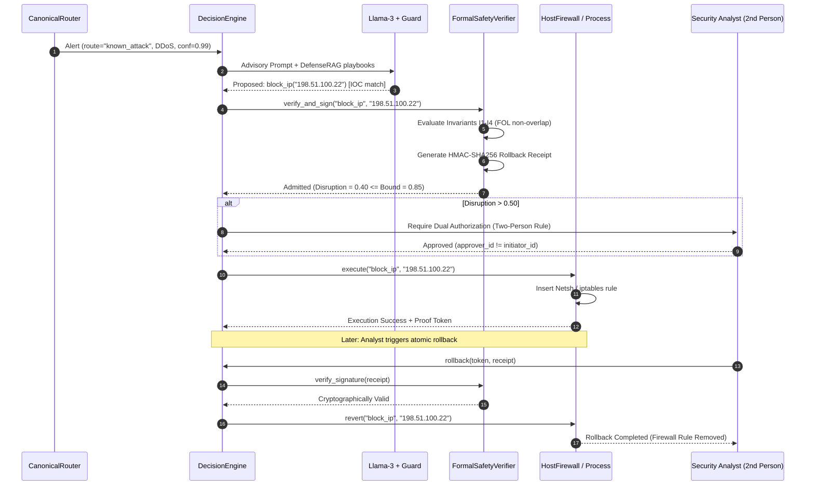

# CHAPTER 3: SYSTEM ARCHITECTURE AS BUILT

## 3.1 Conceptual Architectural Philosophy

The CyberGuard system is designed as a hybrid Real-Time Network Intrusion Detection System (RT-IDS) and automated containment engine. Rather than relying on a monolithic neural network or a purely generative AI agent, CyberGuard implements a modular, multi-tier defense architecture. The foundational philosophy governing the system embodies four core principles:

1. **Classifier-First Inference Guarantee:** In contrast to legacy anomaly-first architectures that use statistical filters to bypass or short-circuit deeper inspection, CyberGuard's Pipeline v2 mandates that every validated flow record reaches the supervised known-attack classifier. Statistical and autoencoder signals operate as independent review evidence, never as pre-classifier benign drop gates [CE-01] {{cite:sommer2010outside}}.
2. **Decoupled Advisory Cognitive Layer:** Large Language Models (LLMs) are strictly excluded from the critical path of real-time flow detection. Flow evaluation executes deterministically at line speed; the LLM is invoked solely as an asynchronous advisory explainer during incident triage [CE-02].
3. **Formal Invariant Verification of Containment:** Recognizing the existential hazard of self-inflicted Denial of Service (Self-DoS), autonomous mitigation actuators are subordinated to a mathematical safety verifier enforcing First-Order Logic invariants [CE-03].
4. **Local-First, Zero-Egress Deployment:** To preserve operational privacy and eliminate third-party supply-chain exposure, the entire architecture binds locally (`127.0.0.1`), utilizing embedded SQLite databases and on-premise quantized neural inference engines {{cite:arp2022dos}}.


<div id="fig4-container" class="figure-container" style="text-align: center; margin: 20px 0;">
  <svg viewBox="0 0 760 480" width="100%" height="auto" style="max-width: 760px; font-family: -apple-system, BlinkMacSystemFont, 'Segoe UI', Roboto, Helvetica, Arial, sans-serif; display: block; margin: 0 auto;" xmlns="http://www.w3.org/2000/svg">
    <defs>
      <linearGradient id="p1Grad" x1="0" y1="0" x2="0" y2="1">
        <stop offset="0%" stop-color="#f8fafc" />
        <stop offset="100%" stop-color="#f1f5f9" />
      </linearGradient>
      <linearGradient id="p2Grad" x1="0" y1="0" x2="0" y2="1">
        <stop offset="0%" stop-color="#f8fafc" />
        <stop offset="100%" stop-color="#f1f5f9" />
      </linearGradient>
      <linearGradient id="boxGrad" x1="0" y1="0" x2="0" y2="1">
        <stop offset="0%" stop-color="#ffffff" />
        <stop offset="100%" stop-color="#f8fafc" />
      </linearGradient>
      <linearGradient id="headerGrad1" x1="0" y1="0" x2="1" y2="0">
        <stop offset="0%" stop-color="#1e3a8a" />
        <stop offset="100%" stop-color="#2563eb" />
      </linearGradient>
      <linearGradient id="headerGrad2" x1="0" y1="0" x2="1" y2="0">
        <stop offset="0%" stop-color="#4c1d95" />
        <stop offset="100%" stop-color="#7c3aed" />
      </linearGradient>
      <filter id="shadow" x="-5%" y="-5%" width="110%" height="115%" filterUnits="userSpaceOnUse">
        <feDropShadow dx="0" dy="2" stdDeviation="3" flood-opacity="0.07" flood-color="#0f172a" />
      </filter>
      <marker id="arrowBlue" viewBox="0 0 10 10" refX="8" refY="5" markerWidth="6" markerHeight="6" orient="auto-start-reverse">
        <path d="M 0 1.5 L 8 5 L 0 8.5 z" fill="#2563eb" />
      </marker>
      <marker id="arrowRed" viewBox="0 0 10 10" refX="8" refY="5" markerWidth="6" markerHeight="6" orient="auto-start-reverse">
        <path d="M 0 1.5 L 8 5 L 0 8.5 z" fill="#dc2626" />
      </marker>
      <marker id="arrowPurple" viewBox="0 0 10 10" refX="8" refY="5" markerWidth="6" markerHeight="6" orient="auto-start-reverse">
        <path d="M 0 1.5 L 8 5 L 0 8.5 z" fill="#7c3aed" />
      </marker>
      <marker id="arrowSlate" viewBox="0 0 10 10" refX="8" refY="5" markerWidth="6" markerHeight="6" orient="auto-start-reverse">
        <path d="M 0 1.5 L 8 5 L 0 8.5 z" fill="#475569" />
      </marker>
    </defs>

    <!-- Background Canvas -->
    <rect width="760" height="480" fill="#ffffff" rx="8" />

    <!-- PHASE I CONTAINER -->
    <g transform="translate(10, 8)">
      <rect width="740" height="206" rx="8" fill="url(#p1Grad)" stroke="#cbd5e1" stroke-width="1.2" filter="url(#shadow)" />
      
      <!-- Phase I Header Badge -->
      <path d="M 0 8 Q 0 0 8 0 L 390 0 L 372 26 L 0 26 Z" fill="url(#headerGrad1)" />
      <text x="14" y="17.5" font-size="10.5" font-weight="700" fill="#ffffff" letter-spacing="0.5">PHASE I: REAL-TIME DETECTION PIPELINE (LINE-SPEED)</text>

      <!-- Layer 1 Box -->
      <g transform="translate(14, 34)">
        <rect width="215" height="160" rx="6" fill="url(#boxGrad)" stroke="#94a3b8" stroke-width="1" />
        <rect width="215" height="26" rx="6" fill="#f1f5f9" stroke="#94a3b8" stroke-width="1" />
        <text x="107" y="17" font-size="11" font-weight="700" fill="#0f172a" text-anchor="middle">Layer 1: Ingestion &amp; Telemetry</text>
        
        <g transform="translate(10, 34)">
          <rect width="195" height="34" rx="4" fill="#ffffff" stroke="#cbd5e1" stroke-width="1" />
          <text x="12" y="15" font-size="9.5" font-weight="600" fill="#1e293b">Raw Socket Sniffer [CE-04]</text>
          <text x="12" y="27" font-size="8" fill="#64748b">AF_PACKET / Raw IP flow assembler</text>
        </g>
        <g transform="translate(10, 74)">
          <rect width="195" height="34" rx="4" fill="#ffffff" stroke="#cbd5e1" stroke-width="1" />
          <text x="12" y="15" font-size="9.5" font-weight="600" fill="#1e293b">Suricata EVE Tailer [CE-05]</text>
          <text x="12" y="27" font-size="8" fill="#64748b">eve.json stream &amp; alert mapper</text>
        </g>
        <g transform="translate(10, 114)">
          <rect width="195" height="34" rx="4" fill="#ffffff" stroke="#cbd5e1" stroke-width="1" />
          <text x="12" y="15" font-size="9.5" font-weight="600" fill="#1e293b">Universal Ingestion Engine [CE-06]</text>
          <text x="12" y="27" font-size="8" fill="#64748b">CSV / JSON / NDJSON batch parser</text>
        </g>
      </g>

      <!-- Arrow L1 -> L2 -->
      <line x1="230" y1="114" x2="260" y2="114" stroke="#2563eb" stroke-width="2" marker-end="url(#arrowBlue)" />

      <!-- Layer 2 Box -->
      <g transform="translate(262, 34)">
        <rect width="205" height="160" rx="6" fill="url(#boxGrad)" stroke="#94a3b8" stroke-width="1" />
        <rect width="205" height="26" rx="6" fill="#f1f5f9" stroke="#94a3b8" stroke-width="1" />
        <text x="102" y="17" font-size="11" font-weight="700" fill="#0f172a" text-anchor="middle">Layer 2: Feature Engineering</text>
        
        <g transform="translate(10, 36)">
          <rect width="185" height="48" rx="4" fill="#ffffff" stroke="#cbd5e1" stroke-width="1" />
          <text x="12" y="17" font-size="9.5" font-weight="600" fill="#1e293b">32-Feature Extraction [CE-07]</text>
          <text x="12" y="30" font-size="8" fill="#64748b">Duration, packet rates, byte ratios,</text>
          <text x="12" y="42" font-size="8" fill="#64748b">TCP flags, inter-arrival times (IAT)</text>
        </g>
        <line x1="102" y1="85" x2="102" y2="99" stroke="#2563eb" stroke-width="1.5" marker-end="url(#arrowBlue)" />
        <g transform="translate(10, 100)">
          <rect width="185" height="48" rx="4" fill="#ffffff" stroke="#cbd5e1" stroke-width="1" />
          <text x="12" y="17" font-size="9.5" font-weight="600" fill="#1e293b">Robust Normalizer [CE-08]</text>
          <text x="12" y="30" font-size="8" fill="#64748b">log1p transformation + RobustScaler</text>
          <text x="12" y="42" font-size="8" fill="#64748b">Mitigates heavy-tailed flow outliers</text>
        </g>
      </g>

      <!-- Arrow L2 -> L3 -->
      <line x1="468" y1="114" x2="496" y2="114" stroke="#2563eb" stroke-width="2" marker-end="url(#arrowBlue)" />

      <!-- Layer 3 Box -->
      <g transform="translate(498, 34)">
        <rect width="228" height="160" rx="6" fill="url(#boxGrad)" stroke="#94a3b8" stroke-width="1" />
        <rect width="228" height="26" rx="6" fill="#f1f5f9" stroke="#94a3b8" stroke-width="1" />
        <text x="114" y="17" font-size="11" font-weight="700" fill="#0f172a" text-anchor="middle">Layer 3: Pipeline v2 Inference</text>
        
        <g transform="translate(8, 32)">
          <rect width="66" height="60" rx="4" fill="#eff6ff" stroke="#bfdbfe" stroke-width="1" />
          <text x="33" y="15" font-size="8.5" font-weight="700" fill="#1e40af" text-anchor="middle">XGBoost</text>
          <text x="33" y="27" font-size="8" fill="#1d4ed8" text-anchor="middle">Classifier</text>
          <text x="33" y="44" font-size="7.5" fill="#475569" text-anchor="middle">Supervised</text>
          <text x="33" y="54" font-size="7.5" fill="#475569" text-anchor="middle">Known Attack</text>
        </g>
        <g transform="translate(79, 32)">
          <rect width="66" height="60" rx="4" fill="#fef2f2" stroke="#fecaca" stroke-width="1" />
          <text x="33" y="15" font-size="8.5" font-weight="700" fill="#991b1b" text-anchor="middle">Z-Score</text>
          <text x="33" y="27" font-size="8" fill="#b91c1c" text-anchor="middle">Filter</text>
          <text x="33" y="44" font-size="7.5" fill="#475569" text-anchor="middle">Statistical</text>
          <text x="33" y="54" font-size="7.5" fill="#475569" text-anchor="middle">Distribution</text>
        </g>
        <g transform="translate(150, 32)">
          <rect width="70" height="60" rx="4" fill="#faf5ff" stroke="#e9d5ff" stroke-width="1" />
          <text x="35" y="15" font-size="8.5" font-weight="700" fill="#6b21a8" text-anchor="middle">Autoencoder</text>
          <text x="35" y="27" font-size="8" fill="#7e22ce" text-anchor="middle">PyTorch</text>
          <text x="35" y="44" font-size="7.5" fill="#475569" text-anchor="middle">Reconstruct</text>
          <text x="35" y="54" font-size="7.5" fill="#475569" text-anchor="middle">Anomaly MSE</text>
        </g>

        <g transform="translate(8, 102)">
          <rect width="212" height="48" rx="4" fill="#ffffff" stroke="#cbd5e1" stroke-width="1" />
          <text x="106" y="16" font-size="9.5" font-weight="700" fill="#0f172a" text-anchor="middle">Canonical Heuristic Router [CE-12]</text>
          <text x="106" y="30" font-size="8" fill="#334155" text-anchor="middle">Classifier-First Mandate: known_attack | review |</text>
          <text x="106" y="42" font-size="8" fill="#334155" text-anchor="middle">unknown_anomaly_review | benign</text>
        </g>
      </g>
    </g>

    <!-- INTER-PHASE CONNECTORS -->
    <path d="M 645 214 L 645 238 L 415 238 L 415 298" fill="none" stroke="#dc2626" stroke-width="2" stroke-dasharray="4,2" marker-end="url(#arrowRed)" />
    <rect x="475" y="229" width="160" height="18" rx="3" fill="#fef2f2" stroke="#f87171" stroke-width="0.8" />
    <text x="555" y="242" font-size="8" font-weight="700" fill="#991b1b" text-anchor="middle">Known Attack (Fast-Path Route)</text>

    <path d="M 545 214 L 545 256 L 134 256 L 134 298" fill="none" stroke="#7c3aed" stroke-width="2" marker-end="url(#arrowPurple)" />
    <rect x="235" y="247" width="180" height="18" rx="3" fill="#faf5ff" stroke="#c084fc" stroke-width="0.8" />
    <text x="325" y="260" font-size="8" font-weight="700" fill="#6b21a8" text-anchor="middle">Ambiguous Anomaly / Review Signal</text>

    <!-- PHASE II CONTAINER -->
    <g transform="translate(10, 270)">
      <rect width="740" height="202" rx="8" fill="url(#p2Grad)" stroke="#cbd5e1" stroke-width="1.2" filter="url(#shadow)" />
      
      <!-- Phase II Header Badge -->
      <path d="M 0 8 Q 0 0 8 0 L 410 0 L 392 26 L 0 26 Z" fill="url(#headerGrad2)" />
      <text x="14" y="17.5" font-size="10.5" font-weight="700" fill="#ffffff" letter-spacing="0.5">PHASE II: COGNITIVE TRIAGE, SAFETY &amp; PERSISTENCE</text>

      <!-- Layer 4 Box -->
      <g transform="translate(14, 34)">
        <rect width="220" height="154" rx="6" fill="url(#boxGrad)" stroke="#94a3b8" stroke-width="1" />
        <rect width="220" height="26" rx="6" fill="#f1f5f9" stroke="#94a3b8" stroke-width="1" />
        <text x="110" y="17" font-size="11" font-weight="700" fill="#0f172a" text-anchor="middle">Layer 4: Cognitive Advisory</text>
        
        <g transform="translate(10, 32)">
          <rect width="200" height="32" rx="4" fill="#ffffff" stroke="#cbd5e1" stroke-width="1" />
          <text x="10" y="14" font-size="9" font-weight="600" fill="#1e293b">MITRE Graph-RAG Engine [CE-13]</text>
          <text x="10" y="25" font-size="7.5" fill="#64748b">ATT&amp;CK techniques + D3FEND defenses</text>
        </g>
        <g transform="translate(10, 68)">
          <rect width="200" height="32" rx="4" fill="#ffffff" stroke="#cbd5e1" stroke-width="1" />
          <text x="10" y="14" font-size="9" font-weight="600" fill="#1e293b">Advisory LLM Explainer [CE-14]</text>
          <text x="10" y="25" font-size="7.5" fill="#64748b">Local quantized llama-server (decoupled)</text>
        </g>
        <g transform="translate(10, 104)">
          <rect width="200" height="40" rx="4" fill="#ffffff" stroke="#cbd5e1" stroke-width="1" />
          <text x="10" y="14" font-size="9" font-weight="700" fill="#b91c1c">Contradiction Guard [CE-15]</text>
          <text x="10" y="25" font-size="7.5" fill="#64748b">Overrides hallucinated LLM benign verdict</text>
          <text x="10" y="35" font-size="7.5" fill="#64748b">when classifier confidence is high</text>
        </g>
      </g>

      <!-- Arrow L4 -> L5 -->
      <line x1="235" y1="112" x2="266" y2="112" stroke="#7c3aed" stroke-width="2" marker-end="url(#arrowPurple)" />
      <rect x="238" y="98" width="26" height="14" rx="2" fill="#faf5ff" stroke="#c084fc" stroke-width="0.5" />
      <text x="251" y="108" font-size="7" font-weight="700" fill="#6b21a8" text-anchor="middle">Cert</text>

      <!-- Layer 5 Box -->
      <g transform="translate(268, 34)">
        <rect width="232" height="154" rx="6" fill="url(#boxGrad)" stroke="#94a3b8" stroke-width="1" />
        <rect width="232" height="26" rx="6" fill="#f1f5f9" stroke="#94a3b8" stroke-width="1" />
        <text x="116" y="17" font-size="11" font-weight="700" fill="#0f172a" text-anchor="middle">Layer 5: Safety Verification</text>
        
        <g transform="translate(10, 32)">
          <rect width="212" height="34" rx="4" fill="#ffffff" stroke="#cbd5e1" stroke-width="1" />
          <text x="10" y="14" font-size="9" font-weight="700" fill="#0f172a">Formal Safety Verifier [CE-03, 16]</text>
          <text x="10" y="26" font-size="7.5" fill="#475569">FOL Invariant Verification (prevents Self-DoS)</text>
        </g>
        <g transform="translate(10, 70)">
          <rect width="212" height="32" rx="4" fill="#ffffff" stroke="#cbd5e1" stroke-width="1" />
          <text x="10" y="14" font-size="9" font-weight="600" fill="#1e293b">Two-Person Rule Engine [CE-17]</text>
          <text x="10" y="25" font-size="7.5" fill="#64748b">Cryptographic dual-authorization token check</text>
        </g>
        <g transform="translate(10, 106)">
          <rect width="102" height="38" rx="4" fill="#eff6ff" stroke="#93c5fd" stroke-width="1" />
          <text x="51" y="16" font-size="8.5" font-weight="600" fill="#1e40af" text-anchor="middle">Host Firewall</text>
          <text x="51" y="28" font-size="7.5" fill="#3b82f6" text-anchor="middle">Windows / iptables</text>
        </g>
        <g transform="translate(120, 106)">
          <rect width="102" height="38" rx="4" fill="#eff6ff" stroke="#93c5fd" stroke-width="1" />
          <text x="51" y="16" font-size="8.5" font-weight="600" fill="#1e40af" text-anchor="middle">Process Isolation</text>
          <text x="51" y="28" font-size="7.5" fill="#3b82f6" text-anchor="middle">PID terminate/cgroup</text>
        </g>
      </g>

      <!-- Arrow L5 -> L6 -->
      <line x1="501" y1="112" x2="528" y2="112" stroke="#475569" stroke-width="2" marker-end="url(#arrowSlate)" />

      <!-- Layer 6 Box -->
      <g transform="translate(530, 34)">
        <rect width="196" height="154" rx="6" fill="url(#boxGrad)" stroke="#94a3b8" stroke-width="1" />
        <rect width="196" height="26" rx="6" fill="#f1f5f9" stroke="#94a3b8" stroke-width="1" />
        <text x="98" y="17" font-size="11" font-weight="700" fill="#0f172a" text-anchor="middle">Layer 6: API &amp; Storage</text>
        
        <g transform="translate(10, 32)">
          <rect width="176" height="32" rx="4" fill="#ffffff" stroke="#cbd5e1" stroke-width="1" />
          <text x="10" y="14" font-size="9" font-weight="600" fill="#1e293b">FastAPI REST Service</text>
          <text x="10" y="25" font-size="7.5" fill="#64748b">Port 8000, JWT auth, RBAC</text>
        </g>
        <g transform="translate(10, 68)">
          <rect width="176" height="32" rx="4" fill="#ffffff" stroke="#cbd5e1" stroke-width="1" />
          <text x="10" y="14" font-size="9" font-weight="600" fill="#1e293b">SQLite WAL Database</text>
          <text x="10" y="25" font-size="7.5" fill="#64748b">Hash-chained audit ledger</text>
        </g>
        <g transform="translate(10, 104)">
          <rect width="176" height="40" rx="4" fill="#ffffff" stroke="#cbd5e1" stroke-width="1" />
          <text x="10" y="14" font-size="9" font-weight="600" fill="#1e293b">Operations Dashboard</text>
          <text x="10" y="25" font-size="7.5" fill="#64748b">Real-time SSE event stream &amp;</text>
          <text x="10" y="35" font-size="7.5" fill="#64748b">quarantine approval console</text>
        </g>
      </g>
    </g>
  </svg>
</div>

<div class="figure-caption"><strong>Fig. 4.</strong> High-Level Layered System Architecture of CyberGuard as Built.</div>

## 3.2 Layered System Decomposition

CyberGuard is decomposed into six distinct architectural layers, as illustrated in Fig. 4:

### Layer 1: Ingestion and Network Telemetry
Layer 1 captures raw network communications and external system telemetry:
- **`LiveFlowSniffer` (`backend/detection/live_sniffer.py`):** Multi-threaded raw socket listener assembling raw IPv4 frames into bidirectional 5-tuple communication flows [CE-04].
- **`SuricataLiveTailer` (`backend/suricata/tailer.py`):** High-throughput log streaming bridge following Suricata `eve.json` files in real-time, mapping Snort/Suricata events into structured feature vectors [CE-05].
- **`UniversalParser` (`backend/api/universal_ingest.py`):** Multi-format container adapter ingesting `.csv`, `.tsv`, `.json`, and `.ndjson` files with strict schema validation [CE-06].

### Layer 2: Feature Engineering and Normalization
Layer 2 maps heterogeneous inputs into a canonical 32-dimensional vector space:
- **Feature Schema Mapper (`backend/detection/features.py`):** Computes the standard 32 flow metrics (duration, packet rates, byte ratios, inter-arrival times, and flag distributions) [CE-07].
- **Robust Normalizer (`backend/detection/normalizer.py`):** Applies volumetric logarithmic transformation ($\log(1 + x)$) and `RobustScaler` quantile centering (subtracting median and dividing by interquartile range) to mitigate extreme networking outliers [CE-08].

### Layer 3: Pipeline v2 Inference and Evidence Fusion
Layer 3 executes multi-model analytical evaluation without inter-component blocking:
- **`AttackClassifier` (`backend/detection/classifier.py`):** Supervised gradient boosted decision tree (XGBoost) or Random Forest outputting predicted class labels and probability confidences [CE-09].
- **`StatisticalFilter` (`backend/detection/statistical.py`):** Independent baseline calculator computing per-feature Z-scores relative to offline benign means and standard deviations [CE-10].
- **`AutoencoderDetector` (`backend/detection/autoencoder.py`):** Fully connected deep autoencoder reconstructing normalized vectors and flagging reconstruction error spikes exceeding empirical quantile thresholds [CE-11].
- **`CanonicalRouter` (`backend/detection/router.py`):** Side-effect-free deterministic decision engine fusing classifier and anomaly evidence into four canonical routes (`known_attack`, `human_review`, `unknown_anomaly_review`, `benign`) [CE-12].

### Layer 4: Cognitive Advisory and Decision Engine
Layer 4 synthesizes alerts with structured threat intelligence:
- **`DefenseRAG` (`backend/mitre/knowledge_graph.py`):** Vector-indexed knowledge base correlating attack labels to MITRE ATT&CK techniques and MITRE D3FEND defensive countermeasures [CE-13].
- **`DecisionEngine` (`backend/decision/engine.py`):** Asynchronous triage coordinator querying an advisory local LLM (`llama-server`) for structured incident summarization [CE-14].
- **`ContradictionGuard`:** Security heuristic overriding LLM exoneration when deterministic high-confidence attack indicators are present [CE-15].

### Layer 5: Safety Verification and Containment Actuation
Layer 5 enforces mitigation while preventing operational self-destruction:
- **`FormalSafetyVerifier` (`backend/safety/formal_verifier.py`):** First-Order Logic safety gate checking four mathematical invariants ($I_1$ to $I_4$), verifying non-overlap with critical assets ($K_{\text{crit}}$) and generating HMAC rollback receipts [CE-16].
- **`TwoPersonRule` Engine:** Cryptographic authorization gate demanding dual authentication (`initiator_id != approver_id`) for high-disruption actions [CE-17].
- **Actuators (`backend/actuators/`):** Operating system mitigation executors implementing Host Firewall rules (Windows Netsh / Linux iptables), Process Termination (`taskkill` / `pkill`), and Suricata dynamic drop rules [CE-18].

### Layer 6: API, Persistence, and Presentation
- **FastAPI Core (`backend/main.py`):** Asynchronous ASGI web framework exposing authenticated RESTful endpoints [CE-19].
- **Database Layer (`backend/db/`):** SQLite persistence utilizing WAL (Write-Ahead Logging) and enforced foreign keys for alert telemetry and decision cases [CE-20].
- **Dashboard (`frontend/`):** Lightweight, zero-framework Vanilla JavaScript and CSS Single Page Application (SPA) displaying real-time operations, interactive charts, and analyst triage consoles [CE-21].

## 3.3 End-to-End Data Flow Pipeline

The end-to-end traversal of network telemetry through CyberGuard follows the systematic path depicted in Fig. 5.

<div id="fig5-container" style="text-align: center; margin: 24px auto; width: 100%; max-width: 760px;">
  <svg viewBox="0 0 760 440" width="100%" height="auto" xmlns="http://www.w3.org/2000/svg" style="background:#ffffff; border:1px solid #cbd5e1; border-radius:8px; box-shadow: 0 4px 6px -1px rgba(0,0,0,0.05); font-family:-apple-system,BlinkMacSystemFont,'Segoe UI',Roboto,Helvetica,Arial,sans-serif;">
    <defs>
      <linearGradient id="gHeader5" x1="0" y1="0" x2="1" y2="0">
        <stop offset="0%" stop-color="#0f172a" />
        <stop offset="100%" stop-color="#1e293b" />
      </linearGradient>
      <linearGradient id="gCol1_5" x1="0" y1="0" x2="0" y2="1">
        <stop offset="0%" stop-color="#f8fafc" />
        <stop offset="100%" stop-color="#f1f5f9" />
      </linearGradient>
      <linearGradient id="gCol2_5" x1="0" y1="0" x2="0" y2="1">
        <stop offset="0%" stop-color="#eff6ff" />
        <stop offset="100%" stop-color="#dbeafe" />
      </linearGradient>
      <linearGradient id="gCol3_5" x1="0" y1="0" x2="0" y2="1">
        <stop offset="0%" stop-color="#f5f3ff" />
        <stop offset="100%" stop-color="#ede9fe" />
      </linearGradient>
      <linearGradient id="gCol4_5" x1="0" y1="0" x2="0" y2="1">
        <stop offset="0%" stop-color="#f0fdf4" />
        <stop offset="100%" stop-color="#dcfce7" />
      </linearGradient>
      <marker id="arr5" viewBox="0 0 10 10" refX="6" refY="5" markerWidth="6" markerHeight="6" orient="auto-start-reverse">
        <path d="M 0 1.5 L 8 5 L 0 8.5 z" fill="#475569" />
      </marker>
      <marker id="arrBlue5" viewBox="0 0 10 10" refX="6" refY="5" markerWidth="6" markerHeight="6" orient="auto-start-reverse">
        <path d="M 0 1.5 L 8 5 L 0 8.5 z" fill="#2563eb" />
      </marker>
      <marker id="arrRed5" viewBox="0 0 10 10" refX="6" refY="5" markerWidth="6" markerHeight="6" orient="auto-start-reverse">
        <path d="M 0 1.5 L 8 5 L 0 8.5 z" fill="#dc2626" />
      </marker>
    </defs>

    <!-- Title Bar -->
    <rect x="0" y="0" width="760" height="34" rx="8" fill="url(#gHeader5)" />
    <rect x="0" y="24" width="760" height="10" fill="url(#gHeader5)" />
    <text x="380" y="22" font-size="11.5" font-weight="700" fill="#ffffff" text-anchor="middle" letter-spacing="0.5">CYBERGUARD END-TO-END PIPELINE: TELEMETRY &rarr; INFERENCE &rarr; TRIAGE &rarr; ACTUATION</text>

    <!-- 4 Swimlane Columns -->
    <!-- Lane 1: Ingestion -->
    <g transform="translate(12, 44)">
      <rect width="172" height="382" rx="6" fill="url(#gCol1_5)" stroke="#cbd5e1" stroke-width="1" />
      <rect width="172" height="24" rx="6" fill="#e2e8f0" stroke="#cbd5e1" stroke-width="1" />
      <text x="86" y="16" font-size="10" font-weight="700" fill="#1e293b" text-anchor="middle">1. TELEMETRY INGESTION</text>

      <!-- Box: Live Sniffer -->
      <g transform="translate(8, 32)">
        <rect width="156" height="52" rx="4" fill="#ffffff" stroke="#94a3b8" stroke-width="1" />
        <text x="8" y="16" font-size="9.5" font-weight="700" fill="#0f172a">LiveFlowSniffer [CE-04]</text>
        <text x="8" y="29" font-size="8" fill="#475569">AF_PACKET raw socket</text>
        <text x="8" y="42" font-size="8" fill="#64748b">Stateful 5-tuple TCP/UDP tracking</text>
      </g>

      <!-- Box: Suricata -->
      <g transform="translate(8, 92)">
        <rect width="156" height="42" rx="4" fill="#ffffff" stroke="#94a3b8" stroke-width="1" />
        <text x="8" y="16" font-size="9.5" font-weight="700" fill="#0f172a">Suricata Tailer [CE-06]</text>
        <text x="8" y="29" font-size="8" fill="#475569">eve.json log stream adapter</text>
      </g>

      <!-- Box: Upload Ingest -->
      <g transform="translate(8, 142)">
        <rect width="156" height="42" rx="4" fill="#ffffff" stroke="#94a3b8" stroke-width="1" />
        <text x="8" y="16" font-size="9.5" font-weight="700" fill="#0f172a">Universal Ingest [CE-20]</text>
        <text x="8" y="29" font-size="8" fill="#475569">PCAP / CSV / Zeek / NDJSON</text>
      </g>

      <!-- Connector Lines into Feature Vector -->
      <line x1="86" y1="84" x2="86" y2="200" stroke="#64748b" stroke-width="1.5" />
      <line x1="86" y1="134" x2="86" y2="200" stroke="#64748b" stroke-width="1.5" />
      <line x1="86" y1="184" x2="86" y2="200" stroke="#64748b" stroke-width="1.5" marker-end="url(#arr5)" />

      <!-- Box: 32 Features -->
      <g transform="translate(8, 202)">
        <rect width="156" height="58" rx="4" fill="#f1f5f9" stroke="#3b82f6" stroke-width="1.5" />
        <text x="78" y="18" font-size="9.5" font-weight="700" fill="#1e40af" text-anchor="middle">Canonical 32-Feature Vector</text>
        <text x="78" y="32" font-size="8" fill="#1e293b" text-anchor="middle">Durations, Packet Rates, Flag Counts,</text>
        <text x="78" y="46" font-size="8" fill="#1e293b" text-anchor="middle">Byte Volumes, IAT Means &amp; Stds</text>
      </g>

      <!-- Backpressure Queue -->
      <g transform="translate(8, 276)">
        <rect width="156" height="46" rx="4" fill="#ffffff" stroke="#94a3b8" stroke-width="1" stroke-dasharray="3 3" />
        <text x="8" y="16" font-size="9" font-weight="700" fill="#0f172a">Bounded Queue [CE-22]</text>
        <text x="8" y="30" font-size="8" fill="#475569">FIFO Capacity N = 10,000</text>
        <text x="8" y="41" font-size="7.5" fill="#64748b">Drops oldest on saturation</text>
      </g>

      <!-- Batch Dispatcher -->
      <g transform="translate(8, 332)">
        <rect width="156" height="38" rx="4" fill="#e2e8f0" stroke="#64748b" stroke-width="1" />
        <text x="78" y="16" font-size="9" font-weight="600" fill="#1e293b" text-anchor="middle">Batch Worker (B = 50)</text>
        <text x="78" y="28" font-size="7.5" fill="#475569" text-anchor="middle">Micro-batched pipeline feed</text>
      </g>
    </g>

    <!-- Arrow Lane 1 -> Lane 2 -->
    <line x1="184" y1="275" x2="198" y2="275" stroke="#2563eb" stroke-width="2" marker-end="url(#arrBlue5)" />

    <!-- Lane 2: Pipeline Inference & Routing -->
    <g transform="translate(198, 44)">
      <rect width="180" height="382" rx="6" fill="url(#gCol2_5)" stroke="#bfdbfe" stroke-width="1" />
      <rect width="180" height="24" rx="6" fill="#dbeafe" stroke="#bfdbfe" stroke-width="1" />
      <text x="90" y="16" font-size="10" font-weight="700" fill="#1e40af" text-anchor="middle">2. INFERENCE &amp; ROUTING</text>

      <!-- Box: Normalization -->
      <g transform="translate(10, 32)">
        <rect width="160" height="40" rx="4" fill="#ffffff" stroke="#93c5fd" stroke-width="1" />
        <text x="8" y="16" font-size="9.5" font-weight="700" fill="#1e3a8a">Robust Normalizer [CE-03]</text>
        <text x="8" y="29" font-size="8" fill="#2563eb">log1p + RobustScaler (IQR)</text>
      </g>

      <!-- 3 Models Stack -->
      <g transform="translate(10, 80)">
        <rect width="160" height="38" rx="4" fill="#ffffff" stroke="#93c5fd" stroke-width="1" />
        <text x="8" y="15" font-size="9" font-weight="700" fill="#0f172a">XGBoost Classifier [CE-08]</text>
        <text x="8" y="28" font-size="7.5" fill="#475569">4-Class: Benign, Bot, DDoS, PortScan</text>
      </g>

      <g transform="translate(10, 124)">
        <rect width="160" height="38" rx="4" fill="#ffffff" stroke="#93c5fd" stroke-width="1" />
        <text x="8" y="15" font-size="9" font-weight="700" fill="#0f172a">Statistical Filter [CE-09]</text>
        <text x="8" y="28" font-size="7.5" fill="#475569">Welford Streaming Z-Score (z &gt; 3.0)</text>
      </g>

      <g transform="translate(10, 168)">
        <rect width="160" height="38" rx="4" fill="#ffffff" stroke="#93c5fd" stroke-width="1" />
        <text x="8" y="15" font-size="9" font-weight="700" fill="#0f172a">PyTorch Autoencoder [CE-10]</text>
        <text x="8" y="28" font-size="7.5" fill="#475569">32&rarr;16&rarr;8&rarr;16&rarr;32 MSE Loss vs &tau;</text>
      </g>

      <!-- Multi-Signal Router -->
      <g transform="translate(10, 220)">
        <polygon points="80,0 160,25 80,50 0,25" fill="#ffffff" stroke="#1d4ed8" stroke-width="1.5" />
        <text x="80" y="22" font-size="9" font-weight="700" fill="#1e40af" text-anchor="middle">Canonical Router</text>
        <text x="80" y="34" font-size="7.5" fill="#2563eb" text-anchor="middle">[CE-11] Precedence Table</text>
      </g>

      <!-- Route Outputs -->
      <g transform="translate(10, 282)">
        <rect width="160" height="26" rx="4" fill="#fee2e2" stroke="#f87171" stroke-width="1" />
        <text x="8" y="17" font-size="8.5" font-weight="700" fill="#b91c1c">Route: known_attack &rarr;</text>
      </g>
      <g transform="translate(10, 314)">
        <rect width="160" height="26" rx="4" fill="#fef3c7" stroke="#fcd34d" stroke-width="1" />
        <text x="8" y="17" font-size="8.5" font-weight="700" fill="#b45309">Route: human_review [OOD]</text>
      </g>
      <g transform="translate(10, 346)">
        <rect width="160" height="26" rx="4" fill="#ecfdf5" stroke="#6ee7b7" stroke-width="1" />
        <text x="8" y="17" font-size="8.5" font-weight="700" fill="#047857">Route: benign [Safe Log]</text>
      </g>
    </g>

    <!-- Arrow Lane 2 -> Lane 3 -->
    <line x1="378" y1="295" x2="394" y2="295" stroke="#dc2626" stroke-width="2" marker-end="url(#arrRed5)" />

    <!-- Lane 3: Cognitive Triage & Verification -->
    <g transform="translate(394, 44)">
      <rect width="176" height="382" rx="6" fill="url(#gCol3_5)" stroke="#ddd6fe" stroke-width="1" />
      <rect width="176" height="24" rx="6" fill="#ede9fe" stroke="#ddd6fe" stroke-width="1" />
      <text x="88" y="16" font-size="10" font-weight="700" fill="#6d28d9" text-anchor="middle">3. COGNITIVE &amp; FORMAL SAFETY</text>

      <!-- Decision Engine -->
      <g transform="translate(10, 32)">
        <rect width="156" height="42" rx="4" fill="#ffffff" stroke="#c4b5fd" stroke-width="1" />
        <text x="8" y="16" font-size="9.5" font-weight="700" fill="#4c1d95">Decision Engine [CE-14]</text>
        <text x="8" y="29" font-size="8" fill="#6d28d9">Threshold scoring &amp; triage policy</text>
      </g>

      <!-- Defense RAG -->
      <g transform="translate(10, 82)">
        <rect width="156" height="42" rx="4" fill="#ffffff" stroke="#c4b5fd" stroke-width="1" />
        <text x="8" y="16" font-size="9.5" font-weight="700" fill="#4c1d95">Defense RAG [CE-26]</text>
        <text x="8" y="29" font-size="8" fill="#6d28d9">MITRE ATT&amp;CK &amp; D3FEND embed</text>
      </g>

      <!-- Advisory LLM -->
      <g transform="translate(10, 132)">
        <rect width="156" height="46" rx="4" fill="#ffffff" stroke="#c4b5fd" stroke-width="1" />
        <text x="8" y="16" font-size="9.5" font-weight="700" fill="#4c1d95">Advisory LLM [CE-27]</text>
        <text x="8" y="29" font-size="8" fill="#6d28d9">Llama-3-8B-Q4 local GPU</text>
        <text x="8" y="40" font-size="7.5" fill="#7c3aed">Generates containment JSON</text>
      </g>

      <!-- Contradiction Guard -->
      <g transform="translate(10, 186)">
        <rect width="156" height="46" rx="4" fill="#ffffff" stroke="#f43f5e" stroke-width="1.5" />
        <text x="8" y="16" font-size="9" font-weight="700" fill="#be123c">Contradiction Guard [CE-21]</text>
        <text x="8" y="29" font-size="7.5" fill="#9f1239">Suppresses hallucinated benigns</text>
        <text x="8" y="40" font-size="7.5" fill="#e11d48">Overrules LLM on high severity</text>
      </g>

      <!-- Formal Verifier Gate -->
      <g transform="translate(10, 244)">
        <rect width="156" height="66" rx="4" fill="#ffffff" stroke="#6d28d9" stroke-width="1.5" />
        <text x="8" y="16" font-size="9.5" font-weight="700" fill="#4c1d95">Formal Safety Gate [CE-18]</text>
        <text x="8" y="29" font-size="8" fill="#1e293b">SymPy FOL Invariants I1 &ndash; I4:</text>
        <text x="8" y="42" font-size="7.5" fill="#581c87">&not;(quarantine &and; unverified &and; &not;override)</text>
        <text x="8" y="55" font-size="7.5" fill="#581c87">(quarantine &and; &not;high_risk) &rArr; override</text>
      </g>

      <!-- Blocked Indicator -->
      <g transform="translate(10, 324)">
        <rect width="156" height="38" rx="4" fill="#fee2e2" stroke="#dc2626" stroke-width="1" />
        <text x="78" y="16" font-size="8.5" font-weight="700" fill="#b91c1c" text-anchor="middle">Violation / Self-DoS Intercept</text>
        <text x="78" y="28" font-size="7.5" fill="#991b1b" text-anchor="middle">Action Aborted &amp; Alert Persisted</text>
      </g>
    </g>

    <!-- Arrow Lane 3 -> Lane 4 -->
    <line x1="570" y1="277" x2="586" y2="277" stroke="#16a34a" stroke-width="2" marker-end="url(#arr5)" />

    <!-- Lane 4: Actuation & Governance -->
    <g transform="translate(586, 44)">
      <rect width="162" height="382" rx="6" fill="url(#gCol4_5)" stroke="#bbf7d0" stroke-width="1" />
      <rect width="162" height="24" rx="6" fill="#dcfce7" stroke="#bbf7d0" stroke-width="1" />
      <text x="81" y="16" font-size="10" font-weight="700" fill="#15803d" text-anchor="middle">4. ACTUATION &amp; AUDIT</text>

      <!-- Two-Person Rule Gate -->
      <g transform="translate(8, 32)">
        <rect width="146" height="58" rx="4" fill="#ffffff" stroke="#22c55e" stroke-width="1.5" />
        <text x="8" y="16" font-size="9" font-weight="700" fill="#14532d">Two-Person Rule [CE-48]</text>
        <text x="8" y="29" font-size="7.5" fill="#166534">Disruption Score &gt; 0.50</text>
        <text x="8" y="41" font-size="7.5" fill="#15803d">Mandates Operator Sign-off:</text>
        <text x="8" y="52" font-size="7.5" fill="#14532d">approver_id &ne; initiator_id</text>
      </g>

      <!-- Actuator Base Router -->
      <g transform="translate(8, 100)">
        <rect width="146" height="42" rx="4" fill="#ffffff" stroke="#86efac" stroke-width="1" />
        <text x="8" y="16" font-size="9" font-weight="700" fill="#0f172a">Actuator Router [CE-09]</text>
        <text x="8" y="29" font-size="7.5" fill="#166534">Dispatches to targets</text>
      </g>

      <!-- Concrete Actuators -->
      <g transform="translate(8, 150)">
        <rect width="146" height="36" rx="4" fill="#ffffff" stroke="#86efac" stroke-width="1" />
        <text x="8" y="15" font-size="8.5" font-weight="600" fill="#1e293b">Host Firewall Actuator</text>
        <text x="8" y="27" font-size="7.5" fill="#475569">Netsh (Win) / iptables (Linux)</text>
      </g>

      <g transform="translate(8, 192)">
        <rect width="146" height="36" rx="4" fill="#ffffff" stroke="#86efac" stroke-width="1" />
        <text x="8" y="15" font-size="8.5" font-weight="600" fill="#1e293b">Process Actuator [CE-15]</text>
        <text x="8" y="27" font-size="7.5" fill="#475569">SIGSTOP suspension / taskkill</text>
      </g>

      <!-- Cryptographic Rollback -->
      <g transform="translate(8, 236)">
        <rect width="146" height="54" rx="4" fill="#ecfdf5" stroke="#16a34a" stroke-width="1.5" />
        <text x="73" y="16" font-size="9" font-weight="700" fill="#15803d" text-anchor="middle">Rollback Receipt [CE-49]</text>
        <text x="73" y="29" font-size="7.5" fill="#166534" text-anchor="middle">HMAC-SHA256 Token</text>
        <text x="73" y="42" font-size="7.5" fill="#14532d" text-anchor="middle">Cryptographic Undo State</text>
      </g>

      <!-- Audit Ledger -->
      <g transform="translate(8, 302)">
        <rect width="146" height="54" rx="4" fill="#ffffff" stroke="#86efac" stroke-width="1" />
        <text x="73" y="16" font-size="9" font-weight="700" fill="#0f172a" text-anchor="middle">Immutable Audit Ledger</text>
        <text x="73" y="29" font-size="7.5" fill="#475569" text-anchor="middle">[CE-54] SHA-256 Hash Chain</text>
        <text x="73" y="42" font-size="7.5" fill="#166534" text-anchor="middle">Forward-Secure State</text>
      </g>
    </g>
  </svg>
</div>
<div class="figure-caption"><strong>Fig. 5.</strong> End-to-End Data Flow Pipeline: From Raw Packets and EVE Logs to Actuation and Human Review.</div>

Telemetry begins when raw packet frames enter `LiveFlowSniffer.process_packet()`. The sniffer parses the IPv4 and transport headers, assigning packets to bidirectional `FlowRecord` entries. Upon stateful teardown (e.g., bidirectional `FIN` or `RST`) or timeout expiry, accumulated flow statistics are converted into the canonical 32-feature vector and dispatched to `DetectionPipeline.detect()`.

Inside the pipeline, feature values are normalized via logarithmic and robust scaling. All three inference sub-modules evaluate the vector in parallel. The resulting signals (predicted class label, classification confidence, maximum statistical Z-score, and autoencoder reconstruction error) are passed to `route_signals()`. When a flow is routed to `known_attack`, an alert is generated and dispatched to `DecisionEngine`. The decision engine queries `DefenseRAG` for relevant defensive techniques, formats an advisory prompt for the local LLM, and evaluates proposed countermeasures through `FormalSafetyVerifier`. If admitted, mitigation executes through the actuators, yielding an atomic cryptographic rollback token.

## 3.4 Concurrency, Threading, and Lifespan Model

To maintain real-time responsiveness without data corruption under high network traffic, CyberGuard implements a structured concurrency architecture (Fig. 6):


<div class="figure-caption"><strong>Fig. 6.</strong> Concurrency and Thread Synchronization Model Across Sniffer, Worker Queue, and Pipeline.</div>

1. **Thread-Safe Double-Checked Pipeline Resolution:** Pipeline loading (`_get_pipeline()` in `backend/api/detection.py`) utilizes thread-safe double-checked locking:
   ```python
   # File: backend/api/detection.py:43-48
   if _pipeline is not None and _pipeline_root == model_root:
       return _pipeline
   with _pipeline_lock:
       if _pipeline is not None and _pipeline_root == model_root:
           return _pipeline
       # Proceed with integrity validation and model instantiation
   ```
   This prevents race conditions during server initialization while eliminating locking overhead on subsequent inference queries [CE-22].
2. **Sniffer Synchronization and TIME_WAIT LRU Cache:** In `LiveFlowSniffer`, concurrent packet ingestion is serialized using an internal mutex (`self._lock = threading.Lock()`). Packet parsing executes prior to lock acquisition, minimizing critical-section hold times [CE-23]. The closed flow table (`self._closed_flows`) is implemented as an `OrderedDict` bounded to $10,000$ entries, providing $O(1)$ Least Recently Used (LRU) eviction to absorb delayed retransmitted teardown ACKs without memory leakage [CE-24].
3. **Queue Backpressure in Live Worker:** To decouple packet capture from slower batch inference and database operations, `LiveWorker` (`backend/detection/live_worker.py`) incorporates a bounded `queue.Queue(maxsize=10000)`. If downstream inference saturates, incoming flows are dropped at the queue boundary rather than allowing unbounded memory growth, with drop counts tracked in process telemetry [CE-25].
4. **FastAPI Lifespan Management:** In `backend/main.py`, server startup and teardown are orchestrated using an asynchronous context manager (`@asynccontextmanager async def _lifespan(app: FastAPI)`). Upon startup, database migrations are applied (`init_all()`) and the live worker is optionally initialized. Upon server termination, the worker is gracefully drained (`default_live_worker.stop(drain=True)`), ensuring in-flight flow evaluations are committed before process shutdown [CE-26].

## 3.5 Interaction Sequence Diagrams

### Sequence 1: Live Packet Sniffing, Flow Aggregation, and Pipeline Ingestion
Fig. 7 illustrates the sequence of operations from physical packet arrival to pipeline classification:


<div class="figure-caption"><strong>Fig. 7.</strong> Sequence Diagram: Real-Time Packet Sniffing, Flow Assembly, and Pipeline Ingestion.</div>

### Sequence 2: Autonomous Incident Triage, SMT Verification, and Actuator Rollback
Fig. 8 illustrates the governance and execution sequence for autonomous containment:


<div class="figure-caption"><strong>Fig. 8.</strong> Sequence Diagram: Automated Containment Actuation Under Two-Person Rule and Formal Safety Gate.</div>

## 3.6 Deployment Topology and Security Boundaries

CyberGuard is engineered to operate strictly within a localized, single-tenant trust boundary:
- **Binding Policy:** By default, all HTTP and WebSocket listeners bind strictly to the loopback interface (`127.0.0.1:8000`), refusing unauthenticated remote access [CE-27].
- **Security Middlewares (`backend/security.py`):**
  - `SecurityHeadersMiddleware`: Injects mandatory defensive HTTP headers on all responses, including `X-Content-Type-Options: nosniff`, `X-Frame-Options: DENY`, `Content-Security-Policy: default-src 'self'`, and `Referrer-Policy: strict-origin-when-cross-origin` [CE-28].
  - `ApiAccessMiddleware`: Validates configured bearer API tokens (`CG_API_TOKEN`) using constant-time string comparisons (`secrets.compare_digest()`) to prevent timing side-channel attacks [CE-29].
  - `RequestLimitsMiddleware` & `limiter`: Enforces strict request body size ceilings ($25$ MB upload cap, $2$ MB JSON body cap) and per-IP rate limits via `SlowAPI` to prevent denial-of-service starvation [CE-30].
  - `TrustedHostMiddleware`: Drops any incoming HTTP request whose `Host` header deviates from allowlisted hostnames (`ALLOWED_HOSTS`) to mitigate DNS rebinding and host-header injection attacks [CE-31].
- **Hardware Profile:** The underlying inference engine operates efficiently across heterogeneous environments:
  - CPU-Only Mode: Utilizes OpenMP multi-threaded XGBoost and PyTorch CPU runtimes.
  - Accelerated Mode: Offloads LLM cognitive advisory generation to local GPU hardware (such as an NVIDIA RTX 5050 / RTX 4090 via CUDA) via `llama-server`.
