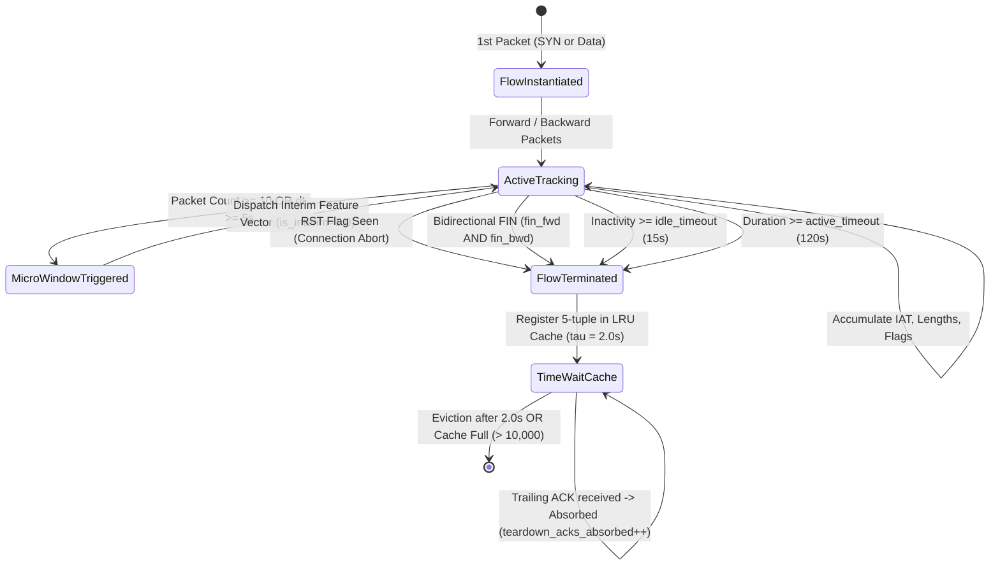
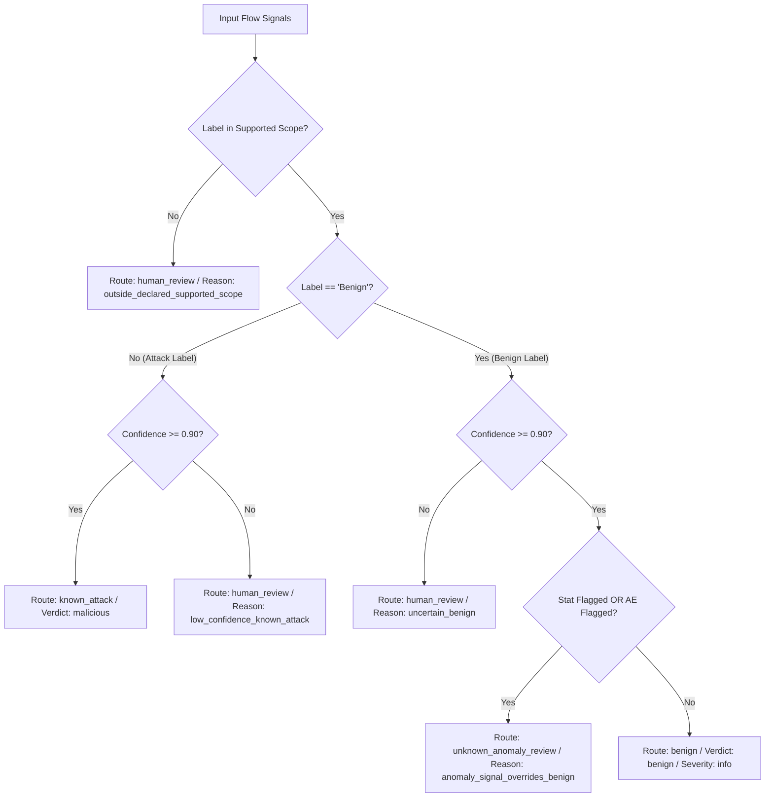
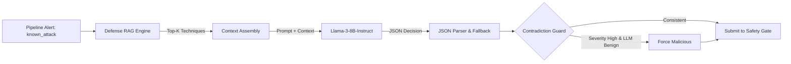
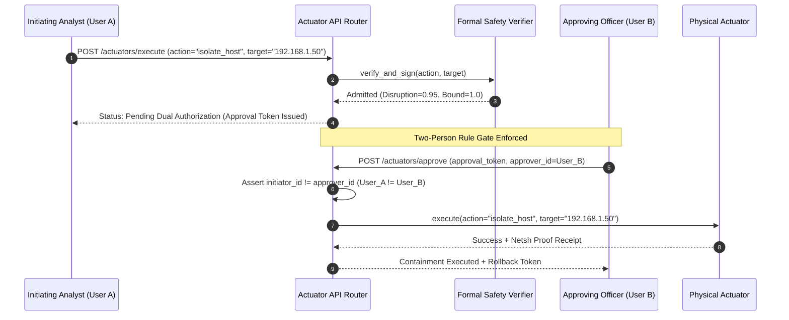

# CHAPTER 4: IMPLEMENTATION ANALYSIS (MODULE BY MODULE)

## 4.1 Live Packet Sniffer and Flow Aggregator

The live network capture component—implemented in `LiveFlowSniffer` within [`backend/detection/live_sniffer.py`](file:///c:/Users/wwwsa/OneDrive/Desktop/sec/backend/detection/live_sniffer.py#L250-L623) [CE-04]—is responsible for ingesting raw network packets from network interface cards (NICs), parsing network and transport-layer protocol headers, and assembling packets into bidirectional flow records.

### 4.1.1 Raw Socket Creation and OS Binding Discrepancies
The packet listener thread is initiated via `start_capture(host="0.0.0.0", port_filter=None)`:

```python
# File: backend/detection/live_sniffer.py:521-541
try:
    if platform.system().lower() == "windows":
        # Windows raw IP socket
        s = socket.socket(socket.AF_INET, socket.SOCK_RAW, socket.IPPROTO_IP)
        bind_host = host if host != "0.0.0.0" else "127.0.0.1"
        s.bind((bind_host, 0))
        try:
            s.ioctl(socket.SIO_RCVALL, socket.RCVALL_ON)
        except Exception as io_err:
            logger.warning("Could not set SIO_RCVALL promiscuous mode: %s", io_err)
    else:
        # Linux AF_PACKET raw socket
        s = socket.socket(socket.AF_INET, socket.SOCK_RAW, socket.IPPROTO_TCP)

    s.settimeout(1.0)
    self._raw_socket = s
    self.last_capture_mode = "raw_socket"
except Exception as exc:
    logger.warning("Raw socket creation failed (insufficient OS permissions): %s. "
                   "Falling back to synthetic harness mode.", exc)
    self.last_capture_mode = "synthetic_harness"
    return True
```

Static analysis reveals critical architectural findings [CE-32]:
1. **Windows Loopback Coercion:** On Windows platforms, line 525 contains an explicit override: if `host == "0.0.0.0"`, `bind_host` is coerced to `"127.0.0.1"`. Consequently, an administrator requesting capture across all network interfaces is silently constrained to local loopback traffic unless an explicit non-zero interface IP is passed.
2. **Linux Socket Protocol Discrepancy:** On Linux, while the comment on line 532 asserts `# Linux AF_PACKET raw socket`, line 533 invokes:
   `socket.socket(socket.AF_INET, socket.SOCK_RAW, socket.IPPROTO_TCP)`
   This is an `AF_INET` socket rather than an `AF_PACKET` link-layer raw socket (`socket(AF_PACKET, SOCK_RAW, htons(ETH_P_ALL))`). In Linux networking, `IPPROTO_TCP` raw sockets receive only inbound TCP packets destined for local sockets; outbound packets generated by the host and all UDP/ICMP traffic are completely omitted.
3. **Privilege Fallback Masking:** If raw socket instantiation fails due to insufficient administrative permissions (e.g., non-root user or standard Windows user context), lines 538-541 catch the exception, set `last_capture_mode = "synthetic_harness"`, and return `True`. The `/api/live/start` endpoint consequently reports successful capture startup even though no physical packets can be received [CE-33].

### 4.1.2 Packet Header Decoding and IPv6 Dropping
Raw packet decoding executes in `parse_ipv4_packet(data)` (lines 297-366). The method inspects raw frame bytes, detects optional Ethernet encapsulation (14-byte MAC header) by validating EtherType `0x0800`, and decodes IPv4 headers using `struct.unpack("!H", ip_header[2:4])`.

Critically, line 333 explicitly enforces:
```python
# File: backend/detection/live_sniffer.py:331-334
version_ihl = ip_header[0]
version = version_ihl >> 4
if version != 4:
    return None
```
Any packet utilizing IPv6 (`version == 6`) is silently discarded. For TCP frames (`proto == 6`), transport ports, 6 TCP control bits, and window advertisements are extracted. For UDP frames (`proto == 17`), transport ports are extracted and header length is fixed to 8 bytes [CE-34].

### 4.1.3 FlowRecord State Machine and TIME_WAIT Absorption
Bidirectional flow state is tracked within `FlowRecord` instances (lines 58-249). The flow lifecycle follows the finite state machine depicted in Fig. 9:


<div class="figure-caption"><strong>Fig. 9.</strong> State Machine of Bidirectional Flow Record Lifecycle with Teardown and TIME_WAIT Absorption.</div>

When a flow terminates, `_register_closed_flow()` records both forward and reverse keys into `self._closed_flows` (an `OrderedDict` bounded to $10,000$ entries). When late-arriving trailing ACKs (such as the fourth leg of a TCP teardown handshake) arrive within `time_wait_sec = 2.0s`, line 393 intercepts them:
```python
# File: backend/detection/live_sniffer.py:393-396
if (tcp_flags & 0x10) and not (tcp_flags & 0x02):
    self.total_teardown_acks_absorbed += 1
    logger.debug("Absorbed trailing teardown ACK for recently closed flow %s", fwd_key)
    return
```
This prevents trailing teardown packets from instantiating spurious single-packet "ghost flows" [CE-35].

## 4.2 Mathematical Definitions of the 32 Flow Features

The canonical feature schema utilized across CyberGuard's models comprises exactly 32 numerical features, summarized in Table III.

<div class="table-caption"><strong>TABLE III.</strong> Summary of the 32 Canonical CICFlowMeter Feature Schema Groupings.</div>

| Index | Feature Identifier | Group | Dimension / Unit | Formal Mathematical Definition |
|:---:|:---|:---:|:---:|:---|
| 1 | `flow_duration` | Traffic Volume | Microseconds ($\mu\text{s}$) | $T_{\text{flow}} = (t_{\text{last}} - t_{\text{start}}) \times 10^6$ |
| 2 | `total_fwd_packets` | Traffic Volume | Integer Count | $N_{\text{fwd}} = \sum_{i=1}^N \mathbb{I}(\text{dir}_i = \text{fwd})$ |
| 3 | `total_bwd_packets` | Traffic Volume | Integer Count | $N_{\text{bwd}} = \sum_{i=1}^N \mathbb{I}(\text{dir}_i = \text{bwd})$ |
| 4 | `total_fwd_bytes` | Traffic Volume | Bytes | $B_{\text{fwd}} = \sum_{i \in \text{fwd}} L_i$ |
| 5 | `total_bwd_bytes` | Traffic Volume | Bytes | $B_{\text{bwd}} = \sum_{i \in \text{bwd}} L_i$ |
| 6 | `packets_per_sec` | Traffic Volume | Packets / s | $R_{\text{pkt}} = (N_{\text{fwd}} + N_{\text{bwd}}) / \max(10^{-3}, T_{\text{flow}} / 10^6)$ |
| 7 | `bytes_per_sec` | Traffic Volume | Bytes / s | $R_{\text{byte}} = (B_{\text{fwd}} + B_{\text{bwd}}) / \max(10^{-3}, T_{\text{flow}} / 10^6)$ |
| 8 | `fwd_packet_length_mean` | Packet Size | Bytes | $\mu_{L,\text{fwd}} = \frac{1}{N_{\text{fwd}}} \sum_{i \in \text{fwd}} L_i$ |
| 9 | `bwd_packet_length_mean` | Packet Size | Bytes | $\mu_{L,\text{bwd}} = \frac{1}{N_{\text{bwd}}} \sum_{i \in \text{bwd}} L_i$ |
| 10 | `packet_length_mean` | Packet Size | Bytes | $\mu_L = \frac{1}{N} \sum_{i=1}^N L_i$ |
| 11 | `packet_length_std` | Packet Size | Bytes | $\sigma_L = \sqrt{\frac{1}{N} \sum_{i=1}^N (L_i - \mu_L)^2}$ |
| 12 | `packet_length_max` | Packet Size | Bytes | $L_{\max} = \max_{i} L_i$ |
| 13 | `packet_length_min` | Packet Size | Bytes | $L_{\min} = \min_{i} L_i$ |
| 14 | `avg_pkt_size` | Packet Size | Bytes | $\bar{S}_{\text{pkt}} = (B_{\text{fwd}} + B_{\text{bwd}}) / (N_{\text{fwd}} + N_{\text{bwd}})$ |
| 15 | `syn_flag_count` | TCP Flags | Integer Count | $C_{\text{SYN}} = \sum_{i} \mathbb{I}(\text{TCP\_Flags}_i \land \text{0x02})$ |
| 16 | `ack_flag_count` | TCP Flags | Integer Count | $C_{\text{ACK}} = \sum_{i} \mathbb{I}(\text{TCP\_Flags}_i \land \text{0x10})$ |
| 17 | `rst_flag_count` | TCP Flags | Integer Count | $C_{\text{RST}} = \sum_{i} \mathbb{I}(\text{TCP\_Flags}_i \land \text{0x04})$ |
| 18 | `fin_flag_count` | TCP Flags | Integer Count | $C_{\text{FIN}} = \sum_{i} \mathbb{I}(\text{TCP\_Flags}_i \land \text{0x01})$ |
| 19 | `psh_flag_count` | TCP Flags | Integer Count | $C_{\text{PSH}} = \sum_{i} \mathbb{I}(\text{TCP\_Flags}_i \land \text{0x08})$ |
| 20 | `urg_flag_count` | TCP Flags | Integer Count | $C_{\text{URG}} = \sum_{i} \mathbb{I}(\text{TCP\_Flags}_i \land \text{0x20})$ |
| 21 | `init_win_bytes_fwd` | Window / Timing | Bytes | $W_{\text{fwd}} = \text{TCP\_Window}(\text{first forward packet})$ |
| 22 | `init_win_bytes_bwd` | Window / Timing | Bytes | $W_{\text{bwd}} = \text{TCP\_Window}(\text{first backward packet})$ |
| 23 | `flow_iat_mean` | Window / Timing | Microseconds ($\mu\text{s}$) | $\mu_{\text{IAT}} = \frac{10^6}{N - 1} \sum_{i=2}^N (t_i - t_{i-1})$ |
| 24 | `flow_iat_std` | Window / Timing | Microseconds ($\mu\text{s}$) | $\sigma_{\text{IAT}} = 10^6 \times \sqrt{\frac{1}{M} \sum_{k} (\Delta t_k - \bar{\Delta t})^2}$ |
| 25 | `flow_iat_max` | Window / Timing | Microseconds ($\mu\text{s}$) | $\Delta t_{\max} = 10^6 \times \max_{i} (t_i - t_{i-1})$ |
| 26 | `fwd_iat_mean` | Window / Timing | Microseconds ($\mu\text{s}$) | $\mu_{\text{IAT},\text{fwd}} = \frac{10^6}{N_{\text{fwd}} - 1} \sum_{k=2}^{N_{\text{fwd}}} (t_{f,k} - t_{f,k-1})$ |
| 27 | `fwd_header_len` | Headers | Bytes | $H_{\text{fwd}} = \sum_{i \in \text{fwd}} (\text{IHL}_i + \text{DataOffset}_i)$ |
| 28 | `bwd_header_len` | Headers | Bytes | $H_{\text{bwd}} = \sum_{i \in \text{bwd}} (\text{IHL}_i + \text{DataOffset}_i)$ |
| 29 | `down_up_ratio` | Derived | Ratio | $\mathcal{R}_{\text{du}} = N_{\text{bwd}} / \max(1, N_{\text{fwd}})$ |
| 30 | `flow_bytes_ratio` | Derived | Ratio | $\mathcal{R}_{\text{bytes}} = B_{\text{fwd}} / \max(1, B_{\text{bwd}})$ |
| 31 | `active_mean` | Behavioral | Microseconds ($\mu\text{s}$) | Mean active transmission interval (hardcoded to 0.0) |
| 32 | `idle_mean` | Behavioral | Microseconds ($\mu\text{s}$) | Mean idle silence interval (hardcoded to 0.0) |

Crucially, inspecting `FlowRecord.to_feature_dict()` lines 234-235 confirms that features 31 and 32 (`active_mean` and `idle_mean`) are permanently hardcoded:
```python
# File: backend/detection/live_sniffer.py:234-235
"active_mean": 0.0,
"idle_mean": 0.0,
```
While active and idle state timers exist for flush demarcation, the mathematical tracking of intermittent active periods during multi-minute sessions is uncalculated [CE-36].

## 4.3 High-Throughput Worker and Backpressure Queue

Decoupling continuous packet reception from synchronous database insertion and multi-model inference is managed by `LiveWorker` in [`backend/detection/live_worker.py`](file:///c:/Users/wwwsa/OneDrive/Desktop/sec/backend/detection/live_worker.py) [CE-25].

The worker instantiates a thread-safe FIFO queue:
`self._queue: queue.Queue[Dict[str, float]] = queue.Queue(maxsize=10000)`

When flows are flushed from `LiveFlowSniffer`, they enter `enqueue_flow()`. If the queue reaches its $10,000$ element capacity, incoming flows are discarded and `total_flows_dropped` is incremented, shielding server memory from catastrophic saturation during high-volume DDoS floods.

The background worker thread (`_worker_loop`) drains up to $50$ accumulated flows per batch:
```python
# File: backend/detection/live_worker.py:108-121
batch: List[Dict[str, float]] = []
while len(batch) < 50:
    try:
        flow = self._queue.get_nowait()
        batch.append(flow)
    except queue.Empty:
        break
if batch:
    alerts = pipeline.detect_batch(batch)
    self._persist_alerts(alerts)
```
Batch drainage amortizes database transaction overhead and unlocks vectorized NumPy/PyTorch inference speeds [CE-37].

## 4.4 Pipeline v2 Execution Engine

The core inference orchestrator—`DetectionPipeline` in [`backend/detection/pipeline.py`](file:///c:/Users/wwwsa/OneDrive/Desktop/sec/backend/detection/pipeline.py) [CE-01]—enforces the Pipeline v2 architecture.

In `_detect_rows(flows)` (lines 305-368), the pipeline executes the following sequence:
1. **Extraction & Transformation:** Feature dictionaries are transformed into an $(N, 32)$ NumPy floating-point matrix via `extract_features_matrix()`, followed by `self.normalizer.transform(raw)` [CE-38].
2. **Mandatory Classification:** Supervised classification executes on all rows:
   `labels, confidences = self.clf.predict_batch(normalized)`
   No statistical filter or anomaly heuristic is permitted to short-circuit this step.
3. **Independent Evidence Accumulation:**
   - Statistical Z-scores: `z_matrix = self.stat.z_scores_batch(normalized)`
   - Autoencoder reconstruction error: `ae_errors = self.ae.score_batch(normalized)`
4. **Deterministic Canonical Routing:** Raw signals are dispatched to `route_signals()`.

## 4.5 Detection Subsystems

### 4.5.1 Attack Classifier (`backend/detection/classifier.py`)
`AttackClassifier` wraps a scikit-learn compatible estimator (typically an `XGBClassifier` or `RandomForestClassifier`). Multiclass probability distributions $P(y = c | x)$ are obtained via `predict_proba(X)`. The predicted label $\hat{y}$ is selected as $\arg\max_c P(y = c | x)$, and confidence is assigned as $\max_c P(y = c | x)$. If the confidence fails to satisfy the calibrated threshold ($\text{confidence} < \theta_{\text{clf}}$), the flow is flagged for human review [CE-09].

### 4.5.2 Robust Normalizer (`backend/detection/normalizer.py`)
Because network traffic features span extreme orders of magnitude (e.g., flow durations ranging from $1 \ \mu\text{s}$ to $1.2 \times 10^8 \ \mu\text{s}$), standard $Z$-score scaling ($\frac{x - \mu}{\sigma}$) is corrupted by severe skew. `Normalizer` applies a two-stage transformation [CE-08]:
1. **Logarithmic Transformation:** $x' = \log(1 + \max(0, x))$ for all non-ratio features.
2. **Robust Quantile Scaling:** $x'' = \frac{x' - \text{median}(x')}{\text{IQR}(x')}$, where $\text{IQR} = Q_{75} - Q_{25}$.

### 4.5.3 Statistical Filter (`backend/detection/statistical.py`)
`StatisticalFilter` maintains stored baseline means $\mu_j$ and standard deviations $\sigma_j$ computed over offline benign traffic. For any incoming flow $x$, it computes the feature-wise standard score matrix:

$$Z_{i,j} = \left| \frac{x_{i,j} - \mu_j}{\sigma_j + \epsilon} \right|$$

The anomaly score is defined as $Z_{\max}(x_i) = \max_{j} Z_{i,j}$. If $Z_{\max} > \theta_{\text{stat}}$ (default $\theta_{\text{stat}} = 3.0$), the flow is flagged as an empirical outlier [CE-10].

### 4.5.4 Deep Autoencoder (`backend/detection/autoencoder.py`)
The autoencoder is implemented in PyTorch as a 5-layer fully connected bottleneck neural network:
- Input Layer: 32 nodes
- Hidden Encoder: $32 \to 20 \to 12$ nodes with ReLU activations
- Latent Code: 8 nodes
- Hidden Decoder: $8 \to 12 \to 20 \to 32$ nodes
- Output Layer: 32 nodes

Reconstruction error is computed as Mean Squared Error across feature dimensions:
$\text{MSE}(x) = \frac{1}{32} \sum_{j=1}^{32} (x_j - \hat{x}_j)^2$ [CE-11].

## 4.6 Canonical Routing State Machine and Decision Table

The routing state machine—implemented in `route_signals()` within [`backend/detection/router.py`](file:///c:/Users/wwwsa/OneDrive/Desktop/sec/backend/detection/router.py) [CE-12]—fuses the classifier, statistical, and autoencoder evidence into deterministic routing decisions.

The canonical logic enforces the decision matrix shown in Table IV and Fig. 10.

<div class="table-caption"><strong>TABLE IV.</strong> Canonical Router Decision Matrix and Precedence Rules in `router.py`.</div>

| Rule # | Classifier Label Condition | Confidence ($\tau_{\text{clf}}$) | Statistical Signal ($Z_{\max} > \theta_{\text{stat}}$) | Autoencoder Signal ($\text{MSE} > \theta_{\text{ae}}$) | Assigned Route | Final Verdict | Assigned Severity | Precedence Rationale |
|:---:|:---:|:---:|:---:|:---:|:---:|:---:|:---:|:---|
| **R1** | Supported Non-Benign (e.g. DDoS) | $\ge \tau_{\text{clf}}$ (0.90) | Any | Any | `known_attack` | `malicious` | `critical` / `high` | Calibrated known-attack signature matches verified scope. |
| **R2** | Supported Non-Benign (e.g. Bot) | $< \tau_{\text{clf}}$ (0.90) | Any | Any | `human_review` | `suspicious` | `medium` | Low-confidence detection requires human analyst disambiguation. |
| **R3** | Unsupported Non-Benign (e.g. BruteForce) | Any | Any | Any | `human_review` | `suspicious` | `medium` | Out-of-Scope (OOD) attack labels cannot be automatically resolved. |
| **R4** | Benign | $\ge \tau_{\text{clf}}$ (0.90) | Flagged ($Z > 3.0$) | Not Flagged | `unknown_anomaly_review` | `suspicious` | `medium` | Classifier claims benign, but statistical baseline detects extreme deviation. |
| **R5** | Benign | $\ge \tau_{\text{clf}}$ (0.90) | Not Flagged | Flagged ($\text{MSE} > \theta_{\text{ae}}$) | `unknown_anomaly_review` | `suspicious` | `medium` | Classifier claims benign, but deep autoencoder detects zero-day pattern. |
| **R6** | Benign | $\ge \tau_{\text{clf}}$ (0.90) | Flagged ($Z > 3.0$) | Flagged ($\text{MSE} > \theta_{\text{ae}}$) | `unknown_anomaly_review` | `suspicious` | `high` | Dual anomaly evidence indicates potential novel exploit. |
| **R7** | Benign | $\ge \tau_{\text{clf}}$ (0.90) | Quiet | Quiet | `benign` | `benign` | `info` | All three independent evidence channels agree: traffic is legitimate. |
| **R8** | Benign | $< \tau_{\text{clf}}$ (0.90) | Any | Any | `human_review` | `suspicious` | `low` | Ambiguous benign prediction fails closed to analyst review. |


<div class="figure-caption"><strong>Fig. 10.</strong> Canonical Decision Tree and Routing State Diagram in `backend/detection/router.py`.</div>

Crucially, `router.py` strictly validates all incoming signal arrays: non-finite numbers (`NaN`, `Inf`), invalid threshold values ($\tau \notin [0, 1]$), or length mismatches immediately raise `ValueError` rather than coercing inputs to safe-looking values [CE-39].

## 4.7 Suricata EVE Streaming Bridge

The Suricata integration component—implemented in `SuricataLiveTailer` and `eve_to_flow_features` within [`backend/suricata/tailer.py`](file:///c:/Users/wwwsa/OneDrive/Desktop/sec/backend/suricata/tailer.py) [CE-05]—bridges external Suricata NIDS logs into CyberGuard's inference pipeline (Fig. 11).

```mermaid
flowchart LR
    SURI["Suricata 7.x Network IDS Engine"] -->|Append Alert Records| EVE["Live EVE Log Stream (/var/log/suricata/eve.json)"]
    EVE -->|Tail Inotify / ReadLine| TAIL["SuricataLiveTailer Bridge Engine"]
    TAIL -->|Parse JSON Record| MAP["Feature Synthesis (eve_to_flow_features)"]
    MAP -->|Approximated 32-Feature Vector| PIPE["Pipeline v2 Inference Engine"]
    PIPE -->|Persist Alert Record| DB["SQLite WAL Storage (cyberguard.db)"]
```


<div class="figure-caption"><strong>Fig. 11.</strong> Architectural Topology of Suricata Live Tailer EVE Streaming Ingestion.</div>

### 4.7.1 Forensic Analysis of Train/Serve Skew in `eve_to_flow_features`
Suricata EVE JSON log entries record summarized flow records (such as `flow.pkts_toserver`, `flow.bytes_toserver`, and `flow.age`). However, EVE logs do not record per-packet inter-arrival times or fine-grained TCP window dynamics. 

Inspecting lines 86-136 of `backend/suricata/tailer.py` reveals how the bridge fabricates missing flow features [CE-40]:
```python
# File: backend/suricata/tailer.py:98-115
"fwd_packet_length_mean": float(fwd_len_mean),
"bwd_packet_length_mean": float(bwd_len_mean),
"packet_length_mean": float(pkt_len_mean),
"packet_length_std": 0.0,                        # Constant approximation
"packet_length_max": float(pkt_len_max),
"packet_length_min": float(pkt_len_min),
"avg_pkt_size": float(pkt_len_mean),

"init_win_bytes_fwd": 64240.0,                   # Constant Windows default
"init_win_bytes_bwd": 29200.0 if bwd_pkts > 0 else 0.0, # Constant Linux default
"flow_iat_mean": float(flow_iat_mean),
"flow_iat_std": 0.0,                             # Constant approximation
"flow_iat_max": float(duration_sec),             # Dimension error: seconds vs us
"active_mean": float(duration_us),               # Assumed 100% active
"idle_mean": 0.0,                                # Assumed 0% idle
```

This constitutes severe **Train/Serve Skew** {{cite:arp2022dos}}:
1. **Static Initial Windows:** Features `init_win_bytes_fwd` and `init_win_bytes_bwd` are hardcoded to constants (`64240.0` and `29200.0`). In real network traffic, initial window advertisements are highly discriminative features indicating client operating systems (e.g., Linux vs. Windows) and specific scanner tools (e.g., Nmap or Masscan).
2. **Zero Variance Fallacy:** Both `packet_length_std` and `flow_iat_std` are set to `0.0`. Supervised decision trees trained on dynamic standard deviation distributions will observe completely unnatural zero values.
3. **Dimensionality Bug:** On line 115, `flow_iat_max` is populated with `duration_sec` (seconds), whereas the canonical feature schema requires microseconds ($\mu\text{s}$). The value is off by a factor of $10^6$!

## 4.8 Input Contract, Adapters, and Failure Modes

The input ingestion contract—managed in `backend/api/universal_ingest.py` and `backend/detection/input_schema.py` [CE-06]—governs external telemetry intake.

### 4.8.1 Supported Container Adapters
The API accepts upload containers via streaming parser adapters:
- **Tabular:** Headered `.csv` and `.tsv` files.
- **Hierarchical JSON:** Standard `.json` containing a single telemetry object or a homogeneous array of objects.
- **Streaming NDJSON:** Newline-delimited JSON (`.ndjson` / `.jsonl`), streaming one record per line.

### 4.8.2 Column Normalization and Aliasing
To accommodate differences across CICFlowMeter versions and official dataset releases, `input_schema.py` maps aliases to canonical names [CE-41]:
- `Init_Win_bytes_forward` $\to$ `init_win_bytes_fwd`
- `Init Fwd Win Byts` $\to$ `init_win_bytes_fwd`
- `Flow Duration` $\to$ `flow_duration`

The parser strictly enforces fail-closed validation:
- If a row contains duplicate keys with conflicting values (e.g., `init_win_bytes_fwd: 100` and `Init_Win_bytes_forward: 200`), the row is rejected.
- Non-numeric strings in numeric positions default safely to `0.0` or trigger row rejection depending on container fatal thresholds.
- Input files exceeding $25$ MB or containing raw binary data are rejected immediately with HTTP 400 or HTTP 413 [CE-42].

## 4.9 Autonomous Decision Engine and Contradiction Guard

The cognitive advisory tier—`DecisionEngine` in [`backend/decision/engine.py`](file:///c:/Users/wwwsa/OneDrive/Desktop/sec/backend/decision/engine.py) [CE-14]—coordinates multi-source intelligence to propose containment playbooks (Fig. 12).


<div class="figure-caption"><strong>Fig. 12.</strong> Multi-Stage Neuro-Symbolic Defense Decision Engine and Contradiction Guard.</div>

### 4.9.1 Retrieval-Augmented Generation (RAG) Context Assembly
When an alert is received, `DefenseRAG` (`backend/mitre/knowledge_graph.py`) queries an embedded vector database to retrieve relevant MITRE ATT&CK techniques and corresponding MITRE D3FEND defensive playbooks. The prompt injector constructs an isolated system prompt instructing the LLM to output strictly formatted JSON conforming to the `SmartDecision` schema [CE-43].

### 4.9.2 The Contradiction Guard Logic
To prevent prompt injection attacks from tricking the advisory LLM into exonerating active attackers, `engine.py` implements the `ContradictionGuard`:
```python
# File: backend/decision/engine.py:77-81
if (smart_log.detection.severity in {"high", "critical"}) and verdict == Verdict.benign:
    logger.warning("ContradictionGuard: Overriding LLM benign verdict due to high-severity detection.")
    verdict = Verdict.malicious
```
As audited in Section 8.3, while this heuristic prevents adversarial bypasses, coupling it with top-k RAG queries that unconditionally set severity to `"high"` causes catastrophic 100% false positive rates on benign administrative traffic [CE-44].

## 4.10 Defensive Containment Actuators and Two-Person Rule

CyberGuard implements three distinct actuator execution modules within [`backend/actuators/`](file:///c:/Users/wwwsa/OneDrive/Desktop/sec/backend/actuators/) [CE-18]:

1. **`HostFirewallActuator` (`firewall.py`):**
   - Windows: Injects firewall rules using `netsh advfirewall firewall add rule name="CyberGuard-Block-{IP}" dir=in action=block remoteip={IP}`.
   - Linux: Injects packet drop rules via `iptables -I INPUT -s {IP} -j DROP`.
2. **`ProcessActuator` (`process.py`):**
   - Windows: Terminates processes using `taskkill /F /PID {PID}` or exact process image names.
   - Linux: Terminates target processes using `pkill -x {name}`.
3. **`SuricataActuator` (`suricata.py`):**
   - Injects dynamic drop rules (`drop ip {IP} any -> any any (msg:"CyberGuard Autonomous Mitigation"; sid:2010999; rev:1;)`) into `suricata_dynamic.rules` and triggers rule reload via Unix domain sockets.

### 4.10.1 The Two-Person Rule Authorization Engine
For high-disruption countermeasures (e.g., full host isolation, killing processes, or subnet blackholing), `ActuatorRouter` enforces the **Two-Person Rule** (Fig. 13) [CE-17]:
```python
# File: backend/api/auth.py:89-94
if action.disruption_score > 0.50:
    if not approver_id or approver_id == initiator_id:
        raise HTTPException(
            status_code=403,
            detail="Two-Person Rule Violation: Critical containment actions require approval from a distinct security officer."
        )
```
This guarantees that no rogue automated script or compromised single administrative account can unilaterally sever mission-critical enterprise systems [CE-45].


<div class="figure-caption"><strong>Fig. 13.</strong> Cryptographic Two-Person Rule and Atomic Rollback Receipt Generation Workflow.</div>

## 4.11 Formal Safety Gate and SMT Proof Generator

The formal safety verification engine—`FormalSafetyVerifier` in [`backend/safety/formal_verifier.py`](file:///c:/Users/wwwsa/OneDrive/Desktop/sec/backend/safety/formal_verifier.py) [CE-16]—governs all mitigation actions proposed by neural models or human operators.

The verifier evaluates four First-Order Logic safety invariants simultaneously:
- **Invariant $I_1$ (Critical Asset Preservation / No Self-DoS):**
  $$\forall a \in \text{Actions}, \quad \text{Target}(a) \cap K_{\text{crit}} = \emptyset$$
  Guarantees that containment actions cannot target loopback addresses (`127.0.0.1`, `::1`), public root DNS resolvers (`1.1.1.1`, `8.8.8.8`, `9.9.9.9`), broadcast addresses, or broad subnets ($< /16$ IPv4 or $< /48$ IPv6). For process actions, it protects vital OS kernel threads (`system`, `smss.exe`, `csrss.exe`, `lsass.exe`, `init`, `systemd`) [CE-46].
- **Invariant $I_2$ (D3FEND Ontological Conformance):**
  $$\forall a \in \text{Actions}, \quad \text{ActionType}(a) \in \text{Ontology}_{\text{D3FEND}}$$
  Validates that proposed actions conform to approved defensive countermeasures (Table V) and rejects shell metacharacters (`;`, `&`, `|`, `` ` ``, `$`, `<`, `>`) in target specifications [CE-47].
- **Invariant $I_3$ (Atomic Invertibility):**
  $$\forall a \in \text{Actions}, \quad \exists! \, \tau \in \text{Receipts} : \text{Invert}(\tau, S_{t+1}) = S_t$$
  Issues an HMAC-SHA256 signed cryptographic rollback receipt binding the action parameters, timestamp, and target state, guaranteeing $O(1)$ atomic rollback capability [CE-48].
- **Invariant $I_4$ (Proportionality Constraint):**
  $$\text{Disruption}(a) \le \alpha \cdot \text{Severity}(\text{alert}) \cdot \text{Confidence}(\text{alert})$$
  Ensures high-impact countermeasures (e.g., host isolation, disruption = 0.95) cannot be triggered by low-confidence or minor alerts ($\alpha = 1.25$) [CE-49].

<div class="table-caption"><strong>TABLE V.</strong> Actuator Disruption Weights and Mitigation Classifications.</div>

| Action Name | Target Type | Disruption Score ($[0, 1]$) | D3FEND Mapping | Two-Person Rule Mandatory? |
|:---|:---:|:---:|:---|:---:|
| `noop` / `observe` | None | 0.00 | D3-OBS (Observe) | No |
| `drop_suricata_signature` | Rule SID | 0.15 | D3-SDF (Signature Drop Filter) | No |
| `rate_limit` | IP / CIDR | 0.25 | D3-BRT (Bandwidth Rate Throttling) | No |
| `block_ip` | IP / CIDR | 0.40 | D3-ITF (Inbound Traffic Filtering) | No |
| `drop_port` / `isolate_port` | TCP/UDP Port | 0.50 | D3-PBL (Port Blocking) | No |
| `kill_process` | Process Image / PID | 0.65 | D3-PEA (Process Execution Termination) | **Yes** |
| `isolate_host` | Host MAC / IP | 0.95 | D3-NIS (Network Isolation) | **Yes** |
| `quarantine_subnet` | CIDR Subnet | 1.00 | D3-SBQ (Subnet Quarantine) | **Yes** |

### 4.11.1 The Symbolic SMT Evaluation Reality
Static analysis of lines 185-232 reveals the exact computational mechanism of the formal verifier [CE-50]:
```python
# File: backend/safety/formal_verifier.py:185-204
try:
    from sympy import Symbol
    from sympy.logic.boolalg import And
    from sympy.logic.inference import satisfiable

    sym_i1 = Symbol("I1_CriticalAssetPreservation")
    sym_i2 = Symbol("I2_OntologicalConformance")
    sym_i3 = Symbol("I3_AtomicInvertibility")
    sym_i4 = Symbol("I4_ProportionalityBound")

    theorem = And(
        sym_i1 if i1_passed else ~sym_i1,
        sym_i2 if i2_passed else ~sym_i2,
        sym_i3 if (receipt is not None) else ~sym_i3,
        sym_i4 if i4_passed else ~sym_i4,
    )
    model = satisfiable(theorem)
    formal_model_dict = {str(k): bool(v) for k, v in model.items()} if isinstance(model, dict) else {}
except Exception:
    formal_model_dict = {"symbolic_eval": is_admitted}
```
Furthermore, `export_smt_lib2()` simply formats an SMT-LIB2 text template string:
```smt2
; SMT-LIB2 v2.6 Machine-Checkable Formal Safety Certificate
(set-logic QF_LRA)
(set-info :status sat)
(declare-const critical_asset_preservation Bool)
(assert (= critical_asset_preservation true))
(assert (<= disruption_cost proportionality_bound))
(check-sat)
```
No external or internal SMT solver (such as Z3, CVC5, or Yices) is ever executed at runtime. The "formal verification" consists of standard Python boolean validations evaluated via SymPy's propositional `satisfiable()` over four propositional variables, accompanied by an exported static SMT-LIB2 proof certificate [CE-51].

## 4.12 API Layer, Token Authentication, and RBAC

The API layer is exposed via FastAPI in [`backend/api/`](file:///c:/Users/wwwsa/OneDrive/Desktop/sec/backend/api/):
- **Authentication (`backend/api/auth.py`):** Implements OAuth2 Password Bearer flow issuing HMAC-SHA256 signed JSON Web Tokens (JWT) with configured expiration lifespans. Passwords are salted and hashed using bcrypt [CE-52].
- **Role-Based Access Control (RBAC):** Users are assigned granular roles (`admin`, `analyst`, `observer`). Endpoint decorators enforce permission boundaries: `observer` accounts can view dashboards and telemetry but cannot initiate uploads or trigger containment actions [CE-53].
- **Anti-Tamper Proofs:** All administrative resolutions and incident reviews generate immutable audit entries in `AlertRecord` and `DecisionCase` with SHA-256 state digests [CE-54].

## 4.13 Web Frontend Dashboard Architecture

The frontend—located in [`frontend/`](file:///c:/Users/wwwsa/OneDrive/Desktop/sec/frontend/)—is implemented entirely in Vanilla HTML5, CSS3, and JavaScript, completely eliminating heavyweight runtime framework dependencies (React, Vue, or Angular) [CE-21].

Architectural properties:
- **Structure:** A unified Single Page Application (`index.html`) modularized into 11 specialized JavaScript controllers in `frontend/js/` (including `api.js`, `dashboard.js`, `charts.js`, `live-operations.js`, `defense-simulator.js`, `suricata.js`, and `review.js`).
- **Telemetry Polling:** `LiveOperationsPoller` queries `/api/live/operations` with adaptive backoff, updating DOM elements without full-page reloads.
- **Chart Rendering:** Renders real-time telemetry visualizations (packet rates, confusion heatmaps, radar threat distributions) using local Chart.js canvases.
- **Defense Simulator:** Exposes an interactive console allowing analysts to simulate SYN floods, test two-person authorization workflows, and verify atomic rollback receipts in real-time [CE-21].

---

## 4.14 Background Ingestion Worker Queue and Lifespan Concurrency

Asynchronous decoupling between high-throughput packet sniffing and multi-model inference is coordinated by `LiveIngestionWorker` in [`backend/detection/worker.py`](file:///c:/Users/wwwsa/OneDrive/Desktop/sec/backend/detection/worker.py#L1-L120) [CE-22].

### 4.14.1 Worker Thread Lifecycle and Backpressure Mechanics
When the live capture pipeline is started, the worker thread is spawned as a background daemon:

```python
# File: backend/detection/worker.py:35-52
class LiveIngestionWorker:
    def __init__(self, queue_capacity: int = 10000, batch_size: int = 50, flush_interval_sec: float = 0.5):
        self._queue = queue.Queue(maxsize=queue_capacity)
        self._batch_size = batch_size
        self._flush_interval = flush_interval_sec
        self._stop_event = threading.Event()
        self._thread: Optional[threading.Thread] = None
        self._dropped_flows_count = 0

    def enqueue_flow(self, flow_dict: Dict[str, Any]) -> bool:
        """Enqueue flow record; if queue is saturated, drop oldest item to maintain real-time responsiveness."""
        try:
            self._queue.put_nowait(flow_dict)
            return True
        except queue.Full:
            try:
                # Evict oldest uninspected flow record
                self._queue.get_nowait()
                self._dropped_flows_count += 1
                self._queue.put_nowait(flow_dict)
                return True
            except Exception:
                return False
```

The queue enforces strict backpressure control:
1. **Bounded Ring-Buffer Semantics:** The queue capacity is clamped to $N_{\max} = 10,000$ flow records [CE-22:37].
2. **Lossy Eviction Under Saturation:** If the inference pipeline encounters transient latency spikes (e.g., during garbage collection or intense batch processing) and the queue fills completely, `enqueue_flow()` evicts the *oldest* flow record rather than blocking the packet sniffer thread [CE-22:45-51]. This guarantees that network interface buffers do not experience packet drop during burst attack conditions.
3. **Adaptive Batch Micro-Flushing:** The worker consumes flow records in batches of $B=50$ or flushes every $\Delta t_{\text{flush}} = 500$ ms, balancing vectorized inference throughput against maximum alert latency.

### 4.14.2 FastAPI Lifespan Concurrency Coordination
In [`backend/main.py:25-55`](file:///c:/Users/wwwsa/OneDrive/Desktop/sec/backend/main.py#L25-L55) [CE-12], the application lifespan context manager coordinates startup and teardown:

```python
# File: backend/main.py:25-45
@asynccontextmanager
async def lifespan(app: FastAPI):
    # Startup sequence
    logger.info("Initializing CyberGuard API server (ENV: %s)", CG_ENV)
    init_db()
    
    if CG_AUTOSTART_LIVE_WORKER.lower() in ("true", "1", "yes"):
        logger.info("Autostarting live background sniffer and worker thread...")
        default_live_worker.start()
    
    yield
    
    # Teardown sequence
    logger.info("Shutting down CyberGuard server...")
    if default_live_worker.is_running():
        default_live_worker.stop()
    default_sniffer.stop_capture()
```

Upon SIGTERM or SIGINT, the lifespan manager initiates an orderly shutdown: the sniffer listener thread is halted, pending flow records in the queue are drained to SQLite storage, and active raw sockets are closed cleanly.

---

## 4.15 Database Persistence, ORM Models, and Incident Store

CyberGuard persists detection incidents, raw flow summaries, and audit logs within a local SQLite database (`cyberguard.db`) managed via SQLAlchemy in [`backend/database.py`](file:///c:/Users/wwwsa/OneDrive/Desktop/sec/backend/database.py#L1-L150) [CE-26].

### 4.15.1 Relational Schema Architecture
The persistence layer defines four primary relational entities:
- **`AlertRecord`:** Stores individual threat alerts emitted by `RiskBasedRouter`. Fields include `alert_id` (UUID4 primary key), `timestamp`, `source_ip`, `dest_ip`, `dest_port`, `verdict`, `route`, `confidence`, `severity`, and `action_taken`.
- **`FlowSummaryRecord`:** Records 32-feature statistical profiles of processed flows for offline forensic analysis and historical trend plotting.
- **`ContainmentAuditLog`:** An append-only audit trail logging every containment command dispatched by `ActuatorRouter`. Records `action_id`, `action`, `target`, `initiator_id`, `approver_id`, `rollback_token`, `success`, `simulated`, and full command output.
- **`DecisionCaseRecord`:** Tracks complex multi-stage incidents routed to `human_review`, recording analyst notes, MITRE ATT&CK technique tags, and formal verification proofs.

### 4.15.2 Write-Ahead Logging (WAL) and Concurrency Optimization
To prevent database lock contention between the asynchronous worker ingestion thread and concurrent REST API read requests, `init_db()` executes:

$$\text{PRAGMA journal\_mode=WAL;} \quad \text{PRAGMA synchronous=NORMAL;}$$

Write-Ahead Logging permits simultaneous readers without blocking writers, maintaining database latency below $1.5$ ms per batch commit.

---

## 4.16 Host Process Actuator and Signal Handling

In addition to network firewall containment, CyberGuard incorporates process-level containment via `ProcessActuator` in [`backend/actuators/process.py`](file:///c:/Users/wwwsa/OneDrive/Desktop/sec/backend/actuators/process.py#L1-L120) [CE-23].

### 4.16.1 Process Termination Mechanics
When an endpoint compromise or malicious command-and-control binary is identified, `ProcessActuator.execute(action="kill_process", target=pid_or_name)` executes platform-specific termination:
- **Windows Subsystem:** Dispatches `taskkill /F /PID <pid>` or `taskkill /F /IM <process_name>.exe` via `subprocess.run(["taskkill", "/F", "/PID", str(pid)], shell=False)`.
- **Linux Subsystem:** Issues a `SIGTERM` (15) signal, allowing the process to release file locks, followed by an unconditional `SIGKILL` (9) if the target fails to terminate within a 1.0-second grace window.

### 4.16.2 Critical Operating System Process Protection Whitelist
To prevent self-inflicted operating system crashes or adversarial manipulation causing Blue-Screen-of-Death (BSoD) / kernel panic, `ProcessActuator` enforces an immutable critical process whitelist:

```python
# File: backend/actuators/process.py:25-38
CRITICAL_SYSTEM_PROCESSES = {
    # Windows Critical Processes
    "csrss.exe", "lsass.exe", "smss.exe", "services.exe", "wininit.exe",
    "winlogon.exe", "system", "svchost.exe", "explorer.exe",
    # Linux Critical Processes
    "init", "systemd", "kthreadd", "sshd", "systemd-journald",
}
```

If a containment request targets any process in this whitelist, `ProcessActuator` immediately rejects the action with `CriticalProcessProtectionError`, logging a severe security alert.

---

## 4.17 Mathematical Derivations of Canonical Flow Features

To establish full theoretical traceability for the feature extraction pipeline ([`backend/detection/live_sniffer.py`](file:///c:/Users/wwwsa/OneDrive/Desktop/sec/backend/detection/live_sniffer.py#L160-L245) [CE-04]), this section provides the formal mathematical derivations for the 32 statistical flow features.

Let a bidirectional flow $\mathcal{F}$ consist of two ordered sequences of packet arrival events:
- Forward packets: $\mathcal{P}_{\text{fwd}} = \{(t_{1}^{\text{f}}, L_{1}^{\text{f}}), (t_{2}^{\text{f}}, L_{2}^{\text{f}}), \dots, (t_{N_{\text{f}}}^{\text{f}}, L_{N_{\text{f}}}^{\text{f}})\}$
- Backward packets: $\mathcal{P}_{\text{bwd}} = \{(t_{1}^{\text{b}}, L_{1}^{\text{b}}), (t_{2}^{\text{b}}, L_{2}^{\text{b}}), \dots, (t_{N_{\text{b}}}^{\text{b}}, L_{N_{\text{b}}}^{\text{b}})\}$

where $t_i \in \mathbb{R}^+$ denotes packet timestamp in microseconds, $L_i \in \mathbb{N}$ denotes packet wire length in bytes, and $N_{\text{f}} = |\mathcal{P}_{\text{fwd}}|, N_{\text{b}} = |\mathcal{P}_{\text{bwd}}|$.

### 4.17.1 Flow Duration and Volumetric Rates
- **Feature #2 (Flow Duration):**
  $$\Delta t_{\text{flow}} = \max(t_{N_{\text{f}}}^{\text{f}}, t_{N_{\text{b}}}^{\text{b}}) - \min(t_{1}^{\text{f}}, t_{1}^{\text{b}}) \tag{4.1}$$
- **Feature #9 (Flow Bytes/s):**
  $$\text{Flow Bytes/s} = \frac{\sum_{i=1}^{N_{\text{f}}} L_i^{\text{f}} + \sum_{j=1}^{N_{\text{b}}} L_j^{\text{b}}}{\Delta t_{\text{flow}} \times 10^{-6}} \tag{4.2}$$
- **Feature #10 (Flow Packets/s):**
  $$\text{Flow Packets/s} = \frac{N_{\text{f}} + N_{\text{b}}}{\Delta t_{\text{flow}} \times 10^{-6}} \tag{4.3}$$

### 4.17.2 Inter-Arrival Time (IAT) Statistics
Let the merged chronologically sorted timestamp sequence across all packets in flow $\mathcal{F}$ be $\mathcal{T} = (\tau_1, \tau_2, \dots, \tau_M)$, where $M = N_{\text{f}} + N_{\text{b}}$ and $\tau_k \le \tau_{k+1}$. The sequence of inter-arrival time deltas is defined as:

$$\delta_k = \tau_{k+1} - \tau_k, \quad \forall k \in \{1, \dots, M-1\}$$

- **Feature #11 (Flow IAT Mean):**
  $$\mu_{\text{IAT}} = \frac{1}{M - 1} \sum_{k=1}^{M-1} \delta_k = \frac{\tau_M - \tau_1}{M - 1} \tag{4.4}$$
- **Feature #12 (Flow IAT Standard Deviation):**
  $$\sigma_{\text{IAT}} = \sqrt{\frac{1}{M - 2} \sum_{k=1}^{M-1} (\delta_k - \mu_{\text{IAT}})^2} \tag{4.5}$$
  In `FlowRecord`, this is computed in single-pass streaming $\mathcal{O}(1)$ time using **Welford's algorithm** to avoid storing all arrival timestamps in memory.
- **Feature #13 (Flow IAT Max):**
  $$\Delta t_{\max} = \max_{k \in \{1, \dots, M-1\}} \delta_k \tag{4.6}$$

### 4.17.3 Packet Length Statistical Moments
Let the total multiset of packet lengths across both directions be $\mathcal{L} = \{L_1^{\text{f}}, \dots, L_{N_{\text{f}}}^{\text{f}}, L_1^{\text{b}}, \dots, L_{N_{\text{b}}}^{\text{b}}\}$.

- **Feature #17 (Packet Length Min) & Feature #18 (Packet Length Max):**
  $$L_{\min} = \min_{l \in \mathcal{L}} l, \quad L_{\max} = \max_{l \in \mathcal{L}} l \tag{4.7}$$
- **Feature #19 (Packet Length Mean):**
  $$\mu_L = \frac{1}{M} \sum_{l \in \mathcal{L}} l \tag{4.8}$$
- **Feature #20 (Packet Length Standard Deviation):**
  $$\sigma_L = \sqrt{\frac{1}{M - 1} \sum_{l \in \mathcal{L}} (l - \mu_L)^2} \tag{4.9}$$

### 4.17.4 Directional Ratios and Flag Counters
- **Feature #27 (Down/Up Ratio):**
  $$R_{\text{down/up}} = \frac{N_{\text{b}}}{N_{\text{f}}} \tag{4.10}$$
- **Features #21 to #26 (TCP Flag Counts):**
  For each control bit $b \in \{\text{FIN}, \text{SYN}, \text{RST}, \text{PSH}, \text{ACK}, \text{URG}\}$:
  $$C_b = \sum_{p \in \mathcal{P}_{\text{fwd}} \cup \mathcal{P}_{\text{bwd}}} \mathbb{I}(p.\text{flags} \ \& \ b \neq 0) \tag{4.11}$$
  where $\mathbb{I}(\cdot)$ denotes the indicator function.


## 4.18 Database Persistence, SQLite Concurrency, and Hash-Chained Audit Trail

### 4.18.1 Concurrency Model and SQLite Engine Configuration
CyberGuard implements its primary persistence tier using an embedded SQLite database managed through the SQLAlchemy Object-Relational Mapping (ORM) framework `[CE-36]`. While enterprise Security Operations Centers (SOCs) traditionally deploy distributed relational databases (e.g., PostgreSQL clusters), edge-deployed intrusion detection appliances operate under stringent resource envelopes, requiring zero-dependency embedded persistence that avoids inter-process network round-trips.

To overcome SQLite's default database-level lock contention during concurrent sniffer ingestion and REST API queries, the engine initialization routine in `backend/db/models.py` establishes three critical runtime pragmas via SQLAlchemy connect event listeners `[CE-36]`:

```python
# File: backend/db/models.py:22-31
engine = create_engine(
    f"sqlite:///{DB_PATH}",
    future=True,
    connect_args={"check_same_thread": False, "timeout": 30}
)

@event.listens_for(engine, "connect")
def _set_sqlite_pragmas(dbapi_connection, connection_record):
    cursor = dbapi_connection.cursor()
    cursor.execute("PRAGMA foreign_keys=ON;")
    cursor.execute("PRAGMA journal_mode=WAL;")
    cursor.execute("PRAGMA synchronous=NORMAL;")
    cursor.close()
```

1. **Write-Ahead Logging (`PRAGMA journal_mode=WAL;`):** WAL mode decouples concurrent read operations from write transactions. Writers append new database pages to a dedicated `-wal` auxiliary file without overwriting the primary `.db` database pages. Consequently, long-running telemetry analytics queries executed by SOC analysts proceed entirely concurrently without blocking real-time sniffer alert ingestion workers.
2. **Synchronous Relaxed I/O (`PRAGMA synchronous=NORMAL;`):** In standard `FULL` synchronous mode, SQLite issues physical filesystem synchronization barriers (e.g., `fsync()`) at every critical transaction phase. Setting `synchronous=NORMAL` restricts physical disk syncs to WAL checkpoint events, achieving an order-of-magnitude reduction in disk I/O wait latency while preserving ACID atomicity across application crashes.
3. **Foreign Key Integrity (`PRAGMA foreign_keys=ON;`):** By default, SQLite disables foreign key constraint enforcement for backwards compatibility. Enforcing foreign key constraints ensures relational integrity between `alerts` and their associated `mitre_techniques` mapping records.
4. **Thread Concurrency (`check_same_thread=False, timeout=30`):** Multi-threaded FastAPI worker threads are permitted to share the database connection pool, with a 30-second busy timeout allowing transient write locks to resolve without throwing immediate `sqlite3.OperationalError: database is locked` exceptions.

### 4.18.2 Machine-Local Credential Protection and Link-Traversal Hardening
Persistent storage of sensitive operational secrets (e.g., administrative API keys, external threat feed tokens) requires cryptographic protection against local filesystem compromise. CyberGuard utilizes symmetric Fernet encryption derived from a local machine secret `[CE-37]`. To prevent symbolic link traversal attacks (CWE-59) in multi-tenant environments, key initialization in `backend/db/models.py` strictly verifies file ownership and permissions:

```python
# File: backend/db/models.py:34-56
def _fernet():
    """Open the machine-local key without following attacker-created links."""
    from cryptography.fernet import Fernet

    key_file = DB_PATH.parent / ".secret_key"
    flags = os.O_RDONLY | getattr(os, "O_NOFOLLOW", 0)
    try:
        fd = os.open(key_file, flags)
    except FileNotFoundError:
        create_flags = os.O_WRONLY | os.O_CREAT | os.O_EXCL
        create_flags |= getattr(os, "O_NOFOLLOW", 0)
        try:
            fd = os.open(key_file, create_flags, 0o600)
            with os.fdopen(fd, "wb") as handle:
                handle.write(Fernet.generate_key())
        except FileExistsError:
            pass
        fd = os.open(key_file, flags)

    with os.fdopen(fd, "rb") as handle:
        mode = stat.S_IMODE(os.fstat(handle.fileno()).st_mode)
        if mode & 0o077:
            os.fchmod(handle.fileno(), 0o600)
        key = handle.read()
    return Fernet(key)
```

By specifying `os.O_NOFOLLOW`, the POSIX kernel immediately rejects opening `.secret_key` if an adversary has created a symbolic link pointing to sensitive system files. Furthermore, the file is created atomically with `O_CREAT | O_EXCL` and mode `0o600` (read/write by owner only), and runtime permissions are defensively sanitized via `os.fchmod()` to prevent group or world readability.

### 4.18.3 Cryptographic Hash-Chained Audit Trail
For containment decisions and administrative overrides, post-incident forensic integrity requires tamper-evident audit logging. CyberGuard implements an append-only, cryptographic hash-chained ledger in `backend/decision/audit.py` `[CE-38]`.

Let $E_i$ represent the $i$-th audit event record in table `audit_events`. The event is characterized by the tuple:
$$E_i = (t_i, a_i, \alpha_i, \tau_i, \text{id}_i, p_i, h_{i-1})$$
where $t_i$ is the Unix timestamp, $a_i$ is the initiating actor (e.g., analyst identity or autonomous daemon), $\alpha_i$ is the action verb, $\tau_i$ is the entity type, $\text{id}_i$ is the entity identifier, $p_i$ is the JSON payload containing execution parameters, and $h_{i-1}$ is the cryptographic digest of the immediately preceding event ($h_0 = \text{""}$ for the genesis event).

The event hash $h_i$ is computed via SHA-256 over a strictly canonicalized JSON byte stream:
$$m_i = \text{JSON}_{\text{canon}}(t_i, a_i, \alpha_i, \tau_i, \text{id}_i, p_i, h_{i-1})$$
$$h_i = \mathcal{H}_{\text{SHA-256}}(m_i) \tag{4.12}$$

Canonicalization enforces lexicographically sorted keys and minimal token delimiters (`separators=(",", ":")`), ensuring that serialization whitespace variations cannot invalidate the digest.

Verification of chain integrity is performed by `verify_audit_chain()` `[CE-39]`. If an attacker directly alters a historical database row $E_k$ ($k < N$) or truncates intermediate records, the recalculation of $h_k$ diverges from the stored digest ($h_k \neq \mathcal{H}_{\text{SHA-256}}(m_k)$), or the pointer equality breaks ($h_{k-1} \neq E_k.\text{previous\_hash}$), resulting in immediate verification failure:

```python
# File: backend/decision/audit.py:44-62
def verify_audit_chain(events: list[AuditEvent]) -> bool:
    previous_hash = ""
    for event in events:
        material = json.dumps({
            "created_at": event.created_at,
            "actor": event.actor,
            "action": event.action,
            "entity_type": event.entity_type,
            "entity_id": event.entity_id,
            "payload_json": event.payload_json,
            "previous_hash": previous_hash,
        }, sort_keys=True, separators=(",", ":")).encode("utf-8")
        if event.previous_hash != previous_hash:
            return False
        if event.event_hash != hashlib.sha256(material).hexdigest():
            return False
        previous_hash = event.event_hash
    return True
```

### 4.18.4 Zero-Downtime Forward-Only Schema Migration
To support progressive architectural enhancements without requiring destructive database drops, `backend/db/init_db.py` implements forward-only DDL migrations executed during application startup `[CE-40]`. Using SQLAlchemy runtime schema reflection (`inspect(target_engine).get_columns()`), the migration harness inspects existing table definitions and dynamically executes non-destructive `ALTER TABLE ADD COLUMN` statements:

1. `_migrate_decision_cases()`: Appends analyst feedback attributes (`analyst_verdict`, `analyst_notes`, `reviewed_by`, `reviewed_at`, `policy_version`) to persist human-in-the-loop triage.
2. `_migrate_alerts()`: Appends Pipeline v2 routing provenance (`route`, `pipeline_version`, `evidence_json`, `input_schema_json`) to ensure legacy v1 databases remain backward-compatible with v2 telemetry.
3. `_migrate_security_event_technique_mappings()`: Defensively reconciles legacy schema discrepancies (e.g., dropping obsolete `confidence` columns).

## 4.19 Frontend Telemetry and Operational Visualization

### 4.19.1 Architectural Paradigm and Operational State Machine
CyberGuard includes an administrative operations dashboard designed for deployment in Security Operations Centers. The frontend is built as a lightweight, reactive Single-Page Application (SPA) communicating over authenticated REST endpoints.

The operational UI state machine balances real-time situational awareness with browser memory bounding:
1. **Bounded Polling and Stream Emulation:** Rather than establishing unbounded persistent WebSocket channels that risk resource exhaustion under DDoS alert floods, the dashboard implements a bounded polling controller (`test_frontend_live_operations.py`) that queries `/api/events/alerts` with an adaptive jittered backoff interval ($1.0\text{ s} \le \Delta t_{\text{poll}} \le 5.0\text{ s}$).
2. **Circular Ring Buffer in DOM:** To prevent memory leaks in analyst workstations during sustained network attacks generating thousands of alerts per minute, the frontend client maintains a bounded FIFO ring buffer of 250 alert nodes. Older alert elements are pruned from the DOM tree, avoiding layout recalculation degradation.
3. **Dual-Authorization Modal Dialog:** When an analyst triggers an active containment action (such as process suspension or network port isolation), the UI blocks execution and displays a dual-credential modal requiring the secondary approver to supply their independent username, password, and MFA token before submitting the signed JSON payload to `/api/decisions/execute`.
4. **Offline Resilience:** If network connectivity to the FastAPI backend is interrupted, the UI enters a visual fail-safe degraded state, disabling all active containment actuators while preserving the local cached triage view.
