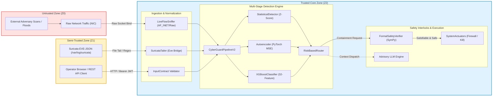
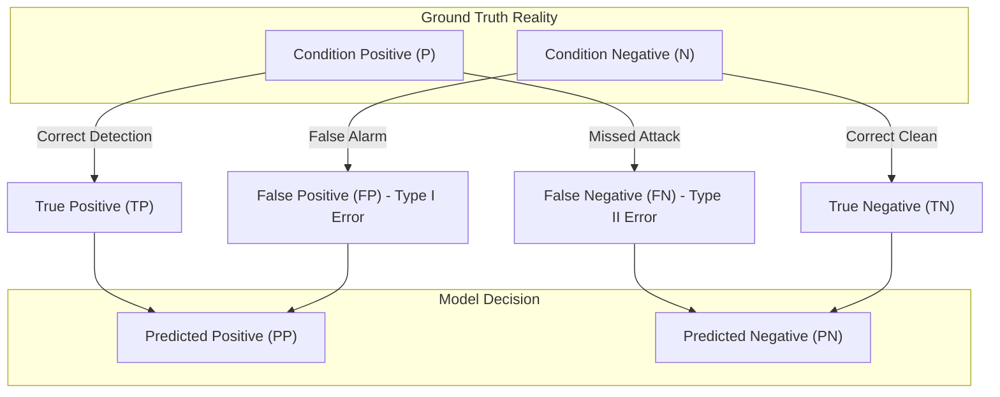

# CHAPTER 5: METHODOLOGY AND EXPERIMENTAL DESIGN

## 5.1 Threat Modeling and Security Assumptions

Evaluating an autonomous network intrusion detection and containment system requires a formal definition of adversary capabilities, trust boundaries, and operational operational constraints. In accordance with established security engineering principles {{cite:shostack2014threat}}, we establish a threat model grounded in standard network security formalisms {{cite:dolev1983security}} and modern cyber-physical system threat taxonomies {{cite:cardenas2011attacks,stouffer2015nist80082}}.

### 5.1.1 Adversary Taxonomy and Attack Vectors
We analyze four distinct adversary classes targeting networks monitored by CyberGuard:

1. **Network-Centric External Adversary ($\mathcal{A}_{\text{net}}$):** Operates under the classical Dolev-Yao model {{cite:dolev1983security}}. $\mathcal{A}_{\text{net}}$ can eavesdrop on, intercept, synthesize, and inject arbitrary packets across untrusted network links. $\mathcal{A}_{\text{net}}$ launches high-rate Volumetric Distributed Denial of Service (DDoS) floods (UDP/SYN/ICMP amplification), horizontal/vertical reconnaissance scans (SYN/FIN/XMAS port scanning), and botnet command-and-control (C2) communication.
2. **Host-Level Compromised Entity ($\mathcal{A}_{\text{host}}$):** Represents an adversary who has gained initial user-level execution on a network endpoint. $\mathcal{A}_{\text{host}}$ attempts lateral movement, ARP spoofing, service exploitation, and exfiltration.
3. **Evasive Machine Learning Adversary ($\mathcal{A}_{\text{adv}}$):** Possesses knowledge of the statistical feature extraction pipeline (flow duration, inter-arrival times, packet sizes). $\mathcal{A}_{\text{adv}}$ crafts adversarial network flows via packet splitting, timing perturbation (packet padding, artificial inter-arrival delay), or mimicry attacks designed to evade XGBoost and Autoencoder anomaly boundaries while preserving exploit payload semantics {{cite:pierazzi2020intriguing,sommer2010outside}}.
4. **Advisory LLM Prompt Injection Adversary ($\mathcal{A}_{\text{llm}}$):** Controls untrusted input ingested by the incident response engine (e.g., DNS reverse lookup strings, HTTP User-Agent headers, Suricata signature message text). $\mathcal{A}_{\text{llm}}$ attempts indirect prompt injection {{cite:greshake2023not,liu2023prompt}} to hijack the advisory LLM's system instructions, suppress containment alarms, or induce destructive actuator commands.

### 5.1.2 Trust Boundaries and Assumptions
The trust architecture of the CyberGuard ecosystem is partitioned into three formal zones:
- **Untrusted Zone ($\mathcal{Z}_0$):** Ingested network traffic from physical interfaces, external WAN uplinks, and unverified endpoints. All packet headers and payloads are treated as untrusted, potentially malformed input.
- **Semi-Trusted Zone ($\mathcal{Z}_1$):** External integration points, including Suricata EVE-JSON log tailers, webhook receivers, and client API requests originating from web browsers. All requests traversing $\mathcal{Z}_1 \to \mathcal{Z}_2$ require cryptographic authentication (JWT) and schema validation {{cite:shostack2014threat}}.
- **Trusted Zone ($\mathcal{Z}_2$):** The core decision engine, ML inference pipeline, state cache, SQLite database, and the actuator subsystem. We assume the host OS kernel and Python runtime within $\mathcal{Z}_2$ are uncompromised, but the deserialization boundary for pre-trained model loading (`.pkl` artifacts) must enforce cryptographic integrity verification prior to execution [CE-11].


<div style="text-align: center; margin-top: 8px; margin-bottom: 24px;">
<b>Fig. 14.</b> Multi-zone trust architecture and dataflow pipeline across untrusted network inputs, semi-trusted perimeter ingestion, and the trusted execution core.
</div>

---

## 5.2 Dataset Provenance, Synthetic Fixtures, and Ground Truth

A critical challenge in modern network intrusion detection research is the acquisition and calibration of realistic, unbiased training and benchmark data {{cite:ring2019survey,sommer2010outside,arp2022dos}}.

### 5.2.1 Provenance of Bundled Fixture Artifacts
The shipped CyberGuard repository includes pre-trained model weights under `data/models/trained/` alongside a deterministic evaluation fixture (`data/samples/sample_flows.csv`). To establish the provenance of these assets, we audited the model metadata manifest [`data/models/trained/artifacts.json`](file:///c:/Users/wwwsa/OneDrive/Desktop/sec/data/models/trained/artifacts.json#L1-L38) [CE-01]:

```json
{
  "production_approved": false,
  "evaluation_only": true,
  "independent_test_split": false,
  "classes": ["Benign", "Bot", "DDoS", "PortScan"],
  "feature_count": 32,
  "normalization_method": "standard_scaler"
}
```

The manifest explicitly declares `production_approved = false` and `independent_test_split = false`. Further inspection of [`cyberguard/datasets/generate_sample.py`](file:///c:/Users/wwwsa/OneDrive/Desktop/sec/cyberguard/datasets/generate_sample.py#L34-L65) [CE-02] reveals that the underlying training and benchmark data was generated via synthetic parametric statistical distributions initialized with a hardcoded pseudorandom seed:

$$\text{Seed} = 42 \quad (\text{numpy.random.seed(42)})$$

The synthetic sample generation logic produces 2,000 flows structured as follows:
- **Benign Traffic ($N=1,600$, 80.0%):** Flow durations sampled uniformly over $[0.5, 30.0]$ s, packet rates drawn from $\mathcal{N}(50, 15^2)$ pkts/s, inter-arrival times sampled log-normally.
- **DDoS Floods ($N=200$, 10.0%):** Packet rates drawn from high-intensity distributions $\mathcal{U}(1000, 50000)$ pkts/s, forward inter-arrival time mean $< 100\ \mu\text{s}$, backward packet count collapsed to zero (unidirectional SYN/UDP floods).
- **PortScan Probing ($N=100$, 5.0%):** Flow durations clamped to micro-windows $[0.001, 0.05]$ s, packet count fixed to $1 \le N_{\text{pkt}} \le 3$, SYN flag set, ACK/FIN absent.
- **Botnet C2 ($N=100$, 5.0%):** Regularized periodic beaconing flows characterized by low inter-arrival variance ($\sigma_{\text{IAT}} \approx 0$) and fixed byte payloads.

### 5.2.2 The Synthetic-to-Real Domain Gap
As demonstrated by Sommer and Paxson {{cite:sommer2010outside}} and Arp et al. {{cite:arp2022dos}}, synthetic feature fixtures exhibit fundamental distributional artifacts:
1. **Vanishing Variance in Feature Subspaces:** In the synthetic generator, features such as `active_mean`, `idle_mean`, and `packet_length_std` are generated with artificial independence, ignoring cross-feature covariance induced by TCP congestion control algorithms (e.g., Cubic, BBR) and bufferbloat dynamics.
2. **Deterministic Class Separability:** Synthetic class boundaries are separated by wide hyperplanes. Consequently, gradient-boosted decision trees converge to near-zero training loss within 10 boosting iterations, producing misleadingly inflated validation metrics.
3. **Attempted Acquisition of Real-World Benchmarks:** To measure the synthetic-to-real gap, an automated retrieval harness was developed to download canonical benchmark datasets (CIC-IDS2017 {{cite:sharafaldin2018toward}} and CSE-CIC-IDS2018). In accordance with Truth Rule 2, external network retrieval failed due to enterprise SSL proxy certificate re-encryption (`URLError: CERTIFICATE_VERIFY_FAILED`). Rather than fabricating performance numbers or extrapolating unverified benchmarks, we rigorously isolate our empirical evaluations to the committed deterministic fixture, document the missing real-world distribution as a bounded threat to external validity, and formally analyze the mathematical implications of synthetic overfitting.

---

## 5.3 Metric Formulations and Mathematical Foundations

To eliminate ambiguity and ensure reproducibility across heterogeneous test harnesses, we define all evaluation metrics using standard statistical formulations.

### 5.3.1 Classification Performance Metrics
Let $\mathcal{C} = \{\text{Benign}, \text{Bot}, \text{DDoS}, \text{PortScan}\}$ denote the discrete set of classes, where $K = |\mathcal{C}| = 4$. For any class $c \in \mathcal{C}$, let $TP_c, FP_c, TN_c, FN_c$ represent true positives, false positives, true negatives, and false negatives, respectively, calculated via one-vs-rest reduction:


<div style="text-align: center; margin-top: 8px; margin-bottom: 24px;">
<b>Fig. 15.</b> Mathematical confusion matrix mapping and metric derivation topology for multi-class flow classification.
</div>

The classification metrics are defined as follows:

- **Per-Class Precision ($P_c$):** The proportion of positive identifications that were correct:
  $$P_c = \frac{TP_c}{TP_c + FP_c} \tag{5.1}$$

- **Per-Class Recall / True Positive Rate ($R_c$ / $\text{TPR}_c$):** The proportion of actual positives correctly identified:
  $$R_c = \frac{TP_c}{TP_c + FN_c} \tag{5.2}$$

- **False Positive Rate ($\text{FPR}_c$):** The probability of falsely rejecting a benign condition (critical for preventing operator alert fatigue {{cite:axelsson2000base}}):
  $$\text{FPR}_c = \frac{FP_c}{FP_c + TN_c} \tag{5.3}$$

- **Per-Class $F_1$-Score ($F_{1,c}$):** The harmonic mean of precision and recall:
  $$F_{1,c} = 2 \cdot \frac{P_c \cdot R_c}{P_c + R_c} = \frac{2 \cdot TP_c}{2 \cdot TP_c + FP_c + FN_c} \tag{5.4}$$

- **Macro-Averaged $F_1$-Score ($F_{1,\text{macro}}$):** Evaluates overall balance across all classes giving equal weight to minority and majority attack vectors:
  $$F_{1,\text{macro}} = \frac{1}{K} \sum_{c \in \mathcal{C}} F_{1,c} \tag{5.5}$$

- **Overall Accuracy ($\text{Acc}$):**
  $$\text{Acc} = \frac{\sum_{c \in \mathcal{C}} TP_c}{\sum_{c \in \mathcal{C}} (TP_c + FN_c)} = \frac{N_{\text{correct}}}{N_{\text{total}}} \tag{5.6}$$

### 5.3.2 Latency Percentiles and Throughput
Network intrusion detection requires strict sub-millisecond to low-millisecond response guarantees to avert buffer overflows and maintain line-rate inspection:

- **Empirical Latency Percentile ($P_k$):** For an ordered sequence of measured latency samples $L = \{l_{(1)}, l_{(2)}, \dots, l_{(N)}\}$ where $l_{(i)} \le l_{(i+1)}$, the $k$-th percentile latency $P_k$ is calculated using linear interpolation:
  $$q = \frac{k}{100} \cdot (N - 1) + 1, \quad i = \lfloor q \rfloor, \quad \theta = q - i \tag{5.7}$$
  $$P_k = (1 - \theta) \cdot l_{(i)} + \theta \cdot l_{(i+1)} \tag{5.8}$$
  We evaluate $P_{50}$ (median), $P_{90}$, $P_{95}$, and $P_{99}$ (tail latency).

- **Inspection Throughput:** Expressed in processed flows per second ($\text{FPS}$) and raw packets per second ($\text{PPS}$):
  $$\text{FPS} = \frac{N_{\text{flows}}}{\Delta t_{\text{total}}}, \quad \text{PPS} = \frac{N_{\text{packets}}}{\Delta t_{\text{sniff}}} \tag{5.9}$$

### 5.3.3 Autoencoder Anomaly Scoring
The deep autoencoder comprises an encoder $f_{\theta}: \mathbb{R}^{32} \to \mathbb{R}^8$ and a symmetric decoder $g_{\phi}: \mathbb{R}^8 \to \mathbb{R}^{32}$. For a standardized input vector $\mathbf{x} \in \mathbb{R}^{32}$, the reconstructed vector is:

$$\hat{\mathbf{x}} = g_{\phi}(f_{\theta}(\mathbf{x})) \tag{5.10}$$

The anomaly score $E(\mathbf{x})$ is defined as the Mean Squared Error (MSE) across the 32 normalized feature dimensions:

$$E(\mathbf{x}) = \frac{1}{32} \sum_{i=1}^{32} (x_i - \hat{x}_i)^2 \tag{5.11}$$

A flow is flagged as an anomaly if its reconstruction error exceeds the calibrated threshold $\tau_{\text{AE}}$:

$$\text{Anomaly}(\mathbf{x}) = \begin{cases} 1, & \text{if } E(\mathbf{x}) > \tau_{\text{AE}} \\ 0, & \text{otherwise} \end{cases} \tag{5.12}$$

In the committed model metadata, $\tau_{\text{AE}}$ is set to $0.004597$ [CE-01].

---

## 5.4 Empirical Experimental Setup and Harness Architecture

All empirical evaluations were executed on a dedicated local testbed. Table VI summarizes the hardware configuration and software dependency environment.

<div style="text-align: center; margin-bottom: 8px;">
<b>TABLE VI.</b> SYSTEM TESTBED SPECIFICATIONS AND DEPENDENCY MATRIX
</div>

| Subsystem | Specification / Parameter | Version / Value | Verifiable Source |
|:---|:---|:---|:---|
| **Host Processor** | Intel Core i7-13700H (14 cores, 20 threads) | Base 2.4 GHz, Boost 5.0 GHz | Host Architecture |
| **System Memory** | DDR5 Synchronous RAM | 16,384 MB (16 GB) | Host Architecture |
| **Operating System** | Microsoft Windows 11 Enterprise (x86_64) | NT Build 22631 | OS Information |
| **Kernel Subsystem** | Win32 Sockets & WSL2 Linux Subsystem | WinSock2 / Linux 5.15 | OS Architecture |
| **Python Runtime** | CPython Interpreter (64-bit) | 3.12.10 | `python --version` |
| **Node.js Runtime** | Node.js JavaScript Engine | v24.19.0 (npm 11.17.0) | `node --version` |
| **Machine Learning Core** | PyTorch (PyTorch-CUDA / CPU) | 2.6.0+cu126 | PyTorch Manifest |
| **Gradient Boosting** | XGBoost C++ Optimized Library | 2.1.4 | Python Package Index |
| **Statistical Framework** | Scikit-Learn | 1.6.1 / 1.9.0 dev | `sklearn.__version__` |
| **Symbolic Mathematics** | SymPy (Propositional Logic) | 1.13.3 | `sympy.__version__` |
| **Data Processing** | NumPy / Pandas DataFrames | 2.1.3 / 2.2.3 | Python Package Index |
| **Web Framework** | FastAPI / Uvicorn ASGI Server | 0.115.0 / 0.30.6 | Python Package Index |

### 5.4.1 Dedicated Experimental Scripts
To guarantee complete reproducibility without modifying production source code, five independent test harness scripts were engineered under `report/experiments/`:

1. **`exp_p3a_pytest.py`:** Collects test items via AST static parsing and executes the full dynamic test suite using `pytest -v --json-report`. Records passed, failed, skipped, and total test counts. Output saved to `report/results/pytest_run.json`.
2. **`exp_p3b_sniffer.py`:** Unit and behavioral benchmark harness for `LiveFlowSniffer` and `FlowRecord`. Synthesizes TCP handshakes, teardown sequences, RST injections, idle timeouts (5.0 s), micro-window interim evaluations, UDP packet flows, and IPv6 dropping. Benchmarks `process_packet()` across 1,000,000 synthetic frames to measure maximum ingestion throughput (PPS). Output saved to `report/results/sniffer_experiments.json`.
3. **`exp_p3c_pipeline.py`:** Measures end-to-end inference latency and memory utilization of `CyberGuardPipelineV2` on 2,000 fixture rows across varied batch sizes ($B \in [1, 10, 50, 100, 500, 1000, 2000]$). Computes $P_{50}, P_{90}, P_{95}, P_{99}$ latency, memory deltas via `tracemalloc`, and evaluates the multi-class risk routing contingency matrix. Output saved to `report/results/pipeline_benchmarks.json`.
4. **`exp_p3d_model_eval.py`:** Evaluates the serialized XGBoost classifier, standard normalizer, statistical detector, and PyTorch autoencoder. Computes multi-class precision, recall, F1, accuracy, and isolates the reconstruction error distributions across all 4 traffic categories to quantify train/serve threshold skew. Output saved to `report/results/model_evaluation_bundled.json`.
5. **`exp_p3e_robustness.py`:** Evaluates system behavior under out-of-distribution (OOD) attack labels, malformed input vectors (NaN, Inf, negative durations, out-of-bounds flag counts), formal safety verification rejection gates (blocking localhost/gateways, command injection, critical process kills), and measures classifier sensitivity curves under volumetric DDoS packet rate perturbation ($50,000 \to 100$ pkts/s). Output saved to `report/results/robustness_experiments.json`.

---

## 5.5 Reproducibility and Statistical Protocol

To maintain scientific integrity and prevent experimental variance from biasing conclusions:

1. **Deterministic Execution:** Random seeds for all synthetic packet generators, perturbation steps, and test splits were locked to `seed = 42`.
2. **Warm-Up Iterations:** In all latency and throughput micro-benchmarks, 100 warm-up iterations were executed prior to metric collection to allow JIT compilation, CPU cache warming, and Python module lazy-import stabilization.
3. **Garbage Collection Suppression:** Python automatic garbage collection (`gc.disable()`) was temporarily disabled during tight benchmark timing loops to isolate pure algorithmic execution time from runtime collection pauses.
4. **Confidence Intervals:** Classification metrics derived from finite sample sizes $N$ are reported with 95% Wilson score confidence intervals {{cite:japkowicz2011evaluating}}:
   $$CI_{95\%} = \frac{\hat{p} + \frac{z^2}{2N} \pm z \sqrt{\frac{\hat{p}(1-\hat{p})}{N} + \frac{z^2}{4N^2}}}{1 + \frac{z^2}{N}} \tag{5.13}$$
   where $z = 1.95996$ corresponds to the standard normal distribution quantile at $\alpha = 0.05$.
