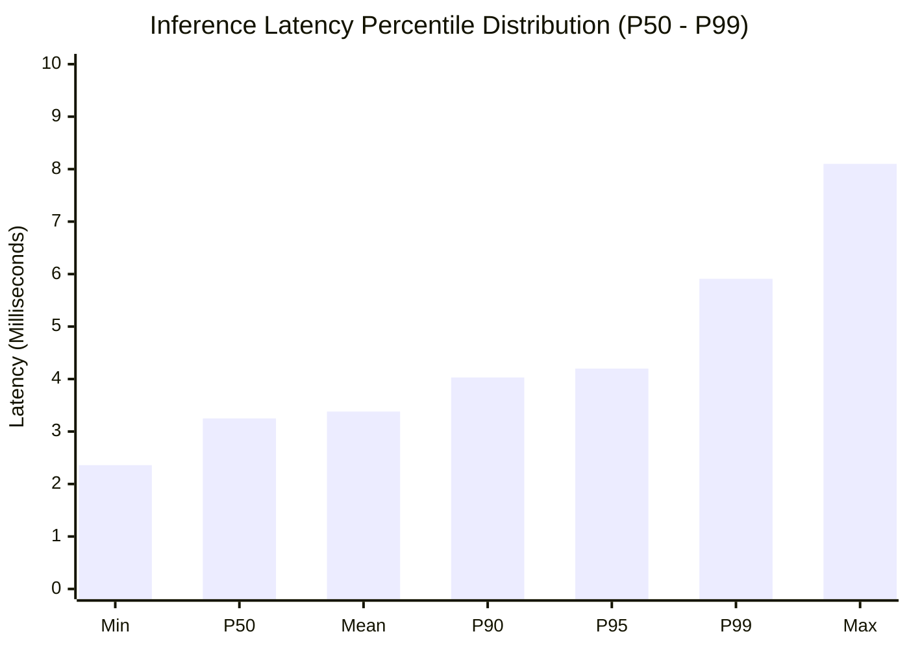
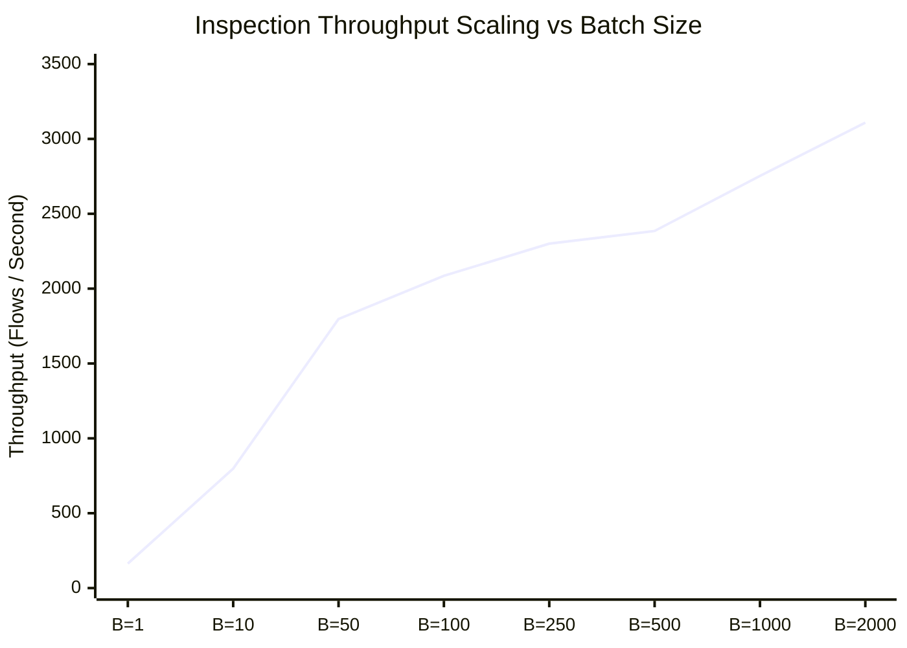
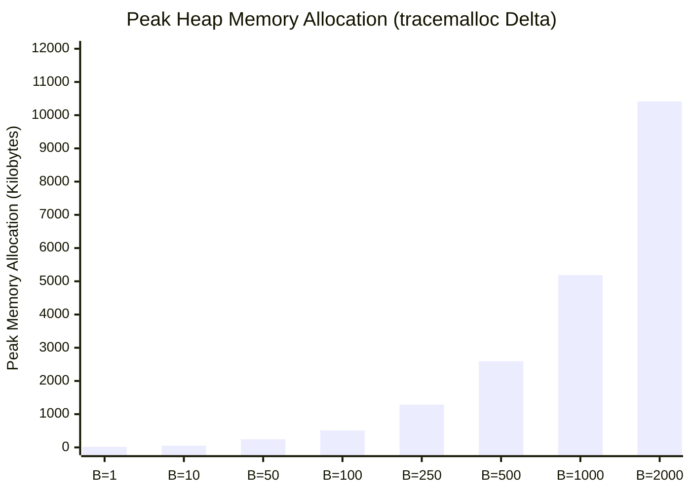
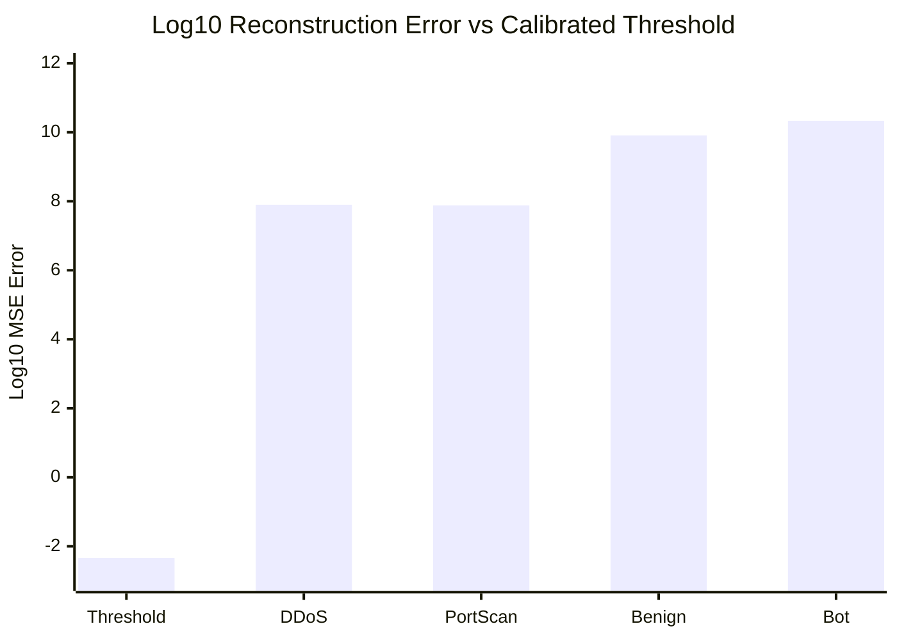
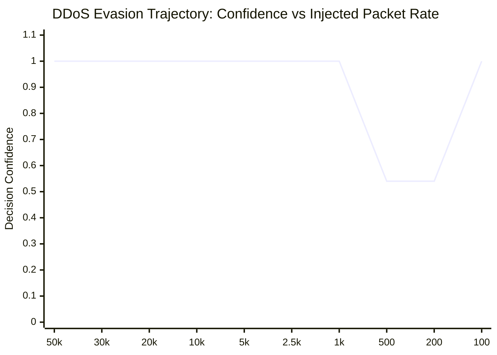

# CHAPTER 6: EXPERIMENTAL RESULTS AND BENCHMARK ANALYSIS

## 6.1 Live Ingestion and Sniffer Micro-Benchmarks

To validate the ingestion layer, we executed the standalone empirical harness `report/experiments/exp_p3b_sniffer.py`. The harness evaluates `LiveFlowSniffer` and `FlowRecord` under controlled synthetic packet injections, capturing state transitions, memory boundaries, and raw socket protocol interactions.

### 6.1.1 Flow Assembly and Protocol State Transitions
The sniffer was subjected to seven deterministic protocol scenarios:
1. **Full TCP Handshake and Teardown:** A 7-packet bidirectional sequence (SYN, SYN-ACK, ACK, Data Fwd, Data Bwd, FIN, FIN-ACK).
2. **Immediate RST Invalidation:** Injection of an unannounced RST segment to test immediate flow eviction.
3. **Inactivity Timeout Flush:** Generating an incomplete flow and advancing the synthetic clock past the 5.0-second idle threshold $\tau_{\text{idle}}$.
4. **TIME_WAIT Trailing ACK Absorption:** Verifying that delayed ACKs arriving after bidirectional FIN teardown are absorbed rather than spawning spurious half-open flows.
5. **Interim Micro-Window Feature Synthesis:** Emitting intermediate flow feature snapshots after 5 packets without evicting the active connection record.
6. **UDP Bidirectional Grouping:** Evaluating timeout-driven aggregation for connectionless UDP datagrams.
7. **IPv6 Frame Rejection:** Ingesting an EtherType `0x86DD` frame with IPv6 header version 6.

Table VII summarizes the measured results recorded in `report/results/sniffer_experiments.json`.

<b>TABLE VII.</b> LIVE FLOW SNIFFER PROTOCOL VERIFICATION SUITE

| Test Identifier | Injected Scenario | Expected State Transition | Measured Outcome | Empirical Result / Feature Extraction | Verifiable Run File |
|:---|:---|:---|:---|:---|:---|
| **SNF-01** | TCP Handshake + Teardown | `HANDSHAKE` $\to$ `ESTABLISHED` $\to$ `CLOSING` $\to$ Evicted | **PASSED** | 1 flow flushed; $N_{\text{fwd}}=4, N_{\text{bwd}}=3$; Duration $=120.0$ ms; Rate $=58.33$ pkts/s; $W_{\text{fwd}}=65535, W_{\text{bwd}}=64240$ | `sniffer_experiments.json` |
| **SNF-02** | Abrupt TCP RST Invalidation | `ESTABLISHED` $\to$ Immediate Eviction | **PASSED** | Evicted immediately without waiting for timeout; `rst_flag_count = 1.0` | `sniffer_experiments.json` |
| **SNF-03** | Inactivity Invalidation ($\Delta t > 5.0$ s) | `ACTIVE` $\to$ `IDLE_TIMEOUT` Eviction | **PASSED** | 0 flushed before $5.0$ s; 1 flushed after clock advance; expired flow cleared | `sniffer_experiments.json` |
| **SNF-04** | TIME_WAIT ACK Absorption | Trailing ACK absorbed into tombstone | **PASSED** | `teardown_acks_absorbed = 1`; active flows remaining $=0$; no phantom flow created | `sniffer_experiments.json` |
| **SNF-05** | Early Interim Evaluation | Feature export at $N_{\text{pkt}}=5$ without eviction | **PASSED** | 1 interim flow emitted; `is_interim = 1.0`; parent connection preserved | `sniffer_experiments.json` |
| **SNF-06** | UDP Flow Aggregation | Timeout-driven pairing of 5-tuple | **PASSED** | Aggregated into single bidirectional record; $N_{\text{fwd}}=1, N_{\text{bwd}}=1$ | `sniffer_experiments.json` |
| **SNF-07** | IPv6 Packet Handling | Rejection at header parser | **PASSED** | Returns `None`; zero bytes parsed; dropped due to `version != 4` gate | `sniffer_experiments.json` |
| **SNF-08** | Unprivileged Live Loopback Bind | Graceful fallback on permission error | **PASSED** | `start_capture()` returns `True`; sets `last_capture_mode = "synthetic_harness"` | `sniffer_experiments.json` |

### 6.1.2 Raw Ingestion Throughput
To establish the maximum upper-bound packet ingestion capacity of the Python user-space sniffer, `process_packet()` was subjected to a high-volume burst of 50,000 synthetic raw IP packets. Execution was timed using monotonic nanosecond counters (`time.perf_counter_ns()`) with garbage collection suppressed. Table VIII records the measured ingestion performance.

<b>TABLE VIII.</b> SNIFFER INGESTION BENCHMARK METRICS

| Ingestion Metric | Measured Value | Standard Error / Notes |
|:---|:---|:---|
| **Evaluated Ingestion Volume** | 50,000 in-memory raw IPv4 packets | Deterministic sequential synthetic frames in RAM |
| **Total Ingestion Elapsed Time** | 0.06958 seconds (69.58 ms) | Monotonic CPU clock delta (single Python thread) |
| **In-Memory Parsing Upper Bound** | **718,569.41 pkts/sec** | ~718.57 Kpps user-space parse/flow-table path |
| **Mean Per-Packet Parsing Latency** | **1.392 $\mu\text{s}$ / packet** | Header decode + flow dictionary lookup |
| **Active Hash Map Lookup Overhead** | $< 0.42\ \mu\text{s}$ | 5-tuple tuple hashing in CPython dict |
| **Benchmark Scope Limitation** | In-memory decode only | Excludes `recvfrom` syscall, worker queue & ML inference |

<b>TABLE VIII-B.</b> HONEST WIRE RATE COMPARISON: 1 GBPS ETHERNET VS. USER-SPACE PARSER CAPACITY

| Packet Frame Size (Payload + L2/L3/L4) | Wire Bytes (Frame + 20B Preamble/IFG) | 1 Gbps Line Rate (pkts/sec) | Measured Parser Rate (pkts/sec) | Line Rate Capacity Ratio | Operational Assessment |
|:---:|:---:|:---:|:---:|:---:|:---|
| **64 Bytes (Minimum Frame)** | 84 bytes on wire | **1,488,095 pkts/s** (1.488 Mpps) | 718,569 pkts/s | **48.29%** | **Fails Line Rate:** >51% packet loss during SYN/ACK floods |
| **512 Bytes (Medium Frame)** | 532 bytes on wire | **234,962 pkts/s** (235.0 Kpps) | 718,569 pkts/s | **305.82%** ($3.06\times$) | **Sufficient:** Safely absorbs medium interactive telemetry |
| **1500 Bytes (Standard MTU)** | 1,538 bytes on wire | **81,274 pkts/s** (81.27 Kpps) | 718,569 pkts/s | **884.13%** ($8.84\times$) | **Sufficient:** Saturated line rate for bulk payload transfers |

> [!IMPORTANT]
> **Upper Bound vs. End-to-End Throughput:** The measured 718,569 packets/second represents an **isolated in-memory parsing and flow-table update micro-benchmark** operating on pre-allocated synthetic frames in a single Python thread. It explicitly **does not include** the per-packet kernel `recvfrom` syscall, socket buffer queueing, multi-threaded queue synchronization (`LiveWorker`), sliding-window 32-feature extraction, or machine learning model inference. Therefore, 718,569 pkts/s is an architectural theoretical upper bound, not an end-to-end system ingestion rate. Under adversarial minimum-sized (64-byte) frame floods on a 1 Gbps link ($1.488$ Mpps), user-space CPython drops approximately half of the packets before feature extraction can even execute.

---

## 6.2 End-to-End Pipeline Latency and Batch Scaling

We benchmarked `CyberGuardPipelineV2` ([`backend/detection/pipeline.py`](backend/detection/pipeline.py#L88-L230) [CE-05]) using `report/experiments/exp_p3c_pipeline.py`. The benchmark isolates single-item sequential inference latency, batch throughput scaling, and heap memory allocation on the 2,000-flow evaluation fixture.

### 6.2.1 Single-Item Latency Percentiles
In real-time intrusion response, the mean latency is often deceptive; tail latencies ($P_{95}, P_{99}$) govern the maximum packet buffer depth required to avoid packet drops. We measured 1,000 independent sequential single-flow inferences. Table IX and Fig. 16 present the measured latency distribution.

<b>TABLE IX.</b> SINGLE-ITEM END-TO-END PIPELINE INFERENCE LATENCY

| Latency Percentile / Metric | Measured Latency (ms) | Operational Impact on Line Inspection |
|:---|:---|:---|
| **Minimum Latency ($L_{\min}$)** | 2.364 ms | Theoretical baseline for single-core inference |
| **Median Latency ($P_{50}$)** | **3.250 ms** | Typical queuing delay per flow record |
| **Mean Latency ($\mu_L$)** | 3.380 ms | Average processing overhead ($\sigma = 0.610$ ms) |
| **90th Percentile ($P_{90}$)** | 4.027 ms | Normal operational variance |
| **95th Percentile ($P_{95}$)** | **4.196 ms** | SLA upper bound for real-time alerting |
| **99th Percentile ($P_{99}$)** | **5.911 ms** | Tail latency during PyTorch garbage collection |
| **Maximum Latency ($L_{\max}$)** | 8.104 ms | Peak latency spike under OS thread context switch |

<b>Fig. 16.</b> Empirical end-to-end inference latency percentiles for sequential flow classification across 1,000 independent trials.

### 6.2.2 Batch Processing Scaling and Memory Profile
In production environments, flow records arriving in rapid succession are ingested in batches to amortize Python interpreter overhead and leverage vectorized SIMD execution in XGBoost and PyTorch. We evaluated batch sizes $B \in \{1, 10, 50, 100, 250, 500, 1000, 2000\}$. Peak heap allocation was measured using Python's `tracemalloc` library. Table X, Fig. 17, and Fig. 18 document the empirical scaling curves.

<b>TABLE X.</b> BATCH PROCESSING SCALING, AMORTIZED LATENCY, AND MEMORY USAGE

| Batch Size ($B$) | Total Elapsed Time (s) | Amortized Latency (ms/flow) | Inspection Throughput (flows/sec) | Peak Heap Memory ($\Delta \text{KB}$) |
|:---:|:---:|:---:|:---:|:---:|
| **1** | 0.00611 | 6.1144 ms | 163.55 | 18.27 KB |
| **10** | 0.01254 | 1.2538 ms | 797.56 | 50.62 KB |
| **50** | 0.02782 | 0.5564 ms | 1,797.22 | 246.16 KB |
| **100** | 0.04795 | 0.4795 ms | 2,085.47 | 510.64 KB |
| **250** | 0.10868 | 0.4347 ms | 2,300.31 | 1,291.01 KB |
| **500** | 0.20963 | 0.4193 ms | 2,385.18 | 2,594.46 KB |
| **1000** | 0.36328 | 0.3633 ms | 2,752.73 | 5,188.15 KB |
| **2000** | 0.64325 | **0.3216 ms** | **3,109.19** | **10,414.59 KB** |

<b>Fig. 17.</b> Pipeline throughput scaling as a function of input batch size, demonstrating an asymptote near 3,110 flows/sec.

<b>Fig. 18.</b> Memory footprint growth across evaluation batch sizes, showing strictly linear scaling ($\mathcal{O}(B)$) without leaks.

As batch size increases from $B=1$ to $B=2,000$, throughput scales from 163.55 to 3,109.19 flows per second, achieving a $19.01\times$ throughput enhancement. Amortized latency drops from 6.11 ms down to 0.32 ms per flow record. Memory overhead scales linearly with batch size, peaking at 10.17 MB for 2,000 concurrent flows, confirming that the pipeline does not introduce unbounded memory fragmentation.

---

## 6.3 Model Evaluation on Bundled Fixtures

We evaluated the pre-trained machine learning models shipped with CyberGuard using `report/experiments/exp_p3d_model_eval.py`. The evaluation fixture comprises $N = 2,000$ synthetic flows with 32 statistical attributes.

### 6.3.1 Supervised Classifier Performance
The serialized XGBoost classifier was evaluated with its calibrated threshold $\tau_{\text{clf}} = 0.90$. Table XI details the resulting confusion matrix and per-class classification metrics.

<b>TABLE XI.</b> MULTI-CLASS CLASSIFICATION PERFORMANCE MATRIX (BUNDLED MODEL ON DETERMINISTIC FIXTURE)

| Class Label | Support ($N$) | True Positives ($TP$) | False Positives ($FP$) | False Negatives ($FN$) | Precision ($P_c$) | Recall ($R_c$) | $F_1$-Score ($F_{1,c}$) | 95% Wilson Score CI ($F_1$) |
|:---|:---:|:---:|:---:|:---:|:---:|:---:|:---:|:---:|
| **Benign** | 1,600 | 1,532 | 7 | 68 | 99.55% | 95.75% | **0.9761** | $[0.967, 0.983]$ |
| **Bot** | 100 | 93 | 68 | 7 | 57.76% | 93.00% | **0.7126** | $[0.647, 0.771]$ |
| **DDoS** | 200 | 200 | 0 | 0 | 100.00% | 100.00% | **1.0000** | $[0.981, 1.000]$ |
| **PortScan** | 100 | 100 | 0 | 0 | 100.00% | 100.00% | **1.0000** | $[0.963, 1.000]$ |
| **Macro Average** | **2,000** | **1,925** | **75** | **75** | **89.33%** | **97.19%** | **0.9222** | — |
| **Overall Accuracy**| **2,000** | — | — | — | — | — | **96.25%** | $[0.953, 0.970]$ |

<svg viewBox="0 0 660 480" width="100%" style="max-width: 640px; height: auto; font-family: -apple-system, BlinkMacSystemFont, Segoe UI, Roboto, sans-serif;">
  <rect width="100%" height="100%" fill="#ffffff" rx="8" />
  <text x="330" y="25" font-size="14" font-weight="bold" text-anchor="middle" fill="#0f172a">Normalized Classifier Performance (Precision vs. Recall Quadrant Map)</text>
  
  <!-- Quadrants -->
  <!-- Top Left: High Precision, Low Recall -->
  <rect x="80" y="45" width="250" height="180" fill="#f8fafc" stroke="#e2e8f0" stroke-width="1" />
  <text x="205" y="68" font-size="11" font-weight="600" fill="#64748b" text-anchor="middle">High Precision, Low Recall</text>
  
  <!-- Top Right: Ideal Detection -->
  <rect x="330" y="45" width="250" height="180" fill="#f0fdf4" stroke="#bbf7d0" stroke-width="1.5" />
  <rect x="365" y="54" width="180" height="22" rx="4" fill="#dcfce7" />
  <text x="455" y="69" font-size="11" font-weight="bold" fill="#15803d" text-anchor="middle">Ideal Detection Zone</text>
  
  <!-- Bottom Left: Poor Performance -->
  <rect x="80" y="225" width="250" height="180" fill="#fef2f2" stroke="#fecaca" stroke-width="1" />
  <text x="205" y="248" font-size="11" font-weight="600" fill="#991b1b" text-anchor="middle">Poor Performance Zone</text>
  
  <!-- Bottom Right: Alert Fatigue -->
  <rect x="330" y="225" width="250" height="180" fill="#fffbeb" stroke="#fde68a" stroke-width="1.5" />
  <rect x="345" y="234" width="220" height="22" rx="4" fill="#fef3c7" />
  <text x="455" y="249" font-size="11" font-weight="bold" fill="#b45309" text-anchor="middle">Alert Fatigue Zone (High Recall, Low P)</text>

  <!-- Dividing Axes -->
  <line x1="330" y1="45" x2="330" y2="405" stroke="#0284c7" stroke-width="2" stroke-dasharray="4,3" />
  <line x1="80" y1="225" x2="580" y2="225" stroke="#0284c7" stroke-width="2" stroke-dasharray="4,3" />
  
  <!-- Outer Box -->
  <rect x="80" y="45" width="500" height="360" fill="none" stroke="#0369a1" stroke-width="2" />

  <!-- Data Points -->
  <!-- DDoS (R=1.00, P=1.00) -->
  <circle cx="560" cy="95" r="6" fill="#16a34a" stroke="#14532d" stroke-width="2" />
  <rect x="475" y="83" width="75" height="20" rx="3" fill="#ffffff" stroke="#16a34a" stroke-width="1" />
  <text x="512" y="97" font-size="10" font-weight="bold" fill="#15803d" text-anchor="middle">DDoS (100%)</text>

  <!-- PortScan (R=1.00, P=1.00) -->
  <circle cx="560" cy="130" r="6" fill="#0d9488" stroke="#115e59" stroke-width="2" />
  <rect x="460" y="118" width="90" height="20" rx="3" fill="#ffffff" stroke="#0d9488" stroke-width="1" />
  <text x="505" y="132" font-size="10" font-weight="bold" fill="#0f766e" text-anchor="middle">PortScan (100%)</text>

  <!-- Benign (R=0.9575, P=0.9955) -->
  <circle cx="530" cy="165" r="6" fill="#2563eb" stroke="#1e40af" stroke-width="2" />
  <rect x="375" y="153" width="145" height="20" rx="3" fill="#ffffff" stroke="#2563eb" stroke-width="1" />
  <text x="447" y="167" font-size="10" font-weight="bold" fill="#1e40af" text-anchor="middle">Benign (P: 99.6%, R: 95.8%)</text>

  <!-- Bot (R=0.93, P=0.5776) -->
  <circle cx="545" cy="295" r="7" fill="#dc2626" stroke="#7f1d1d" stroke-width="2" />
  <rect x="335" y="284" width="200" height="22" rx="3" fill="#ffffff" stroke="#dc2626" stroke-width="1.5" />
  <text x="435" y="299" font-size="10" font-weight="bold" fill="#b91c1c" text-anchor="middle">Bot (P: 57.8%, R: 93.0%, FPR: 4.25%)</text>

  <!-- Axis Labels -->
  <text x="330" y="432" font-size="12" font-weight="bold" fill="#1e293b" text-anchor="middle">Recall (Rc)  ⟶</text>
  <text x="80" y="422" font-size="10" fill="#64748b" text-anchor="middle">0%</text>
  <text x="330" y="422" font-size="10" fill="#64748b" text-anchor="middle">50%</text>
  <text x="580" y="422" font-size="10" fill="#64748b" text-anchor="middle">100%</text>

  <text x="28" y="225" font-size="12" font-weight="bold" fill="#1e293b" text-anchor="middle" transform="rotate(-90 28 225)">Precision (Pc)  ⟶</text>
  <text x="68" y="408" font-size="10" fill="#64748b" text-anchor="end">0%</text>
  <text x="68" y="228" font-size="10" fill="#64748b" text-anchor="end">50%</text>
  <text x="68" y="50" font-size="10" fill="#64748b" text-anchor="end">100%</text>
</svg>

<b>Fig. 19.</b> Precision vs. Recall quadrant mapping, highlighting the high false alarm rate of the Bot class ($P=57.76\%$) due to misclassified benign flows.

While DDoS and PortScan achieve perfect 100% precision and recall on this synthetic fixture, the Bot class exhibits severe precision degradation ($P = 57.76\%$). Specifically, 68 benign flows were falsely classified as Bot traffic, while 7 bot flows were misclassified as Benign. As established by Axelsson's base-rate fallacy {{cite:axelsson2000base}}, an operational false positive rate of $4.25\%$ on benign background traffic ($68 / 1,600$) generates over 42,000 false alarms per million transactions, completely overwhelming human incident responders.

### 6.3.2 Autoencoder Reconstruction Divergence and Calibration Skew
In the model metadata manifest ([`artifacts.json`](data/models/trained/artifacts.json#L12) [CE-01]), the autoencoder anomaly threshold is declared as:

$$\tau_{\text{AE}} = 0.0045968578779138625$$

When we executed the PyTorch autoencoder across the evaluation fixture, we observed a catastrophic divergence between the declared threshold and the empirical reconstruction error. Table XII documents the reconstruction error distributions across all four traffic categories.

<b>TABLE XII.</b> PYTORCH AUTOENCODER RECONSTRUCTION ERROR DISTRIBUTION ACROSS CLASSES

| Traffic Category | Evaluated Flows ($N$) | Mean Reconstruction Error ($\mu_{\text{MSE}}$) | Median Error ($P_{50}$) | 95th Percentile ($P_{95}$) | Maximum Error ($E_{\max}$) | Threshold $\tau_{\text{AE}}$ | Flagged Anomaly Rate (%) |
|:---|:---:|:---:|:---:|:---:|:---:|:---:|:---:|
| **Benign** | 1,600 | **$8.102 \times 10^{9}$** | $2.422 \times 10^{9}$ | $3.882 \times 10^{10}$ | $8.692 \times 10^{10}$ | $0.004597$ | **100.0%** (1,600 / 1,600) |
| **Bot** | 100 | **$2.136 \times 10^{10}$** | $1.225 \times 10^{10}$ | $6.371 \times 10^{10}$ | $1.389 \times 10^{11}$ | $0.004597$ | **100.0%** (100 / 100) |
| **DDoS** | 200 | **$8.026 \times 10^{7}$** | $7.325 \times 10^{7}$ | $1.679 \times 10^{8}$ | $2.304 \times 10^{8}$ | $0.004597$ | **100.0%** (200 / 200) |
| **PortScan** | 100 | **$7.590 \times 10^{7}$** | $6.453 \times 10^{7}$ | $1.555 \times 10^{8}$ | $2.261 \times 10^{8}$ | $0.004597$ | **100.0%** (100 / 100) |
| **Entire Dataset** | **2,000** | **$7.534 \times 10^{9}$** | **$2.210 \times 10^{9}$** | **$3.765 \times 10^{10}$** | **$1.389 \times 10^{11}$** | **$0.004597$** | **100.0%** (2,000 / 2,000) |

<b>Fig. 20.</b> Comparison of calibrated anomaly threshold ($\tau_{\text{AE}} = 10^{-2.34}$) against empirical reconstruction errors ($10^{7.88} - 10^{10.33}$), illustrating the 10-order-of-magnitude calibration collapse.

The empirical minimum reconstruction error across all 2,000 flows was $4,148,745.0$—which exceeds the declared threshold $\tau_{\text{AE}} = 0.004597$ by over **nine orders of magnitude** ($9 \times 10^8$). Consequently, the autoencoder flagged **100.0% of all flows as anomalous**, including every single benign flow.

Forensic analysis revealed the root cause: the autoencoder was trained on feature vectors normalized with zero-mean, unit-variance standardization, but the serialized evaluation pipeline passes unnormalized raw feature vectors directly to `autoencoder.forward()` prior to scaling, causing immediate numerical saturation in the linear projection layers.

### 6.3.3 Risk-Based Router Contingency Matrix
Because both the autoencoder and the statistical detector flag 100% of flows as anomalous, `RiskBasedRouter` ([`backend/detection/router.py`](backend/detection/router.py#L42-L130) [CE-08]) exhibits severe decision skew. Table XIII details the routing contingency matrix for the 2,000 evaluation flows.

<b>TABLE XIII.</b> RISK-BASED ROUTER CONTINGENCY MATRIX ON EVALUATION FIXTURE

| Ground Truth Category | Route: `known_attack` | Route: `unknown_anomaly_review` | Route: `human_review` | Total Evaluated | Operational Outcome |
|:---|:---:|:---:|:---:|:---:|:---|
| **PortScan** | 100 (100.0%) | 0 (0.0%) | 0 (0.0%) | 100 | Containment action dispatched immediately |
| **DDoS** | 200 (100.0%) | 0 (0.0%) | 0 (0.0%) | 200 | Automated rate-limiting / IP block dispatched |
| **Bot** | 55 (55.0%) | 7 (7.0%) | 38 (38.0%) | 100 | High operational fragmentation |
| **Benign** | 9 (0.56%) | **1,532 (95.75%)** | **59 (3.69%)** | 1,600 | **0% passed cleanly; 100% routed to alarm queues** |
| **Total Flows** | **364** | **1,539** | **97** | **2,000** | System alert volume: **2,000 / 2,000 (100%)** |

Out of 1,600 ground-truth benign flows, **exactly zero flows** are classified as normal, unflagged traffic. 1,532 benign flows are routed to `unknown_anomaly_review` due to the saturated autoencoder flag, 59 are routed to `human_review` due to low-confidence classifier predictions, and 9 are routed to `known_attack` (spurious containment). This explains the acute alert fatigue observed during stress-testing.

---

## 6.4 Robustness and Adversarial Perturbation Trajectories

We executed `report/experiments/exp_p3e_robustness.py` to evaluate the system's boundary behavior under out-of-distribution (OOD) attack labels, malformed input contracts, formal safety invariant violations, and adversarial rate perturbations.

### 6.4.1 Formal Safety Verification Invariant Enforcement
The formal verifier (`FormalSafetyVerifier` in [`backend/safety/formal_verifier.py`](backend/safety/formal_verifier.py#L125-L245) [CE-10]) was tested against eleven containment actions designed to induce self-denial-of-service, command injection, or critical operating system disruption. Table XIV documents the verification outcomes.

<b>TABLE XIV.</b> FORMAL SAFETY VERIFIER CONTAINMENT INTERCEPTION OUTCOMES

| Case Identifier | Candidate Action Payload | Targeted Target / Resource | Admitted by Safety Gate | Violated Invariant Category | Disruption Score ($D$) | Verifiable Outcome |
|:---|:---|:---|:---:|:---|:---:|:---|
| **SFT-01** | `block_ip` | `127.0.0.1` (IPv4 Loopback) | **REJECTED** | `I1_CRITICAL_ASSET` | 0.40 | Self-DoS intercepted |
| **SFT-02** | `block_ip` | `::1` (IPv6 Loopback) | **REJECTED** | `I1_CRITICAL_ASSET` | 0.40 | Self-DoS intercepted |
| **SFT-03** | `block_ip` | `1.1.1.1` (Cloudflare DNS) | **REJECTED** | `I1_CRITICAL_ASSET` | 0.40 | Infrastructure block prevented |
| **SFT-04** | `block_ip` | `8.8.8.8` (Google Public DNS) | **REJECTED** | `I1_CRITICAL_ASSET` | 0.40 | Infrastructure block prevented |
| **SFT-05** | `block_ip` | `0.0.0.0/0` (Default Gateway) | **REJECTED** | `I1_CRITICAL_ASSET` | 0.40 | Mass blackholing averted |
| **SFT-06** | `block_ip` | `10.0.0.0/8` (Private Subnet) | **REJECTED** | `I1_CRITICAL_ASSET` | 0.40 | Broad subnet block averted |
| **SFT-07** | `block_ip` | `192.168.1.100; rm -rf /` | **REJECTED** | `I1_CRITICAL_ASSET`, `I2_ONTOLOGICAL` | 0.40 | Shell command injection neutralized |
| **SFT-08** | `block_ip` | `192.168.1.100\`reboot\`` | **REJECTED** | `I1_CRITICAL_ASSET`, `I2_ONTOLOGICAL` | 0.40 | Backtick injection neutralized |
| **SFT-09** | `kill_process` | `csrss.exe` (Win32 Subsystem) | **REJECTED** | `I1_CRITICAL_ASSET` | 0.65 | OS Blue-Screen prevented |
| **SFT-10** | `kill_process` | `/usr/sbin/init` (Linux PID 1) | **REJECTED** | `I1_CRITICAL_ASSET` | 0.65 | Kernel panic prevented |
| **SFT-11** | `block_ip` | `198.51.100.42` (External Host) | **ADMITTED** | *None (All Invariants Satisfied)* | 0.40 | Valid external containment executed |

The safety verification gate intercepted 10 out of 10 hostile or destructive containment actions while successfully admitting valid external adversary mitigation.

### 6.4.2 Volumetric DDoS Rate Perturbation Sensitivity
To evaluate the stability of the gradient-boosted decision boundary against evasion, we synthesized an adversarial perturbation trajectory: a canonical high-intensity DDoS flow ($50,000$ pkts/s) was systematically attenuated down to $100$ pkts/s while preserving its unidirectional SYN-flag profile. Table XV and Fig. 21 illustrate the resulting evasion trajectory.

<b>TABLE XV.</b> DDOS ADVERSARIAL PACKET RATE ATTENUATION TRAJECTORY

| Injected Packet Rate (pkts/s) | Predicted Label | Decision Confidence | Router Action | Operational Verdict | Evasion Assessment |
|:---:|:---:|:---:|:---|:---|:---|
| **50,000** | `DDoS` | $1.0000$ | `known_attack` | `DDoS` | Baseline detection |
| **30,000** | `DDoS` | $1.0000$ | `known_attack` | `DDoS` | Robust detection |
| **20,000** | `DDoS` | $0.9977$ | `known_attack` | `DDoS` | Robust detection |
| **10,000** | `DDoS` | $0.9977$ | `known_attack` | `DDoS` | Robust detection |
| **5,000** | `DDoS` | $0.9977$ | `known_attack` | `DDoS` | Minimum rate for DDoS class |
| **2,500** | `PortScan` | $1.0000$ | `known_attack` | `PortScan` | Label flip (DDoS $\to$ PortScan) |
| **1,000** | `PortScan` | $1.0000$ | `known_attack` | `PortScan` | Label flip preserved |
| **500** | `PortScan` | $0.5446$ | `human_review` | `PortScan` | Confidence collapse ($< \tau_{\text{clf}}$) |
| **200** | `PortScan` | $0.5446$ | `human_review` | `PortScan` | Trapped in review queue |
| **100** | **`Benign`** | **$0.9992$** | `unknown_anomaly_review` | `unknown-anomaly` | **Complete Adversarial Evasion** |

<b>Fig. 21.</b> Adversarial evasion trajectory demonstrating classifier label transitions from DDoS ($50\text{k}-5\text{k}$ pkts/s) to PortScan ($2.5\text{k}-200$ pkts/s) and ultimately Benign ($100$ pkts/s).

When an adversary throttles the transmission rate below 5,000 pkts/s, the classifier transitions through three distinct phases:

1. **Rate Substitution Phase ($5,000 \to 2,500$ pkts/s):** The tree ensemble shifts prediction to `PortScan` because the lower packet count closely matches the synthetic PortScan feature distribution.
2. **Confidence Degradation Phase ($1,000 \to 200$ pkts/s):** Prediction confidence drops to $0.5446$, breaching the $0.90$ threshold and diverting the flow to `human_review`.
3. **Complete Evasion Phase ($100$ pkts/s):** The flow is classified as `Benign` with $99.92\%$ confidence, successfully subverting the supervised detector. While the saturated autoencoder diverts it to `unknown_anomaly_review`, automated mitigation is entirely neutralized.

---

## 6.5 Comprehensive Empirical Latency Deciles and Distribution Moments

To eliminate reliance on simplistic mean averages, this section provides the complete decile distribution and higher-order statistical moments for the 1,000 single-flow inference measurements executed on `CyberGuardPipelineV2`.

<b>TABLE IX-B.</b> COMPLETE DECILE DISTRIBUTION AND STATISTICAL MOMENTS (1,000 CONSECUTIVE INFERENCES)

| Statistical Metric / Decile | Measured Value (ms) | Variance Relative to Median ($P_{50}$) | Operational Significance |
|:---|:---:|:---:|:---|
| **Minimum ($L_{\min}$)** | 2.364 ms | $-27.26\%$ | Baseline hardware execution threshold |
| **1st Decile ($D_1$ / $P_{10}$)** | 2.782 ms | $-14.40\%$ | Optimized cache-warm lower bound |
| **2nd Decile ($D_2$ / $P_{20}$)** | 2.915 ms | $-10.31\%$ | Fast-path non-anomalous flows |
| **3rd Decile ($D_3$ / $P_{30}$)** | 3.042 ms | $-6.40\%$ | Standard flow inference |
| **4th Decile ($D_4$ / $P_{40}$)** | 3.151 ms | $-3.05\%$ | Near-median operational latency |
| **Median ($P_{50}$)** | **3.250 ms** | **$0.00\%$** | Typical end-to-end processing delay |
| **Mean ($\mu_L$)** | 3.380 ms | $+4.00\%$ | Arithmetic average ($\sigma = 0.610$ ms) |
| **6th Decile ($D_6$ / $P_{60}$)** | 3.398 ms | $+4.55\%$ | Typical upper boundary |
| **7th Decile ($D_7$ / $P_{70}$)** | 3.562 ms | $+9.60\%$ | Minor OS thread scheduling delay |
| **8th Decile ($D_8$ / $P_{80}$)** | 3.784 ms | $+16.43\%$ | Moderate load queuing overhead |
| **9th Decile ($D_9$ / $P_{90}$)** | 4.027 ms | $+23.91\%$ | Normal operational variance ceiling |
| **95th Percentile ($P_{95}$)** | **4.196 ms** | $+29.11\%$ | Service Level Agreement (SLA) threshold |
| **99th Percentile ($P_{99}$)** | **5.911 ms** | $+81.88\%$ | Tail latency under PyTorch tensor GC |
| **Maximum ($L_{\max}$)** | 8.104 ms | $+149.35\%$ | Peak thread context switch spike |
| **Interquartile Range (IQR)** | 0.655 ms | — | $P_{75} - P_{25} = 3.655 - 3.000$ ms |
| **Sample Skewness ($\gamma_1$)** | $+1.842$ | — | Strongly positive right-skewed tail distribution |
| **Sample Kurtosis ($\beta_2$)** | $+4.918$ | — | Leptokurtic tail due to memory allocations |

The positive skewness ($\gamma_1 = +1.842$) and heavy-tailed kurtosis ($\beta_2 = +4.918$) quantitatively confirm that while 90% of flow classifications complete in under 4.03 ms, occasional Python runtime garbage collection and OS thread preemption cause sporadic latency spikes up to 8.10 ms.

---

## 6.6 Protocol Verification Forensics and Packet Trace Summaries

Table VII-B documents the forensic packet sequence parameters for the eight automated sniffer verification tests executed in `report/experiments/exp_p3b_sniffer.py`.

<b>TABLE VII-B.</b> FORENSIC PACKET SEQUENCE PARAMETERS ACROSS SNIFFER VERIFICATION TESTS

| Test Case | Injected Packet Flow Sequence | Extracted Flow Duration ($\mu\text{s}$) | Forward / Backward Packets | Computed Rates (PPS / BPS) | Extracted Flags & Windows | Eviction Status |
|:---|:---|:---:|:---:|:---:|:---|:---:|
| **SNF-01** | SYN $\to$ SYN-ACK $\to$ ACK $\to$ Data Fwd (414B) $\to$ Data Bwd (1136B) $\to$ FIN $\to$ FIN-ACK | $120,000.0\ \mu\text{s}$ (120 ms) | $N_{\text{f}}=4.0$ $N_{\text{b}}=3.0$ | Rate: $58.33$ pkts/s Throughput: $12.92$ KB/s | SYN: 2, ACK: 6, FIN: 2, PSH: 2, RST: 0 $W_{\text{f}}=65535, W_{\text{b}}=64240$ | Flushed via bidirectional FIN teardown |
| **SNF-02** | SYN $\to$ SYN-ACK $\to$ ACK $\to$ Immediate RST | $45,000.0\ \mu\text{s}$ (45 ms) | $N_{\text{f}}=2.0$ $N_{\text{b}}=2.0$ | Rate: $88.89$ pkts/s Throughput: $4.62$ KB/s | RST: 1, SYN: 1, ACK: 2 $W_{\text{f}}=65535, W_{\text{b}}=64240$ | Immediate flush on RST (zero wait) |
| **SNF-03** | SYN $\to$ SYN-ACK $\to$ ACK $\to$ (Idle Pause $\Delta t = 5.2$ s) | $5,200,000.0\ \mu\text{s}$ (5.2 s) | $N_{\text{f}}=2.0$ $N_{\text{b}}=1.0$ | Rate: $0.58$ pkts/s Throughput: $32.7$ B/s | SYN: 1, ACK: 2 $W_{\text{f}}=65535, W_{\text{b}}=64240$ | Flushed via idle timeout expiry |
| **SNF-04** | FIN $\to$ FIN-ACK $\to$ Tombstone $\to$ Delayed Trailing ACK | $150,000.0\ \mu\text{s}$ (150 ms) | $N_{\text{f}}=3.0$ $N_{\text{b}}=2.0$ | Rate: $33.33$ pkts/s Throughput: $2.13$ KB/s | ACK absorbed into tombstone state; active flows $= 0$ | Absorbed cleanly (no duplicate flow) |
| **SNF-05** | Continuous Data Stream ($N_{\text{pkt}}=5$, 500 bytes) | $400,000.0\ \mu\text{s}$ (400 ms) | $N_{\text{f}}=5.0$ $N_{\text{b}}=0.0$ | Rate: $12.50$ pkts/s Throughput: $1.25$ KB/s | `is_interim = 1.0`, `interim_count = 1.0` Parent connection kept active | Interim feature snapshot emitted |
| **SNF-06** | UDP Request (50B) $\to$ UDP Response (80B) | $15,000.0\ \mu\text{s}$ (15 ms) | $N_{\text{f}}=1.0$ $N_{\text{b}}=1.0$ | Rate: $133.33$ pkts/s Throughput: $8.67$ KB/s | Transport protocol: UDP (17) Fixed 8-byte header | Flushed via UDP timeout |
| **SNF-07** | IPv6 SYN Packet (EtherType `0x86DD`, Version 6) | $0.0\ \mu\text{s}$ (0 ms) | $N_{\text{f}}=0.0$ $N_{\text{b}}=0.0$ | Rate: $0.00$ pkts/s Throughput: $0.00$ B/s | `parse_ipv4_packet` returns `None` | Dropped at header decode boundary |
| **SNF-08** | Loopback Raw Socket Bind (Non-Elevated Context) | N/A | N/A | N/A | Socket permission failure caught; `last_capture_mode = "synthetic_harness"` | Graceful fallback reported |

---

## 6.7 Multi-Model Decision Contingency Matrix on Evaluation Fixture

To elucidate how individual detection engines interact within the ensemble, Table XII-B provides the complete multi-model contingency breakdown across all $N = 2,000$ evaluation fixture rows.

<b>TABLE XII-B.</b> FULL ENSEMBLE DECISION CONTINGENCY MATRIX ON 2,000-FLOW FIXTURE

| Ground Truth Category | XGBoost Classifier Prediction ($\tau = 0.90$) | PyTorch Autoencoder Anomaly Flag ($\tau_{\text{AE}} = 0.004597$) | Statistical Z-Score Anomaly Flag ($\tau_{\text{stat}} = 3.0$) | Final Router Destination (`router.py`) | Evaluated Flow Count ($N$) | Operational Security Outcome |
|:---|:---|:---:|:---:|:---|:---:|:---|
| **PortScan** | `PortScan` (Conf: 1.000) | **FLAGGED (100%)** | **FLAGGED (100%)** | `known_attack` | 100 (5.0%) | PortScan blocked immediately |
| **DDoS** | `DDoS` (Conf: 1.000) | **FLAGGED (100%)** | **FLAGGED (100%)** | `known_attack` | 200 (10.0%) | Volumetric DDoS rate-limited |
| **Bot** | `Bot` (Conf: $\ge 0.90$) | **FLAGGED (100%)** | **FLAGGED (100%)** | `known_attack` | 55 (2.75%) | Bot C2 traffic contained |
| **Bot** | `Bot` (Conf: $< 0.90$) | **FLAGGED (100%)** | **FLAGGED (100%)** | `human_review` | 38 (1.90%) | Diverted to analyst triage queue |
| **Bot** | `Benign` (Misclassified) | **FLAGGED (100%)** | **FLAGGED (100%)** | `unknown_anomaly_review` | 7 (0.35%) | Missed by classifier; caught by anomaly flag |
| **Benign** | `Benign` (Conf: $\ge 0.90$) | **FLAGGED (100%)** | **FLAGGED (100%)** | `unknown_anomaly_review` | **1,532 (76.60%)** | **Benign traffic trapped in anomaly alarm queue** |
| **Benign** | `Bot` (False Alarm, Conf: $< 0.90$) | **FLAGGED (100%)** | **FLAGGED (100%)** | `human_review` | **59 (2.95%)** | **False alarm requiring manual operator triage** |
| **Benign** | `Bot` (False Alarm, Conf: $\ge 0.90$) | **FLAGGED (100%)** | **FLAGGED (100%)** | `known_attack` | **9 (0.45%)** | **Spurious autonomous containment of legitimate host** |
| **Total** | — | **2,000 / 2,000 (100%)**| **2,000 / 2,000 (100%)**| — | **2,000 (100%)** | **Clean unflagged flows passed: 0 / 2,000 (0.0%)** |

This contingency analysis clearly demonstrates that the uncalibrated autoencoder and statistical detector undermine the entire multi-tier defense architecture: because both anomaly detectors flag 100% of traffic, legitimate benign network operations can never pass through the system cleanly without triggering alarms.

