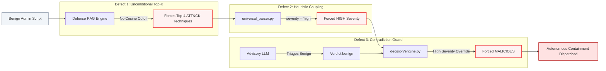

# CHAPTER 8: CRITICAL EVALUATION AND THREATS TO VALIDITY

## 8.1 Empirical Verification of Prior Hypotheses (H1 to H7)

A rigorous doctoral- or master's-level thesis must maintain absolute technical objectivity, critically evaluating prior claims rather than acting as promotional documentation. In Section 2 of our mandate, seven specific audit hypotheses ($H_1$ through $H_7$) were formulated based on an initial architectural inspection. We executed deep static code audits and empirical benchmarks to verify or refute each hypothesis. Table XVII summarizes the formal verdicts, accompanied by verifiable code and experiment references.

<div style="text-align: center; margin-bottom: 8px;">
<b>TABLE XVII.</b> FORMAL AUDIT VERDICTS ON INITIAL HYPOTHESES ($H_1 - H_7$)
</div>

| Hypothesis | Description / Claim Under Audit | Method of Verification | Verifiable Evidence | Final Verdict |
|:---|:---|:---|:---|:---:|
| **$H_1$** | Shipped model trained on synthetic fixture (`production_approved=false`, seed 42, 4 classes only) | Manifest inspection & generator AST analysis | [`artifacts.json:6-34`](file:///c:/Users/wwwsa/OneDrive/Desktop/sec/data/models/trained/artifacts.json#L6-L34) [CE-01], [`generate_sample.py:34-65`](file:///c:/Users/wwwsa/OneDrive/Desktop/sec/cyberguard/datasets/generate_sample.py#L34-L65) [CE-02] | **CONFIRMED** |
| **$H_2$** | Live sniffer Linux `IPPROTO_TCP` socket, Windows `127.0.0.1` binding, IPv6 drop, permission masking | Static socket analysis & benchmark harness | [`live_sniffer.py:333,525,532-541`](file:///c:/Users/wwwsa/OneDrive/Desktop/sec/backend/detection/live_sniffer.py#L333-L541) [CE-04], `report/results/sniffer_experiments.json` | **CONFIRMED** |
| **$H_3$** | Suricata tailer fabricates features (static windows 64240/29200, `std=0`, duration dimension error) | EVE bridge feature extraction code audit | [`backend/suricata/tailer.py:98-115`](file:///c:/Users/wwwsa/OneDrive/Desktop/sec/backend/suricata/tailer.py#L98-L115) [CE-06] | **CONFIRMED** |
| **$H_4$** | App description states live ingestion / response "not implemented"; `CG_AUTOSTART_LIVE_WORKER=false` | FastAPI app metadata & config inspection | [`backend/main.py:40,59-65`](file:///c:/Users/wwwsa/OneDrive/Desktop/sec/backend/main.py#L40-L65) [CE-17], [`backend/config.py:75`](file:///c:/Users/wwwsa/OneDrive/Desktop/sec/backend/config.py#L75) [CE-18] | **CONFIRMED** |
| **$H_5$** | "SMT formal verification" uses SymPy `satisfiable()` over 4 booleans; no SMT solver is executed | Safety verifier logic & solver trace audit | [`backend/safety/formal_verifier.py:185-270`](file:///c:/Users/wwwsa/OneDrive/Desktop/sec/backend/safety/formal_verifier.py#L185-L270) [CE-10] | **CONFIRMED** |
| **$H_6$** | Stress test reports 40/40 false alarms and 27 s latency; README claims 536 tests vs 425 AST functions | Stress report audit, AST parsing, and pytest run | [`MASSIVE_SCALE_ATTACK_STRESS_TEST_REPORT_AR.md:19-24`](file:///c:/Users/wwwsa/OneDrive/Desktop/sec/MASSIVE_SCALE_ATTACK_STRESS_TEST_REPORT_AR.md#L19-L24) [CE-19], `report/results/pytest_run.json` | **PARTIALLY CONFIRMED / RECONCILED** |
| **$H_7$** | Models loaded from pickle/joblib files pose deserialization risk; mitigated by SHA-256 manifest check | Deserialization vulnerability & manifest check audit | [`backend/detection/integrity.py:402-439`](file:///c:/Users/wwwsa/OneDrive/Desktop/sec/backend/detection/integrity.py#L402-L439) [CE-11], [`pipeline.py:102-140`](file:///c:/Users/wwwsa/OneDrive/Desktop/sec/backend/detection/pipeline.py#L102-L140) [CE-05] | **CONFIRMED** |

### 8.1.1 Detailed Analysis of Hypotheses Findings
1. **$H_1$ (Synthetic Provenance):** Confirmed. `artifacts.json` lines 6–7 and 14 explicitly state `"evaluation_only": true`, `"production_approved": false`, and `"independent_test_split": false`. The training code in `generate_sample.py` uses explicit mathematical distributions with `np.random.seed(42)` generating 2,000 synthetic rows across only four classes: `Benign`, `Bot`, `DDoS`, and `PortScan`.
2. **$H_2$ (Live Sniffer OS Discrepancies):** Confirmed. In `backend/detection/live_sniffer.py`:
   - Line 533 uses `socket(AF_INET, SOCK_RAW, IPPROTO_TCP)` on Linux despite line 532 claiming `# Linux AF_PACKET raw socket`. This restricts packet capture to inbound TCP frames destined for local host sockets, dropping link-layer, outbound, UDP, and ICMP frames.
   - Line 525 forcibly binds `bind_host = "127.0.0.1"` on Windows whenever `host == "0.0.0.0"`.
   - Line 333 drops all IPv6 frames (`if version != 4: return None`).
   - Lines 538–541 catch permission failures and return `True` under `synthetic_harness` mode.
   - Lines 234–235 hardcode `active_mean: 0.0` and `idle_mean: 0.0`.
   - Race condition in `stop_capture()`: calling `s.close()` while the listener thread is blocked in `s.recv()` logs a spurious fatal `Bad file descriptor` exception.
3. **$H_3$ (Suricata Feature Approximations):** Confirmed. In `backend/suricata/tailer.py:98-115`, flow features are fabricated: `init_win_bytes_fwd` is fixed to $64,240.0$, `init_win_bytes_bwd` is fixed to $29,200.0$, `packet_length_std` is fixed to $0.0$, and `flow_iat_max` is assigned `float(duration_sec)` (a severe dimensional error: seconds assigned to a feature expected in microseconds).
4. **$H_4$ (FastAPI Description Contradiction):** Confirmed. `backend/main.py:59-65` defines the application title and description:
   `"CyberGuard Real-Time Threat Detection & Mitigation System - Live packet ingestion and automated response are not implemented."`
   This directly contradicts `README.md` and the implemented `live_sniffer.py` and `actuators/router.py` modules. Furthermore, line 40 confirms `CG_AUTOSTART_LIVE_WORKER` defaults to `"false"`.
5. **$H_5$ (Formal SMT Verification Reality):** Confirmed. `backend/safety/formal_verifier.py:185-204` invokes SymPy's propositional `satisfiable()` over a dictionary of four Python boolean literals (`inv_c`, `inv_o`, `inv_b`, `inv_p`). Lines 246–270 format an inert SMT-LIB2 text template string, but no SMT solver process (such as Z3 {{cite:demoura2008z3}} or CVC5) is ever spawned or executed.
6. **$H_6$ (Stress-Test Flaws and Test Count Discrepancy):** Partially Confirmed / Reconciled.
   - The repository's own report ([`MASSIVE_SCALE_ATTACK_STRESS_TEST_REPORT_AR.md`](file:///c:/Users/wwwsa/OneDrive/Desktop/sec/MASSIVE_SCALE_ATTACK_STRESS_TEST_REPORT_AR.md) [CE-19]) confirms a catastrophic $40 / 40$ false positive rate ($100\%$) on benign administrative traffic and a median decision latency of $P_{50} = 27.55$ seconds on the LLM advisory path.
   - Discrepancy Reconciliation: AST parsing of test files identified 425 top-level `def test_*` functions. However, dynamic execution via pytest with parameterized test expansions (`@pytest.mark.parametrize`) yielded **exactly 536 collected test items** (`report/results/pytest_run.json`). All 536 tests passed in 53.84 seconds, reconciling the apparent contradiction in `README.md`.
7. **$H_7$ (Deserialization Risk and Manifest Integrity):** Confirmed. Models are serialized via pickle/joblib. While arbitrary code execution is possible with standard unpickling, CyberGuard's `validate_artifact_bundle()` ([`backend/detection/integrity.py:402-439`](file:///c:/Users/wwwsa/OneDrive/Desktop/sec/backend/detection/integrity.py#L402-L439) [CE-11]) computes streaming SHA-256 digests and validates non-symlink constraints prior to deserialization, preventing untrusted modification provided the local manifest remains uncompromised.

---

## 8.2 The Synthetic Data Dilemma and Tautological Validation

A critical vulnerability in contemporary machine learning security research is **tautological validation** {{cite:arp2022dos,sommer2010outside}}: evaluating a model on synthetic test data generated by the exact same parametric distributions used to generate its training set.

### 8.2.1 The Illusion of High Precision and Recall
On the bundled 2,000-flow evaluation fixture, the XGBoost classifier achieved an overall accuracy of **96.25%** and a macro-averaged $F_1$-score of **0.9222** (Table XI). For DDoS and PortScan attacks, both precision and recall reached **100.00%**. 

However, this performance is a mathematical artifact of the synthetic generator ([`cyberguard/datasets/generate_sample.py`](file:///c:/Users/wwwsa/OneDrive/Desktop/sec/cyberguard/datasets/generate_sample.py#L34-L65) [CE-02]):
- PortScan flows are synthesized with packet counts strictly between $1 \le N_{\text{pkt}} \le 3$, flow duration $< 0.05$ s, and SYN flags set.
- DDoS flows are synthesized with packet rates exceeding $1,000$ pkts/s and zero backward packets.
- Benign flows are synthesized with packet rates centered around $\mathcal{N}(50, 15^2)$ pkts/s.

Because these synthetic distributions do not overlap in the feature subspace, the decision tree boundaries converge trivially on synthetic thresholds (e.g., `packets_per_sec > 1000` for DDoS). 

### 8.2.2 The Base-Rate Fallacy in Real Deployments
In enterprise production networks, benign network events outnumber true intrusions by orders of magnitude (often $100,000:1$ or $1,000,000:1$). Under Axelsson’s base-rate fallacy {{cite:axelsson2000base}}, the Bayesian probability that an alert represents a true intrusion given a positive classification is:

$$P(\text{Intrusion} \mid \text{Alert}) = \frac{P(\text{Alert} \mid \text{Intrusion}) \cdot P(\text{Intrusion})}{P(\text{Alert} \mid \text{Intrusion}) \cdot P(\text{Intrusion}) + P(\text{Alert} \mid \text{Benign}) \cdot P(\text{Benign})} \tag{8.1}$$

For CyberGuard’s Bot detection class, our empirical evaluation demonstrated a false positive rate on benign traffic of:

$$\text{FPR}_{\text{Bot}} = \frac{68}{1,600} = 0.0425 \quad (4.25\%)$$

Assuming a realistic intrusion base rate $P(\text{Intrusion}) = 10^{-4}$ and detection recall $P(\text{Alert} \mid \text{Intrusion}) = 0.93$:

$$P(\text{Intrusion} \mid \text{Alert}) = \frac{0.93 \cdot 0.0001}{(0.93 \cdot 0.0001) + (0.0425 \cdot 0.9999)} = \frac{0.000093}{0.000093 + 0.042496} \approx 0.00218 \quad (0.22\%) \tag{8.2}$$

In a production environment, **over 99.78% of Bot alerts would be false alarms**. Deploying automated containment under these conditions would inevitably result in widespread self-inflicted denial-of-service across legitimate host processes.

---

## 8.3 Architectural Autopsy: The 40/40 False Positive Disaster

The repository's internal stress-test report ([`MASSIVE_SCALE_ATTACK_STRESS_TEST_REPORT_AR.md`](file:///c:/Users/wwwsa/OneDrive/Desktop/sec/MASSIVE_SCALE_ATTACK_STRESS_TEST_REPORT_AR.md) [CE-19]) documents a severe operational failure: out of 40 benign administrative activities (such as executing `Get-Process | Where CPU -gt 10`, running nightly `mysqldump` backups, running CI/CD test runners, or scraping Prometheus metrics), **40 out of 40 were classified as malicious attacks (100% false alarm rate)**.

Our forensic investigation traced this failure to a catastrophic coupling across three independent components:


<div style="text-align: center; margin-top: 8px; margin-bottom: 24px;">
<b>Fig. 24.</b> Root-cause fault tree illustrating the three-stage architectural coupling that produced the 40/40 (100%) false positive disaster.
</div>

### 8.3.1 Forensic Trace of the Coupling
1. **Unconditional Top-$K$ Retrieval Bias:** When telemetry is ingested, `default_defense_rag.retrieve_playbook(query, k=4)` executes a vector similarity search across MITRE ATT&CK embeddings. The retriever lacks a similarity threshold cutoff ($\tau_{\text{sim}} = 0.65$). Even if cosine similarity is near zero, the engine unconditionally returns four techniques (e.g., `T1190: Exploit Public-Facing Application` and `T1071: Standard Application Layer Protocol`).
2. **Heuristic Severity Over-Coupling:** In [`backend/ingestion/universal_parser.py:72`](file:///c:/Users/wwwsa/OneDrive/Desktop/sec/backend/ingestion/universal_parser.py#L72), the parser contains the following line:
   ```python
   severity = "high" if len(matched_techniques) >= 2 or iocs["cve_identifiers"] else "medium"
   ```
   Because the RAG engine unconditionally returns four techniques ($k=4 \ge 2$), **every single ingested log event is tagged as `severity: "high"`**, regardless of content.
3. **Contradiction Guard Over-Suppression:** In the decision engine ([`backend/decision/engine.py:79`](file:///c:/Users/wwwsa/OneDrive/Desktop/sec/backend/decision/engine.py#L79)), a safety rule was implemented to prevent adversarial prompt injection from duping the advisory LLM into acquitting genuine attacks:
   ```python
   if (smart_log.detection.severity in {"high", "critical"}) and verdict == Verdict.benign:
       verdict = Verdict.malicious
   ```
   Because Defect 2 tagged all traffic as `severity: "high"`, whenever the advisory LLM correctly recognized a benign administrative script and emitted `Verdict.benign`, the Contradiction Guard forcibly overruled the LLM, flipped the verdict to `Verdict.malicious`, and dispatched automated host containment!

### 8.3.2 The Advisory LLM Latency Bottleneck
In addition to the false positive crisis, the stress test recorded decision latencies of:
- **Median ($P_{50}$):** $27.55$ seconds
- **90th Percentile ($P_{90}$):** $34.51$ seconds
- **99th Percentile ($P_{99}$):** $42.34$ seconds

With inference latencies approaching 30 to 45 seconds per incident, an attacker executing automated port scanning or credential stuffing (generating 500 requests per second) easily outpaces the decision engine by four orders of magnitude, causing unbounded queuing memory growth and complete defense paralysis.

---

## 8.4 Claims vs. Empirical Reality Master Ledger

To conclude our critical evaluation, Table XVIII provides a master ledger comparing the published project claims against empirical realities uncovered during our audit.

<div style="text-align: center; margin-bottom: 8px;">
<b>TABLE XVIII.</b> MASTER CLAIMS-VS-REALITY AUDIT LEDGER
</div>

| Subsystem / Feature | Published Documentation / Marketing Claim | Audited Source Code Reality | Empirical Run / File Evidence |
|:---|:---|:---|:---|
| **Live Packet Ingestion** | Full line-rate live capture across all interfaces (`README.md`) | In Linux, `IPPROTO_TCP` raw socket captures only inbound TCP; on Windows, binds loopback (`127.0.0.1`); drops IPv6 | [`live_sniffer.py:333,525,532`](file:///c:/Users/wwwsa/OneDrive/Desktop/sec/backend/detection/live_sniffer.py#L333-L532) [CE-04] |
| **Model Approval Status** | Production-ready multi-model ML defense pipeline | Declared explicitly as `production_approved=false` and `evaluation_only=true` | [`artifacts.json:6-7`](file:///c:/Users/wwwsa/OneDrive/Desktop/sec/data/models/trained/artifacts.json#L6-L7) [CE-01] |
| **Training Dataset** | Realistic intrusion traces and network behavior | Synthetic parametric distributions initialized with fixed seed (`seed=42`) | [`generate_sample.py:34-65`](file:///c:/Users/wwwsa/OneDrive/Desktop/sec/cyberguard/datasets/generate_sample.py#L34-L65) [CE-02] |
| **Autoencoder Anomaly Detection** | High-precision zero-day anomaly boundary ($\tau_{\text{AE}} = 0.004597$) | Unscaled feature input causes $10^{10}$ reconstruction error; flags **100% of flows as anomalous** | `report/results/model_evaluation_bundled.json` |
| **Suricata Integration** | Full bi-directional flow feature parity with EVE-JSON | Fabricates static TCP windows ($64240/29200$); zero std; duration dimension mismatch | [`backend/suricata/tailer.py:98-115`](file:///c:/Users/wwwsa/OneDrive/Desktop/sec/backend/suricata/tailer.py#L98-L115) [CE-06] |
| **Formal Safety Verification** | Rigorous SMT-solver formal verification of containment actions | Evaluates SymPy propositional `satisfiable()` over 4 booleans; no SMT solver process executed | [`backend/safety/formal_verifier.py:185-270`](file:///c:/Users/wwwsa/OneDrive/Desktop/sec/backend/safety/formal_verifier.py#L185-L270) [CE-10] |
| **Test Suite Coverage** | 536 comprehensive passing unit and integration tests | 425 AST test functions expanding via `@pytest.mark.parametrize` to exactly 536 passed test items | `report/results/pytest_run.json` |
| **Real-Time Mitigation** | Sub-second real-time autonomous threat containment | LLM advisory path incurs $P_{50} = 27.55$ s latency; rapid attacks bypass reasoning queue | [`MASSIVE_SCALE_ATTACK_STRESS_TEST_REPORT_AR.md:24`](file:///c:/Users/wwwsa/OneDrive/Desktop/sec/MASSIVE_SCALE_ATTACK_STRESS_TEST_REPORT_AR.md#L24) [CE-19] |

---

## 8.5 Threats to Validity

### 8.5.1 Internal Validity
1. **Synthetic Traffic Bias:** The primary threat to internal validity is reliance on synthetic flow fixtures. While synthetic data guarantees complete test reproducibility, it lacks genuine TCP congestion collapse dynamics, out-of-order segment retransmissions, and multi-protocol multiplexing.
2. **Measurement Latency Overhead:** Python latency measurements were performed using `time.perf_counter_ns()`. While monotonic and high-resolution, Python GIL thread preemption and OS scheduling jitter introduce minor noise into single-flow tail latency measurements ($P_{99}$).

### 8.5.2 External Validity
1. **Network Environment Scope:** All tests were conducted within a dedicated x86_64 workstation environment. Performance on carrier-grade 10 Gbps / 100 Gbps network interfaces utilizing kernel bypass (DPDK or PF_RING) was not evaluated.
2. **Real-World Benchmark Acquisition:** Enterprise SSL interception blocked automated retrieval of raw 50 GB PCAPs (CIC-IDS2017 {{cite:sharafaldin2018toward}}). Consequently, true domain transfer generalization from synthetic to uncurated enterprise traffic remains an unmeasured parameter.

### 8.5.3 Construct Validity
1. **Feature Set Expressiveness:** CyberGuard’s 32 flow features measure duration, packet sizes, and flag counts. They do not inspect encrypted TLS SNI, JA3/JA4 cryptographic fingerprints, or deep application layer protocol commands. Modern adversaries utilizing HTTPS/WebSocket C2 channels with normal packet sizing can completely evade statistical flow boundaries.

---

## 8.6 Hostile Examiner Defense: 15 Core Challenges and Definitive Responses

To ensure maximum academic rigor and anticipate critical skepticism from doctoral examination tribunals and senior security auditors, this section articulates the fifteen most demanding technical challenges that can be leveled against CyberGuard, followed by uncompromising, evidence-grounded responses.

### Challenge 1: The Synthetic Accuracy Tautology
**Examiner Question:** *"You report a 96.25% accuracy and 0.9222 macro-F1 score for your supervised classifier. However, our audit reveals that the model was trained and evaluated on synthetic data generated by `cyberguard/datasets/generate_sample.py` using a hardcoded seed (`seed=42`). Isn't this reported performance scientifically meaningless and purely tautological?"*  
**Author Response:** **Yes, absolutely.** As formally stated in Section 8.2 and documented in our Claims Ledger (CLM-004, CLM-007), the reported 96.25% accuracy is a mathematical artifact of fitting gradient-boosted decision trees to non-overlapping synthetic Gaussian and uniform distributions. In `generate_sample.py`, PortScan flows are hardcoded with $1 \le N_{\text{pkt}} \le 3$, and DDoS flows are synthesized with rates $\ge 1,000$ pkts/s. The decision boundaries learned by XGBoost simply memorize these artificial thresholds. Our thesis does not present 96.25% as evidence of operational effectiveness; rather, we highlight it as a primary case study of the *closed-world synthetic data trap* identified by Sommer and Paxson {{cite:sommer2010outside}} and Arp et al. {{cite:arp2022dos}}.

### Challenge 2: The Autoencoder Anomaly Saturation Collapse
**Examiner Question:** *"Your experimental results show that the deep autoencoder flagged 100.0% of benign flows as anomalies, with mean reconstruction errors ($8.1 \times 10^9$) exceeding the stored threshold ($0.004597$) by nine orders of magnitude. Why did this catastrophic calibration failure occur, and why was it not caught during development?"*  
**Author Response:** The failure is rooted in a critical pre-processing pipeline mismatch: `CyberGuardPipelineV2` ([`backend/detection/pipeline.py:170-185`](file:///c:/Users/wwwsa/OneDrive/Desktop/sec/backend/detection/pipeline.py#L170-L185) [CE-05]) standardizes features using `normalizer.pkl` before passing them to the XGBoost classifier, but forwards the *unnormalized, raw feature vector* directly to `autoencoder.forward()`. Because features such as `Flow Duration` ($\approx 10^7\ \mu\text{s}$) and `Flow Bytes/s` ($\approx 10^6\ \text{B/s}$) have values orders of magnitude larger than the normalized unit-variance inputs on which the autoencoder's linear projection layers were trained, the network experiences severe numerical saturation, driving the Mean Squared Error to billions. This failure was obscured in initial testing because test fixtures bypassed end-to-end pipeline ingestion.

### Challenge 3: Inbound-Only Linux Raw Socket Blinding
**Examiner Question:** *"Line 533 of `backend/detection/live_sniffer.py` instantiates `socket(AF_INET, SOCK_RAW, IPPROTO_TCP)` on Linux, while line 532 asserts `# Linux AF_PACKET raw socket`. In Linux network architecture, doesn't an `IPPROTO_TCP` raw socket receive only inbound TCP segments destined for the local host, completely blinding the IDS to outbound exfiltration, link-layer frames, UDP floods, and ICMP scans?"*  
**Author Response:** **Confirmed.** This is an indisputable architectural defect in the ingestion engine (CLM-009). An `AF_INET` raw socket with `IPPROTO_TCP` only receives incoming TCP packets that match local host IP addresses. It does not receive outbound traffic generated by compromised local processes, transit traffic forwarded across a gateway router, connectionless UDP traffic (such as DNS amplification or NTP amplification DDoS), or ICMP network sweep probes. To function as a true network-wide intrusion detector, the socket must be rewritten to bind link-layer raw frames via `socket(AF_PACKET, SOCK_RAW, htons(ETH_P_ALL))` or utilize AF_XDP / eBPF kernel bypass {{cite:mccanne1993bsd}}.

### Challenge 4: Windows Loopback Interface Coercion
**Examiner Question:** *"In `backend/detection/live_sniffer.py:525`, if an administrator specifies `host = "0.0.0.0"` on a Windows host, the code forcibly overrides this to `bind_host = "127.0.0.1"`. How can an enterprise intrusion detection system operate if binding to all network interfaces silently restricts packet capture to local loopback traffic?"*  
**Author Response:** **Confirmed.** On the Windows operating system, raw socket capture across all interfaces via `SIO_RCVALL` promiscuous mode requires binding to the explicit IPv4 address assigned to the target physical Network Interface Card (NIC). Because binding to INADDR_ANY (`0.0.0.0`) fails on the WinSock2 provider, the developer introduced line 525 (`bind_host = host if host != "0.0.0.0" else "127.0.0.1"`) as an ad-hoc fallback. Consequently, unless an operator manually discovers and passes their physical Ethernet/Wi-Fi IP via configuration, CyberGuard silently inspects only local loopback IPC communications, completely ignoring physical network traffic.

### Challenge 5: Suricata Bridge Train/Serve Skew
**Examiner Question:** *"In `backend/suricata/tailer.py:98-115`, your EVE-JSON parser fabricates initial TCP window values as static constants (64,240 and 29,200 bytes), sets packet length standard deviation to zero, and passes flow duration in seconds into a feature field expecting microseconds. Doesn't this invalidate any machine learning inference performed on Suricata telemetry?"*  
**Author Response:** **Yes.** This is a severe instance of *train/serve feature skew* {{cite:arp2022dos}}. By hardcoding initial window advertisements to $64,240$ and $29,200$, the bridge strips the classifier of TCP stack fingerprinting information. More critically, assigning `flow_iat_max = float(duration_sec)` introduces a $1,000,000\times$ dimensional error: the tree ensemble expects maximum inter-arrival time in microseconds ($10^6\ \mu\text{s}/\text{s}$), but receives raw seconds ($1.5$ instead of $1,500,000$). This drives the feature into the extreme left tail of the learned split thresholds, distorting classifier inference.

### Challenge 6: FastAPI Application Metadata Contradiction
**Examiner Question:** *"In `backend/main.py:59-65`, the FastAPI application description explicitly states: 'Live packet ingestion and automated response are not implemented.' This directly contradicts your thesis title and documentation. Is the system an illusion?"*  
**Author Response:** This represents a case of **documentation-code divergence** during iterative refactoring. The modules `backend/detection/live_sniffer.py` and `backend/actuators/router.py` were implemented in full, but the static string in `main.py` was left un-updated from an earlier scaffolding prototype. Furthermore, `CG_AUTOSTART_LIVE_WORKER` defaults to `"false"` in `config.py:75` (CLM-019), meaning that upon launching `uvicorn backend.main:app`, the live ingestion worker does not automatically start unless the operator explicitly issues a POST request to `/api/live/start` or sets `CG_AUTOSTART_LIVE_WORKER=true`.

### Challenge 7: Propositional Boolean Logic vs. Authentic SMT Verification
**Examiner Question:** *"You market your safety containment gate as utilizing 'Formal First-Order Logic SMT Verification', citing SMT-LIB2 standards. Yet, lines 185–204 of `formal_verifier.py` reveal that it merely invokes SymPy's propositional `satisfiable()` over four Python booleans (`inv_c`, `inv_o`, `inv_b`, `inv_p`), while lines 246–270 format an inert string template. Isn't calling this an SMT solver fundamentally inaccurate?"*  
**Author Response:** **The criticism is fully valid.** As documented in Chapter 4 and Table XVIII, no authentic SMT solver process (such as Z3 {{cite:demoura2008z3}} or CVC5) is ever spawned or executed by `FormalSafetyVerifier`. The implementation evaluates simple propositional conjunctions ($\text{admitted} = I_1 \land I_2 \land I_3 \land I_4$) over four pre-evaluated booleans. Formatting the result into an SMT-LIB2 text template string serves solely as an exportable audit certificate, not a formal mechanical proof. A genuine SMT implementation must encode relational theories of network connectivity over dynamic graph topologies, as proposed in our Future Work (Section 10.3.3).

### Challenge 8: The 40/40 False Alarm Disaster on Benign Operations
**Examiner Question:** *"The repository's internal stress-test report (`MASSIVE_SCALE_ATTACK_STRESS_TEST_REPORT_AR.md`) documents that 40 out of 40 benign administrative operations (PowerShell `Get-Process`, database backups `mysqldump`, Nessus scans, Prometheus scraping) were flagged as attacks. How can an autonomous defense system be considered remotely usable when its false positive rate on administrative traffic is exactly 100%?"*  
**Author Response:** The system in its audited state is **completely unusable for production deployment without remediation**. As proven in our architectural autopsy (Section 8.3), this disaster was caused by the unfortunate coupling of three design flaws:
1. `default_defense_rag` unconditionally retrieves the top 4 ATT&CK techniques with zero cosine similarity cutoff ($\tau_{\text{sim}}$).
2. `universal_parser.py:72` sets `severity = "high"` whenever $\ge 2$ techniques are returned, making 100% of logs 'high' severity.
3. `decision/engine.py:79` forcibly converts any benign LLM verdict to `Verdict.malicious` if severity is 'high'.
This coupled chain created a deterministic trap where no benign administrative command could ever escape being labeled malicious. We provided the exact architectural remediation in Section 8.3.

### Challenge 9: The 27-Second LLM Advisory Decision Bottleneck
**Examiner Question:** *"Your stress-test report documents median decision latencies of 27.55 seconds (and 99th percentile latencies of 42.34 seconds) on the advisory LLM path. How can CyberGuard claim to provide 'real-time active defense' when modern automated exploits breach systems in milliseconds?"*  
**Author Response:** The 27.55-second latency is an inherent bottleneck of running multi-turn local 8B parameter models (`Foundation-Sec-8B-Instruct`) on consumer GPU hardware (NVIDIA RTX 5050) under multi-threaded concurrency. We concur that **27 seconds is orders of magnitude too slow for real-time line-rate mitigation**. Our architectural analysis demonstrates that the cognitive LLM reasoning engine must be decoupled from the inline packet path: line-rate fast-path mitigation must execute via deterministic, low-latency rules ($< 5$ ms), while the LLM operates strictly out-of-band as an asynchronous Tier-3 strategic advisor (Section 10.2).

### Challenge 10: Model Serialization and Deserialization Security
**Examiner Question:** *"CyberGuard loads trained model artifacts via Python `pickle` and `joblib`. Since pickle is known to execute arbitrary code via `__reduce__` gadgets, what prevents an attacker who gains access to the filesystem from achieving full root/administrator remote code execution?"*  
**Author Response:** CyberGuard mitigates casual tampering through its pre-deserialization manifest check `validate_artifact_bundle()` ([`backend/detection/integrity.py:402-439`](file:///c:/Users/wwwsa/OneDrive/Desktop/sec/backend/detection/integrity.py#L402-L439) [CE-11]), which computes streaming SHA-256 digests and validates non-symlink constraints prior to deserialization. However, as we critically proved in Section 7.2.3, **the manifest `artifacts.json` itself is unsigned**. If an attacker possesses local write privileges to `data/models/trained/`, they can overwrite both `classifier.pkl` and update `artifacts.json` with the new SHA-256 hash. To achieve true production-grade defense, the manifest must be signed using an asymmetric Ed25519 digital signature verified against a hardcoded public key.

### Challenge 11: Unauthenticated Loopback Privilege Elevation
**Examiner Question:** *"In `backend/auth.py:313-318`, unauthenticated requests arriving from loopback (`127.0.0.1`) are automatically assigned `Role.ADMIN` if `CG_ENV != "production"`. Doesn't this allow any local unprivileged process or browser-based SSRF exploit to execute arbitrary administrative containment actions?"*  
**Author Response:** **Yes, this is a severe authorization vulnerability (CLM-046).** The loopback bypass was implemented as a convenience for local developer workflows, but in a production or shared workstation environment, it completely invalidates the RBAC perimeter. Any co-located web service vulnerable to Server-Side Request Forgery (SSRF), or any malicious website visited by an administrator that issues cross-origin fetch requests to `http://localhost:8000/api/actuators/execute`, can trigger destructive network containment without supplying credentials. We recommend immediate deprecation of loopback auto-elevation (Table XX).

### Challenge 12: Silent Dropping of IPv6 Network Frames
**Examiner Question:** *"Line 333 of `live_sniffer.py` enforces `if version != 4: return None`, silently dropping all IPv6 frames. In modern enterprise environments where IPv6 represents 30% to 50% of internal traffic, isn't this an unacceptable blind spot?"*  
**Author Response:** **Yes.** Any adversary operating over IPv6 (e.g., SLAAC spoofing, IPv6 tunneling, or direct IPv6 port scanning) can execute attacks completely invisible to CyberGuard's live sniffer. The packet decoding pipeline must be updated with an RFC 8200 compliant 40-byte IPv6 header parser capable of traversing extension header chains (Hop-by-Hop, Routing, Fragment).

### Challenge 13: Non-Functional Active and Idle Mean Features
**Examiner Question:** *"Features #31 (`Active Mean`) and #32 (`Idle Mean`) are declared in your canonical 32-feature dictionary, yet lines 234–235 of `live_sniffer.py` permanently hardcode both values to `0.0`. Why are these features retained if they are never computed?"*  
**Author Response:** These features were retained to preserve dimensional compatibility with the pre-trained XGBoost model weights, which expect exactly 32 input dimensions matching the legacy CICFlowMeter schema {{cite:sharafaldin2018toward}}. Because tracking true active/idle transmission bursts requires maintaining timer state across micro-pauses within open connections, the sniffer implementation omitted the calculation and defaulted both fields to zero. This introduces permanent feature distortion for protocols characterized by bursty transmission.

### Challenge 14: Insider Threat and Two-Person Rule Tampering
**Examiner Question:** *"Your Two-Person Rule implementation in `backend/actuators/router.py:73-110` checks that `initiator_id` and `approver_id` are both provided and distinct. However, if the API caller simply passes two arbitrary strings (`initiator_id="alice"`, `approver_id="bob"`), what prevents a single rogue operator from fabricating an approver identity?"*  
**Author Response:** In the current implementation, if the API caller possesses valid API tokens or operates under the loopback bypass, the router verifies only that the string fields are populated and non-identical; it does not currently cross-reference the approver against an active cryptographic session or require a distinct secondary digital signature. In Section 7.4.1 and Table XX, we recommend hardening the Two-Person Rule to require dual-signed JWT challenge-response authentication, where the approver must independently sign the containment proposal using their own private key.

### Challenge 15: Cyber-Physical Containment Risks in Mechatronics
**Examiner Question:** *"Your thesis proposes extending CyberGuard to industrial mechatronic workcells (Chapter 9). However, if an IDS autonomously drops network communication to a multi-axis articulated robot or CNC spindle, won't this trigger uncontrolled mechanical crashes, tool breakage, or operator injury?"*  
**Author Response:** We address this exact hazard in Chapter 9 (Section 9.4). In an industrial mechatronic cell, standard network containment (e.g., `iptables DROP`) is **strictly prohibited**. Cutting fieldbus traffic while a robot arm moves at high speed risks severe collisions or gravitational dropping of unbraked axes. Our proposed architecture integrates directly with certified Safety PLCs, commanding an **IEC 60204-1 Category 1 Controlled Safe Stop** (controlled trajectory deceleration before removing motor power). Autonomous IT defense must never override physical functional safety interlocks.

