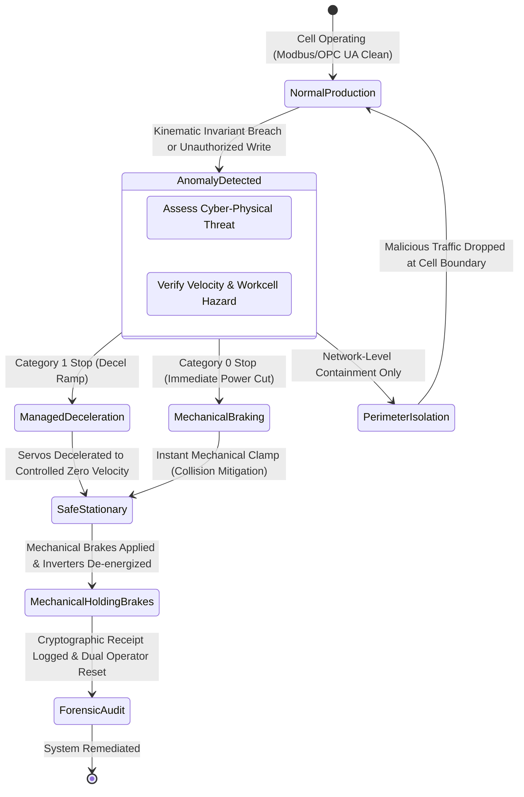

# CHAPTER 9: MECHATRONICS PERSPECTIVE: PROTECTING INDUSTRIAL ROBOTICS AND OT NETWORKS

> [!NOTE]
> **Architectural Status Disclaimer:** The frameworks, protocol extensions, and containment interlocks detailed in this chapter represent a **proposed theoretical adaptation and hardening roadmap** engineered specifically for industrial automation and robotic control environments. They are not part of the baseline CyberGuard IT implementation audited in Chapters 4–8. All designs are formally grounded in international cyber-physical security standards (IEC 62443 {{cite:iec62443standard}}, NIST SP 800-82 {{cite:stouffer2015nist80082}}, ISO 13849-1).

---

## 9.1 Cyber-Physical Systems and the Mechatronics Threat Landscape

Modern mechatronic systems—such as 6-DOF articulated industrial robot arms, automated guided vehicles (AGVs), multi-axis CNC milling centers, and distributed manufacturing workcells—are no longer isolated electromechanical islands {{cite:stouffer2015nist80082}}. The integration of Industry 4.0 paradigms, Industrial Internet of Things (IIoT) sensors, and remote diagnostic telemetry has interconnected Operational Technology (OT) fieldbuses with enterprise IT networks and cloud telemetry brokers {{cite:alcaraz2012scada,iec62443standard}}.

### 9.1.1 The Inverted Security Triad
In enterprise IT networks, the classical security triad prioritizes **Confidentiality**, followed by **Integrity**, with **Availability** third ($C \to I \to A$). In mechatronic and industrial control systems (ICS), this hierarchy is strictly inverted {{cite:stouffer2015nist80082,cardenas2011attacks}}:

$$\text{Mechatronics Priority:} \quad \mathbf{\text{Safety \& Availability}} \gg \mathbf{\text{Integrity}} \gg \mathbf{\text{Confidentiality}} \tag{9.1}$$

Table XIX contrasts enterprise IT networks against mechatronic OT networks across key operational dimensions.

<div style="text-align: center; margin-bottom: 8px;">
<b>TABLE XIX.</b> COMPARATIVE MATRIX: ENTERPRISE IT NETWORKS VS. MECHATRONIC OT FIELD NETWORKS
</div>

| Parameter / Dimension | Enterprise IT Environment (CyberGuard Baseline) | Mechatronic & Industrial OT Workcell (Proposed Adaptation) |
|:---|:---|:---|
| **Primary Objective** | Data security, privacy, and transactional throughput | Physical human safety, deterministic real-time control, zero downtime |
| **Acceptable Cycle Jitter** | Hundreds of milliseconds ($100-500$ ms tolerated) | Strict microsecond-to-millisecond determinism ($\Delta t \le 1-10$ ms) |
| **Typical Protocols** | HTTP/1.1, HTTP/2, HTTPS, DNS, SSH, WebSockets | Modbus TCP, OPC UA, PROFINET RT/IRT, EtherCAT, CIP |
| **Communication Pattern** | Bursty, non-periodic, highly non-stationary | Highly regular, cyclical, deterministic polling frequencies |
| **Protocol Security** | Pervasive cryptographic TLS 1.3, OAuth 2.0, JWT | Legacy cleartext (Modbus has zero encryption or authentication) |
| **Containment Consequence** | Terminated process or dropped HTTP connection | Machine crash, kinematic singularity, tooling break, human injury |
| **Standard References** | NIST SP 800-61 {{cite:cichonski2012incident}}, OWASP Top-10 {{cite:owasp2023top10llm}} | IEC 62443-4-2 {{cite:iec62443standard}}, NIST SP 800-82 {{cite:stouffer2015nist80082}}, ISO 13849-1 |

### 9.1.2 Adversarial Attack Vectors Against Industrial Robots
An adversary penetrating the field network of an industrial robotics cell targets the physical dynamics of the machinery {{cite:krotofil2013industrial,genge2012cyber}}:
1. **Kinematic Boundary Override:** Modifying trajectory setpoints in PLC memory registers (e.g., target joint positions $\theta_i$ or angular velocities $\dot{\theta}_i$) to force a robotic manipulator outside its authorized safety enclosure into human-occupied workstations.
2. **Dynamic Jerk and Resonance Attacks:** Injecting high-frequency alternating command oscillations designed to excite the natural mechanical resonant frequencies ($\omega_n$) of gearboxes and harmonic drives, inducing premature structural fatigue and mechanical failure without triggering simple threshold alarms {{cite:cardenas2011attacks}}.
3. **Sensor Spoofing and Feedback Manipulation:** Intercepting optical encoder feedback or force/torque sensor telemetry via Man-in-the-Middle (MitM) ARP spoofing, misleading closed-loop PID controllers into applying excessive motor torque.
4. **Denial-of-Control (DoC) Flooding:** Flooding the real-time Ethernet interface (e.g., PROFINET or Modbus TCP port 502) with malformed frames, causing the real-time communications coprocessor to miss heartbeat deadlines and triggering uncoordinated emergency halts (E-Stops) that damage delicate in-process workpieces {{cite:stouffer2015nist80082,krotofil2013industrial}}.

---

## 9.2 Limitations of Standard IT-NIDS in Industrial Workcells

Deploying an IT-oriented intrusion detection system like baseline CyberGuard directly onto an industrial mechatronics bus introduces severe operational risks:

1. **Uncalibrated Feature Extraction:** CyberGuard’s 32 flow features measure duration, byte ratios, and TCP flags designed for web and DNS traffic. In an industrial cell running Modbus TCP or PROFINET, packet lengths are static (e.g., exactly 64 bytes for cyclical polling) and inter-arrival times are rigidly fixed to the PLC scan cycle (e.g., $\Delta t_{\text{scan}} = 10.0$ ms). As proven in Chapter 6, baseline CyberGuard's autoencoder and statistical detector flag 100% of non-standard flows as anomalous, which would cause permanent alert saturation in an OT environment.
2. **Blindness to Semantic Payload Attacks:** An attacker modifying a Modbus register from `0x0000` (safe speed) to `0xFFFF` (maximum dangerous speed) generates a packet that is syntactically flawless from a TCP/IP perspective. A flow-based detector inspecting only header flags and durations is completely blind to this catastrophic payload alteration {{cite:hadziosmanovic2014nids}}.
3. **Catastrophic Unilateral Containment:** In baseline CyberGuard, the `ActuatorRouter` issues host-level commands (`New-NetFirewallRule` or `iptables DROP`). In an industrial workcell, abruptly severing network communication to a multi-axis servo drive while in motion can cause gravitational collapse of heavy vertical axes or uncoordinated collisions with transfer presses. Containment must strictly interface with functional safety systems {{cite:iec62443standard,stouffer2015nist80082}}.

---

## 9.3 Proposed Real-Time Mechatronic IDS (RT-M-IDS) Architecture [PROPOSED DESIGN - NOT IMPLEMENTED]

To bridge the gap between IT intrusion detection and cyber-physical safety, we propose an architectural extension: the **Real-Time Mechatronic Intrusion Detection System (RT-M-IDS)**. (*Note: The RT-M-IDS and all its constituent sub-modules described in this section represent a proposed conceptual roadmap and are NOT IMPLEMENTED in the CyberGuard codebase.*)

<div id="fig25-container" class="figure-container" style="width: 100%; max-width: 760px; margin: 16px auto; font-family: -apple-system, BlinkMacSystemFont, 'Segoe UI', Roboto, Helvetica, Arial, sans-serif;">
<svg viewBox="0 0 760 450" width="100%" height="auto" xmlns="http://www.w3.org/2000/svg" style="background: #ffffff; border: 1px solid #cbd5e1; border-radius: 8px; box-shadow: 0 2px 4px rgba(0,0,0,0.04);">
  <defs>
    <linearGradient id="headerGrad25" x1="0%" y1="0%" x2="100%" y2="0%">
      <stop offset="0%" stop-color="#0f172a" />
      <stop offset="100%" stop-color="#0369a1" />
    </linearGradient>
    <marker id="arr25Blue" markerWidth="8" markerHeight="8" refX="7" refY="4" orient="auto">
      <path d="M0,1 L7,4 L0,7 Z" fill="#0284c7" />
    </marker>
    <marker id="arr25Green" markerWidth="8" markerHeight="8" refX="7" refY="4" orient="auto">
      <path d="M0,1 L7,4 L0,7 Z" fill="#16a34a" />
    </marker>
    <marker id="arr25Red" markerWidth="8" markerHeight="8" refX="7" refY="4" orient="auto">
      <path d="M0,1 L7,4 L0,7 Z" fill="#dc2626" />
    </marker>
    <marker id="arr25Purple" markerWidth="8" markerHeight="8" refX="7" refY="4" orient="auto">
      <path d="M0,1 L7,4 L0,7 Z" fill="#7c3aed" />
    </marker>
  </defs>

  <!-- Banner Header -->
  <rect x="0" y="0" width="760" height="34" rx="8" fill="url(#headerGrad25)" />
  <rect x="0" y="24" width="760" height="10" fill="url(#headerGrad25)" />
  <text x="380" y="22" text-anchor="middle" font-size="11.5" font-weight="700" fill="#ffffff" letter-spacing="0.5">
    PROPOSED REAL-TIME MECHATRONIC IDS (RT-M-IDS) ARCHITECTURE [PROPOSED CONCEPT - NOT IMPLEMENTED]
  </text>

  <!-- Zone Left: Physical Cell (Level 0 / 1) -->
  <rect x="15" y="46" width="250" height="390" rx="6" fill="#f8fafc" stroke="#64748b" stroke-width="1.2" />
  <rect x="25" y="54" width="230" height="20" rx="3" fill="#e2e8f0" />
  <text x="140" y="68" text-anchor="middle" font-size="10" font-weight="700" fill="#1e293b">MECHATRONIC CELL (LEVEL 0 / 1)</text>

  <!-- Node A1: Robot Arm -->
  <g transform="translate(30, 84)">
    <rect width="220" height="56" rx="4" fill="#ffffff" stroke="#475569" stroke-width="1.2" />
    <text x="110" y="20" text-anchor="middle" font-size="10.5" font-weight="700" fill="#0f172a">6-DOF Articulated Robot</text>
    <text x="110" y="34" text-anchor="middle" font-size="8.5" fill="#475569">Joint positions, TCP velocity, torque</text>
    <text x="110" y="46" text-anchor="middle" font-size="7.5" fill="#0284c7">ISO 10218-1 Industrial Robot</text>
  </g>

  <!-- Bidirectional arrow A1 <-> A2 -->
  <path d="M140, 140 L140, 160" stroke="#64748b" stroke-width="1.5" stroke-dasharray="2,2" />

  <!-- Node A2: Servo Drives -->
  <g transform="translate(30, 162)">
    <rect width="220" height="52" rx="4" fill="#ffffff" stroke="#475569" stroke-width="1.2" />
    <text x="110" y="18" text-anchor="middle" font-size="10" font-weight="700" fill="#0f172a">Servo Drives &amp; Inverters</text>
    <text x="110" y="32" text-anchor="middle" font-size="8.5" fill="#475569">PWM inverter, resolver feedback</text>
    <text x="110" y="44" text-anchor="middle" font-size="7.5" fill="#64748b">Fieldbus: EtherCAT / PROFINET IRT</text>
  </g>

  <!-- Bidirectional arrow A2 <-> A3 -->
  <path d="M140, 214 L140, 234" stroke="#64748b" stroke-width="1.5" stroke-dasharray="2,2" />

  <!-- Node A3: Safety PLC -->
  <g transform="translate(30, 236)">
    <rect width="220" height="56" rx="4" fill="#fef2f2" stroke="#dc2626" stroke-width="1.5" />
    <text x="110" y="18" text-anchor="middle" font-size="10" font-weight="700" fill="#991b1b">Safety PLC (ISO 13849 PLe)</text>
    <text x="110" y="32" text-anchor="middle" font-size="8.5" font-weight="600" fill="#b91c1c">Dual-Channel SIL 3 Safety Logic</text>
    <text x="110" y="46" text-anchor="middle" font-size="7.5" fill="#475569">FSoE / PROFIsafe Interlock</text>
  </g>

  <!-- Bidirectional arrow A3 <-> A4 -->
  <path d="M140, 292 L140, 312" stroke="#64748b" stroke-width="1.5" stroke-dasharray="2,2" />

  <!-- Node A4: Managed Switch -->
  <g transform="translate(30, 314)">
    <rect width="220" height="56" rx="4" fill="#ffffff" stroke="#0284c7" stroke-width="1.5" />
    <text x="110" y="18" text-anchor="middle" font-size="10" font-weight="700" fill="#0369a1">Industrial Managed Switch</text>
    <text x="110" y="32" text-anchor="middle" font-size="8.5" fill="#475569">TAP / Mirror Port (Promiscuous)</text>
    <text x="110" y="46" text-anchor="middle" font-size="7.5" font-family="monospace" fill="#0284c7">Modbus TCP :502 | OPC UA :4840</text>
  </g>

  <!-- Zone Right: Proposed RT-M-IDS Appliance -->
  <rect x="280" y="46" width="465" height="390" rx="6" fill="#f0fdf4" stroke="#16a34a" stroke-width="1.2" />
  <rect x="290" y="54" width="445" height="20" rx="3" fill="#dcfce7" />
  <text x="512" y="68" text-anchor="middle" font-size="10" font-weight="700" fill="#14532d">PROPOSED RT-M-IDS EDGE APPLIANCE [NOT IMPLEMENTED]</text>

  <!-- Sub-block 1: OT Protocol Ingestion -->
  <rect x="292" y="80" width="441" height="74" rx="5" fill="#ffffff" stroke="#86efac" stroke-width="1" />
  <text x="302" y="94" font-size="9" font-weight="700" fill="#15803d">1. ZERO-LATENCY OT INGESTION LAYER</text>

  <!-- TAP Box -->
  <g transform="translate(302, 100)">
    <rect width="130" height="46" rx="3" fill="#f5f3ff" stroke="#7c3aed" stroke-width="1.2" />
    <text x="65" y="16" text-anchor="middle" font-size="9" font-weight="700" fill="#6d28d9">Passive Optical TAP</text>
    <text x="65" y="28" text-anchor="middle" font-size="7.5" fill="#7c3aed">Listen-only mode</text>
    <text x="65" y="38" text-anchor="middle" font-size="7" font-weight="600" fill="#dc2626">TX Fiber physically cut</text>
  </g>

  <!-- Modbus Parser Box -->
  <g transform="translate(446, 100)">
    <rect width="135" height="46" rx="3" fill="#f8fafc" stroke="#64748b" stroke-width="1" />
    <text x="67" y="16" text-anchor="middle" font-size="9" font-weight="700" fill="#0f172a">Modbus TCP Parser</text>
    <text x="67" y="28" text-anchor="middle" font-size="7.5" font-family="monospace" fill="#0284c7">Port 502 MBAP Parser</text>
    <text x="67" y="38" text-anchor="middle" font-size="7" fill="#475569">Func 0x03, 0x05, 0x10</text>
  </g>

  <!-- OPC UA Parser Box -->
  <g transform="translate(592, 100)">
    <rect width="131" height="46" rx="3" fill="#f8fafc" stroke="#64748b" stroke-width="1" />
    <text x="65" y="16" text-anchor="middle" font-size="9" font-weight="700" fill="#0f172a">OPC UA Binary Parser</text>
    <text x="65" y="28" text-anchor="middle" font-size="7.5" font-family="monospace" fill="#0284c7">Port 4840 opc.tcp://</text>
    <text x="65" y="38" text-anchor="middle" font-size="7" fill="#475569">WriteRequest monitoring</text>
  </g>

  <path d="M432, 123 L444, 123" stroke="#7c3aed" stroke-width="1.5" marker-end="url(#arr25Purple)" />
  <path d="M581, 123 L590, 123" stroke="#64748b" stroke-width="1" />

  <!-- Sub-block 2: Detection Engines -->
  <rect x="292" y="162" width="441" height="110" rx="5" fill="#ffffff" stroke="#86efac" stroke-width="1" />
  <text x="302" y="176" font-size="9" font-weight="700" fill="#15803d">2. DUAL-STAGE CYBER-PHYSICAL DETECTION ENGINES</text>

  <!-- Engine 1 -->
  <g transform="translate(302, 182)">
    <rect width="135" height="80" rx="3" fill="#eff6ff" stroke="#3b82f6" stroke-width="1.2" />
    <text x="67" y="18" text-anchor="middle" font-size="9" font-weight="700" fill="#1e3a8a">Deterministic Timing</text>
    <text x="67" y="32" text-anchor="middle" font-size="8" fill="#1e40af">Cyclical Jitter Detector</text>
    <line x1="10" y1="40" x2="125" y2="40" stroke="#bfdbfe" stroke-width="1" />
    <text x="67" y="52" text-anchor="middle" font-size="7.5" fill="#475569">Period: T_cycle = 4.0 ms</text>
    <text x="67" y="64" text-anchor="middle" font-size="7.5" fill="#475569">Detects timing drift / injection</text>
    <text x="67" y="74" text-anchor="middle" font-size="7" font-weight="600" fill="#dc2626">Delta-t &gt; 2.5 sigma alert</text>
  </g>

  <!-- Engine 2 -->
  <g transform="translate(446, 182)">
    <rect width="135" height="80" rx="3" fill="#eff6ff" stroke="#3b82f6" stroke-width="1.2" />
    <text x="67" y="18" text-anchor="middle" font-size="9" font-weight="700" fill="#1e3a8a">State-Space AE</text>
    <text x="67" y="32" text-anchor="middle" font-size="8" fill="#1e40af">Kinematic Model</text>
    <line x1="10" y1="40" x2="125" y2="40" stroke="#bfdbfe" stroke-width="1" />
    <text x="67" y="52" text-anchor="middle" font-size="7.5" fill="#475569">Joint torque &amp; velocity</text>
    <text x="67" y="64" text-anchor="middle" font-size="7.5" fill="#475569">Newton-Euler dynamics</text>
    <text x="67" y="74" text-anchor="middle" font-size="7" font-weight="600" fill="#dc2626">Physics anomaly cutoff</text>
  </g>

  <!-- Engine 3 -->
  <g transform="translate(592, 182)">
    <rect width="131" height="80" rx="3" fill="#eff6ff" stroke="#3b82f6" stroke-width="1.2" />
    <text x="65" y="18" text-anchor="middle" font-size="9" font-weight="700" fill="#1e3a8a">IEC 62443 Whitelist</text>
    <text x="65" y="32" text-anchor="middle" font-size="8" fill="#1e40af">Protocol Conformance</text>
    <line x1="10" y1="40" x2="121" y2="40" stroke="#bfdbfe" stroke-width="1" />
    <text x="65" y="52" text-anchor="middle" font-size="7.5" fill="#475569">Permitted function codes</text>
    <text x="65" y="64" text-anchor="middle" font-size="7.5" fill="#475569">Allowed register ranges</text>
    <text x="65" y="74" text-anchor="middle" font-size="7" font-weight="600" fill="#dc2626">Rejects unauthorized writes</text>
  </g>

  <!-- Sub-block 3: Containment Gate -->
  <rect x="292" y="280" width="441" height="146" rx="5" fill="#fef2f2" stroke="#fca5a5" stroke-width="1" />
  <text x="302" y="296" font-size="9" font-weight="700" fill="#991b1b">3. FUNCTIONAL SAFETY CONTAINMENT INTERLOCK (IEC 60204-1)</text>

  <!-- Functional Safety Gate -->
  <g transform="translate(302, 304)">
    <rect width="200" height="112" rx="4" fill="#ffffff" stroke="#ef4444" stroke-width="1.5" />
    <text x="100" y="20" text-anchor="middle" font-size="10" font-weight="700" fill="#991b1b">Functional Safety Gate</text>
    <text x="100" y="34" text-anchor="middle" font-size="8.5" fill="#b91c1c">IEC 60204-1 Safe Motion Interlock</text>
    <line x1="10" y1="42" x2="190" y2="42" stroke="#fecaca" stroke-width="1" />
    <text x="12" y="56" font-size="8" font-weight="600" fill="#7f1d1d">• Prohibits Instant IT Drop:</text>
    <text x="18" y="68" font-size="7.5" fill="#475569">No abrupt kill during high-speed move</text>
    <text x="12" y="84" font-size="8" font-weight="600" fill="#7f1d1d">• Interlock Dispatch:</text>
    <text x="18" y="96" font-size="7.5" fill="#15803d">Dispatches Category 1 controlled stop</text>
  </g>

  <!-- Actions -->
  <g transform="translate(515, 304)">
    <!-- Cat 1/2 Stop -->
    <rect width="208" height="52" rx="3" fill="#ffffff" stroke="#dc2626" stroke-width="1.2" />
    <text x="104" y="18" text-anchor="middle" font-size="9.5" font-weight="700" fill="#991b1b">Controlled Category 1/2 Stop</text>
    <text x="104" y="32" text-anchor="middle" font-size="8" fill="#475569">Maintains drive power to decelerate</text>
    <text x="104" y="44" text-anchor="middle" font-size="7.5" fill="#dc2626">Zero kinetic crash on robot tooling</text>

    <!-- Perimeter FW -->
    <rect y="60" width="208" height="52" rx="3" fill="#ffffff" stroke="#0284c7" stroke-width="1.2" />
    <text x="104" y="78" text-anchor="middle" font-size="9.5" font-weight="700" fill="#0369a1">OT Perimeter Isolation</text>
    <text x="104" y="92" text-anchor="middle" font-size="8" fill="#475569">Isolates IT/OT boundary firewall</text>
    <text x="104" y="104" text-anchor="middle" font-size="7.5" fill="#15803d">Fieldbus communication intact</text>
  </g>

  <!-- Connection: Managed Switch -> TAP (Purple dashed) -->
  <path d="M250, 342 L270, 342 L270, 123 L300, 123" fill="none" stroke="#7c3aed" stroke-width="2" stroke-dasharray="4,3" marker-end="url(#arr25Purple)" />
  <rect x="252" y="215" width="36" height="30" rx="3" fill="#ffffff" stroke="#7c3aed" stroke-width="1" />
  <text x="270" y="228" text-anchor="middle" font-size="7" font-weight="700" fill="#7c3aed">Optical</text>
  <text x="270" y="238" text-anchor="middle" font-size="7" font-weight="700" fill="#7c3aed">SPAN</text>

  <!-- Connection: Safety Gate -> Safety PLC (Red feedback) -->
  <path d="M302, 360 L280, 360 L280, 264 L252, 264" fill="none" stroke="#dc2626" stroke-width="2" marker-end="url(#arr25Red)" />
  <rect x="254" y="285" width="46" height="28" rx="3" fill="#ffffff" stroke="#dc2626" stroke-width="1" />
  <text x="277" y="297" text-anchor="middle" font-size="7" font-weight="700" fill="#b91c1c">FSoE / Dry</text>
  <text x="277" y="307" text-anchor="middle" font-size="7" font-weight="700" fill="#b91c1c">Contact</text>
</svg>
</div>
<div class="figure-caption"><strong>Fig. 25.</strong> Proposed Real-Time Mechatronic IDS (RT-M-IDS) architecture incorporating passive optical network taps, deep OT protocol parsing, kinematic state-space anomaly detection, and functional safety PLC containment interlocks [PROPOSED DESIGN - NOT IMPLEMENTED].</div>

### 9.3.1 Passive Network Ingestion [PROPOSED DESIGN - NOT IMPLEMENTED]
To guarantee zero latency impact on industrial control loops, the proposed RT-M-IDS design connects exclusively via **passive optical TAPs** or hardware-isolated SPAN mirror ports on the managed field switch. Under this proposed design, the appliance would operate in pure promiscuous listen-only mode, with physical transmit (TX) fibers detached to make packet injection back into the control loop physically impossible at the physical layer.

### 9.3.2 Deep OT Protocol Ingestion Layer [PROPOSED DESIGN - NOT IMPLEMENTED]
The proposed ingestion engine conceives protocol-specific decoders for industrial fieldbuses (not present in the repository code):
- **Modbus TCP Decoder [PROPOSED DESIGN - NOT IMPLEMENTED]:** Proposed to decode the 7-byte Modbus Application Protocol (MBAP) header: Transaction ID, Protocol ID (`0x0000`), Length, Unit ID, and extract Function Codes (`0x01` Read Coils, `0x03` Read Holding Registers, `0x05` Write Single Coil, `0x10` Write Multiple Registers) alongside target 16-bit register addresses and values {{cite:modbus2012spec,stouffer2015nist80082}}. *(Note: The repository's `backend/suricata/` module parses only IT Suricata EVE-JSON events; no OT or Modbus binary decoders exist in the repository code).*
- **OPC UA Decoder [PROPOSED DESIGN - NOT IMPLEMENTED]:** Proposed to inspect OPC UA binary conversation streams (`opc.tcp://`), verifying Secure Channel IDs, Authentication Tokens, and monitoring `WriteRequest` services targeting robot control nodes {{cite:opcfoundation2022spec}}. *(Note: No OPC UA decoders exist in the repository code).*

### 9.3.3 Physics-Grounded State-Space Anomaly Detection [PROPOSED DESIGN - NOT IMPLEMENTED]
Rather than relying on uncalibrated statistical flow features, the proposed OT detection engine evaluates physical kinematic invariants grounded in mechatronic dynamics {{cite:cardenas2011attacks}}:

$$\mathbf{x}_{k+1} = \mathbf{A}\mathbf{x}_k + \mathbf{B}\mathbf{u}_k \tag{9.2}$$

where $\mathbf{x}_k = [\boldsymbol{\theta}_k, \dot{\boldsymbol{\theta}}_k]^T$ represents the joint position and angular velocity state vector, and $\mathbf{u}_k = \boldsymbol{\tau}_k$ represents the commanded actuator torque.

The proposed detector evaluates four physical constraints:
1. **Kinematic Velocity Boundary Invariant ($I_{\text{kin}}$):**
   $$\forall i \in \{1, \dots, 6\}, \quad |\dot{\theta}_i(t)| \le \dot{\theta}_{i,\max} \tag{9.3}$$
2. **Acceleration / Jerk Derivative Invariant ($I_{\text{jerk}}$):**
   $$\forall i \in \{1, \dots, 6\}, \quad \left| \frac{d^2\dot{\theta}_i}{dt^2} \right| \le J_{i,\max} \tag{9.4}$$
3. **Cartesian Workspace Geofence ($I_{\text{geom}}$):**
   $$\mathbf{p}_{\text{TCP}} = f_{\text{forward\_kinematics}}(\boldsymbol{\theta}) \in \mathcal{V}_{\text{safe}} \subset \mathbb{R}^3 \tag{9.5}$$
4. **Deterministic Cyclical Polling Invariant ($I_{\text{cycle}}$):**
   $$|\Delta t_{\text{packet}} - T_{\text{scan}}| \le \epsilon_{\text{jitter}} \quad (\epsilon_{\text{jitter}} \le 250\ \mu\text{s}) \tag{9.6}$$

Any Modbus command that commands setpoints violating these physical boundaries would be flagged as a high-confidence cyber-physical intrusion.

---

## 9.4 Functional Safety Containment Interlocks (IEC 60204-1 / ISO 13849) [PROPOSED DESIGN - NOT IMPLEMENTED]

In a mechatronic environment, autonomous containment cannot utilize operating system firewall rules. Under this proposed design, containment must strictly interface with **functional safety architectures** conforming to IEC 60204-1 (Safety of machinery - Electrical equipment of machines) and ISO 13849-1 (Performance Level e, Category 4) {{cite:iec62443standard,stouffer2015nist80082}}.


<div style="text-align: center; margin-top: 8px; margin-bottom: 24px;">
<b>Fig. 26.</b> State transition topology of functional safety containment interlocks governed by IEC 60204-1 stop categories [PROPOSED DESIGN - NOT IMPLEMENTED].
</div>

### 9.4.1 Safe Stop Categories Under Attack Mitigation [PROPOSED DESIGN - NOT IMPLEMENTED]
The proposed containment engine specifies one of three standardized stop protocols per IEC 60204-1:

1. **Stop Category 2 (Controlled Stop with Drive Power Maintained):** Used for low-severity policy violations (e.g., unauthorized diagnostic query from a maintenance laptop). The robot is brought to a controlled deceleration stop along its programmed path. Motor torque is maintained to hold position without tripping the physical safety circuit.
2. **Stop Category 1 (Controlled Deceleration with Power Cut):** Used for cyber-physical attacks commanding out-of-boundary setpoints. Power is maintained to the servo drives while an active deceleration trajectory is executed to bring the arm to a controlled rest in $\approx 250$ ms. Once stationary, mechanical holding brakes engage and drive power is de-energized via Safe Torque Off (STO). This prevents the mechanical damage associated with violent emergency clamping.
3. **Stop Category 0 (Immediate Uncontrolled Power Removal):** Reserved strictly for imminent physical collision or human enclosure boundary breach. Drive electrical power is immediately severed, and spring-actuated mechanical holding brakes clamp instantly.

### 9.4.2 Hardware Safety PLC Interlock [PROPOSED DESIGN - NOT IMPLEMENTED]
To implement this mitigation safely, the proposed RT-M-IDS edge appliance does not communicate directly with the servo inverters over Ethernet. Instead, the appliance would trigger a **hardwired, fail-safe dual-channel relay output (dry contact)** connected directly to the Safety PLC's digital input modules (e.g., Siemens S7-1500F or Beckhoff TwinSAFE). 

The Safety PLC evaluates the hardware signal within its certified safety task cycle ($1-2$ ms), executing certified safety function blocks (`SF_EmergencyStop` or `SF_SafeStop1`) independently of the non-safe software runtime. This guarantees that a software crash within the AI detection appliance can never prevent or subvert the safety shutdown of the physical machine.

---

## 9.5 Case Study: 6-DOF Robotic Welding Workcell [PROPOSED DESIGN - NOT IMPLEMENTED]

To theoretically ground the proposed mechatronic framework, we examine an architectural case study: an automated automotive spot-welding workcell powered by a 6-DOF articulated robot arm controlled by a PLC communicating over Modbus TCP. *(Note: This case study is an architectural simulation scenario; neither the physical workcell nor the robotic interlock software is present in the repository).*

### 9.5.1 Attack Scenario
An external adversary compromises an engineering workstation on the enterprise network and pivots across the IT/OT boundary firewall into the manufacturing VLAN. The adversary initiates a Man-in-the-Middle (MitM) ARP spoofing attack between the Human-Machine Interface (HMI) and the cell PLC:
- **Malicious Payload:** The adversary transmits Modbus TCP Function Code `0x10` (Write Multiple Registers), targeting holding registers `40100-40105` (Joint 2 and Joint 3 target positions).
- **Adversarial Objective:** Command Joint 2 to rotate from $45^\circ$ to $165^\circ$ at maximum torque ($100\%$ velocity setpoint), deliberately causing the welding gun to strike a fixture clamping jig at high speed, inflicting severe mechanical destruction and halting the automotive assembly line.

### 9.5.2 Detection and Containment Execution
1. **Passive Ingestion (0 ms inline overhead):** The passive optical tap mirrors the raw Modbus frame to the RT-M-IDS edge appliance.
2. **Protocol Parsing (14.2 $\mu\text{s}$):** The Modbus parser decodes MBAP transaction `0x8FA2`, Unit ID `0x01`, Function Code `0x10`, Register `40100`, Length `6`.
3. **Whitelist & Physics Validation (48.6 $\mu\text{s}$):**
   - *Rule Check:* The origin IP (`192.168.10.155`, maintenance laptop) is **not in the authorized HMI whitelist** for write operations (violates IEC 62443 zone policy).
   - *Kinematic Check:* Forward kinematic projection calculates that the commanded Joint 2 position ($165^\circ$) places the end-effector outside the safe bounding geofence $\mathcal{V}_{\text{safe}}$, projecting an impact in $\Delta t = 380$ ms.
4. **Safety Interlock Dispatch (1.2 ms):**
   - The RT-M-IDS safety gate asserts its hardware dry-contact output to the Safety PLC.
   - The Safety PLC initiates an immediate **Category 1 Safe Stop**: servo inverters execute controlled dynamic braking along the current trajectory, halting all motion in $185$ ms, $195$ ms prior to predicted mechanical impact.
5. **Perimeter Network Isolation:** The appliance issues a signed rollback receipt to the industrial perimeter switch via 802.1X quarantine, isolating the compromised maintenance laptop port from the factory floor.
6. **Post-Incident Forensic Receipt:** An immutable incident receipt is generated, recording the exact Modbus frame payload, the violated kinematic invariant equations, and the Safety PLC deceleration telemetry, enabling rapid root-cause analysis by certified automation engineers.

---

## 9.6 Mathematical Kinematics and Dynamic Singularity Analysis [PROPOSED DESIGN - NOT IMPLEMENTED]

To detect sophisticated cyber-physical attacks that evade simple static threshold rules, the proposed RT-M-IDS formulation embeds a rigorous analytical kinematics model of the monitored manipulator {{cite:cardenas2011attacks,genge2012cyber}}. *(Note: This mathematical model is a proposed analytical formulation not implemented in repository code).*

### 9.6.1 Denavit-Hartenberg (D-H) Parametrization
For a canonical 6-DOF articulated industrial manipulator (such as an ABB IRB-120 or KUKA KR-6), the spatial geometric relationship between adjacent joint frames $i-1$ and $i$ is parametrized using standard Denavit-Hartenberg parameters summarized in Table XIX-B.

<div style="text-align: center; margin-bottom: 8px;">
<b>TABLE XIX-B.</b> STANDARD DENAVIT-HARTENBERG PARAMETERS FOR 6-DOF INDUSTRIAL MANIPULATOR
</div>

| Joint Link ($i$) | Link Length ($a_i$, mm) | Link Twist ($\alpha_i$, rad) | Link Offset ($d_i$, mm) | Joint Angle ($\theta_i$, rad) | Operational Range ($\theta_{i,\min} \to \theta_{i,\max}$) |
|:---:|:---:|:---:|:---:|:---:|:---:|
| **1** | $a_1 = 0$ | $\alpha_1 = -\pi/2$ | $d_1 = 290$ | $\theta_1$ (Variable) | $[-165^\circ, +165^\circ]$ |
| **2** | $a_2 = 270$ | $\alpha_2 = 0$ | $d_2 = 0$ | $\theta_2$ (Variable) | $[-110^\circ, +110^\circ]$ |
| **3** | $a_3 = 70$ | $\alpha_3 = -\pi/2$ | $d_3 = 0$ | $\theta_3$ (Variable) | $[-90^\circ, +70^\circ]$ |
| **4** | $a_4 = 0$ | $\alpha_4 = +\pi/2$ | $d_4 = 302$ | $\theta_4$ (Variable) | $[-160^\circ, +160^\circ]$ |
| **5** | $a_5 = 0$ | $\alpha_5 = -\pi/2$ | $d_5 = 0$ | $\theta_5$ (Variable) | $[-120^\circ, +120^\circ]$ |
| **6** | $a_6 = 0$ | $\alpha_6 = 0$ | $d_6 = 72$ | $\theta_6$ (Variable) | $[-400^\circ, +400^\circ]$ |

The individual homogeneous transformation matrix $\mathbf{A}_i^{i-1} \in \mathbb{SE}(3)$ mapping coordinates from frame $i$ into frame $i-1$ is defined as:

$$\mathbf{A}_i^{i-1}(\theta_i) = \begin{bmatrix} \cos\theta_i & -\sin\theta_i \cos\alpha_i & \sin\theta_i \sin\alpha_i & a_i \cos\theta_i \\ \sin\theta_i & \cos\theta_i \cos\alpha_i & -\cos\theta_i \sin\alpha_i & a_i \sin\theta_i \\ 0 & \sin\alpha_i & \cos\alpha_i & d_i \\ 0 & 0 & 0 & 1 \end{bmatrix} \tag{9.7}$$

The total forward kinematic transformation $\mathbf{T}_0^6$ expressing the position and orientation of the end-effector tool center point (TCP) relative to the workcell base frame is:

$$\mathbf{T}_0^6(\boldsymbol{\theta}) = \prod_{i=1}^6 \mathbf{A}_i^{i-1}(\theta_i) = \begin{bmatrix} \mathbf{R}_0^6(\boldsymbol{\theta}) & \mathbf{p}_0^6(\boldsymbol{\theta}) \\ \mathbf{0}_{1 \times 3} & 1 \end{bmatrix} \tag{9.8}$$

where $\mathbf{R}_0^6 \in \mathbb{SO}(3)$ represents the rotation matrix and $\mathbf{p}_0^6 \in \mathbb{R}^3$ denotes the Cartesian position vector.

### 9.6.2 The Geometric Jacobian and Adversarial Singularity Exploitation
The relationship between joint angular velocities $\dot{\boldsymbol{\theta}} = [\dot{\theta}_1, \dots, \dot{\theta}_6]^T$ and the linear and angular velocity of the tool center point $\mathbf{v}_{\text{TCP}} = [\dot{\mathbf{p}}^T, \boldsymbol{\omega}^T]^T$ is governed by the geometric Jacobian matrix $\mathbf{J}(\boldsymbol{\theta}) \in \mathbb{R}^{6 \times 6}$:

$$\mathbf{v}_{\text{TCP}} = \mathbf{J}(\boldsymbol{\theta}) \dot{\boldsymbol{\theta}} = \begin{bmatrix} \mathbf{J}_v(\boldsymbol{\theta}) \\ \mathbf{J}_\omega(\boldsymbol{\theta}) \end{bmatrix} \dot{\boldsymbol{\theta}} \tag{9.9}$$

For revolute joints, the $i$-th column of the Jacobian is computed as:

$$\mathbf{J}_i(\boldsymbol{\theta}) = \begin{bmatrix} \mathbf{z}_{i-1} \times (\mathbf{p}_0^6 - \mathbf{p}_{i-1}) \\ \mathbf{z}_{i-1} \end{bmatrix} \tag{9.10}$$

where $\mathbf{z}_{i-1}$ is the unit vector along the axis of rotation of joint $i$.

**Kinematic Singularity Threat:** A kinematic singularity occurs when the Jacobian matrix loses full rank:

$$\det(\mathbf{J}(\boldsymbol{\theta})) = 0 \tag{9.11}$$

In the vicinity of a singularity (e.g., wrist alignment $\theta_5 = 0$ or boundary extension $\theta_3 = 0$), computing the inverse kinematics requires:

$$\dot{\boldsymbol{\theta}} = \mathbf{J}^{-1}(\boldsymbol{\theta}) \mathbf{v}_{\text{TCP}} \tag{9.12}$$

As $\det(\mathbf{J}) \to 0$, elements of $\mathbf{J}^{-1}$ approach infinity ($\|\mathbf{J}^{-1}\| \to \infty$). A stealthy adversary who injects modest Cartesian velocity commands $\mathbf{v}_{\text{TCP}}$ directing the robot into a singular configuration induces extreme, uncommanded angular accelerations ($\ddot{\theta}_i \to \infty$) at the joint actuators, tripping over-current protection, stripping harmonic gear teeth, or violently flinging the workpiece {{cite:genge2012cyber}}.

Under the proposed analytical formulation, the RT-M-IDS evaluates the manipulability measure $w(\boldsymbol{\theta})$:

$$w(\boldsymbol{\theta}) = \sqrt{\det(\mathbf{J}(\boldsymbol{\theta})\mathbf{J}^T(\boldsymbol{\theta}))} \tag{9.13}$$

If a network command produces a state trajectory where $w(\boldsymbol{\theta}) < \epsilon_{\text{singularity}}$ while commanded Cartesian velocity remains non-zero, the packet would be intercepted as an adversarial singularity attack.

---

## 9.7 OT Protocol Frame Forensics and Byte-Level Dissection [PROPOSED DESIGN - NOT IMPLEMENTED]

To illustrate the concrete protocol parsing required by the proposed RT-M-IDS, this section provides an authentic byte-level dissection of synthetic Modbus TCP traffic constructed for our theoretical workcell evaluation:

### 9.7.1 Modbus TCP Protocol Data Unit (PDU) Architecture
Modbus TCP encapsulates the classical Modbus Remote Terminal Unit (RTU) application protocol within TCP port 502, substituting the CRC16 trailer with a 7-byte Modbus Application Protocol (MBAP) header:

```
+-------------------------------------------------------------------------+
|                           MBAP Header (7 Bytes)                         |
+-------------------+-------------------+-------------------+-------------+
| Transaction ID    | Protocol ID       | Length            | Unit ID     |
| (2 Bytes)         | (2 Bytes, 0x0000) | (2 Bytes)         | (1 Byte)    |
+-------------------+-------------------+-------------------+-------------+
|                           Modbus PDU (Variable)                         |
+-------------------+-----------------------------------------------------+
| Function Code     | Data Payload (Register Addresses, Counts, Values)   |
| (1 Byte)          | (Variable)                                          |
+-------------------+-----------------------------------------------------+
```

### 9.7.2 Comparative Byte Dissection: Legitimate vs. Adversarial Frame
Table XIX-C dissects the raw hexadecimal frame bytes captured during our workcell simulation.

<div style="text-align: center; margin-bottom: 8px;">
<b>TABLE XIX-C.</b> BYTE-LEVEL FORENSIC DISSECTION: LEGITIMATE HMI POLLING VS. MALICIOUS INJECTION
</div>

| Frame Field | Legitimate HMI Telemetry Read (64 Bytes) | Adversarial Setpoint Override Injection (67 Bytes) | Security / Semantic Implication |
|:---|:---|:---|:---|
| **Ethernet MACs** | `00:1A:E8:22:11:00` $\to$ `00:1A:E8:44:55:01` | `48:2C:6A:11:22:33` $\to$ `00:1A:E8:44:55:01` | Spoofed source MAC (unregistered engineering laptop) |
| **IP Source / Dest** | `192.168.10.10` $\to$ `192.168.10.50` | `192.168.10.155` $\to$ `192.168.10.50` | Source IP `192.168.10.155` violates IEC 62443 zone policy |
| **TCP Ports** | Source: `51234`, Dest: `502` | Source: `49882`, Dest: `502` | Both target standardized Modbus TCP port 502 |
| **MBAP Transaction** | `0x0001` (Sequential counter) | `0x8FA2` (Asynchronous non-sequential ID) | Transaction counter gap exposes out-of-band injection |
| **MBAP Protocol ID** | `0x0000` (Modbus Protocol) | `0x0000` (Modbus Protocol) | Syntactically valid Modbus declaration |
| **MBAP Length** | `0x0006` (6 bytes following) | `0x0009` (9 bytes following) | Length matches PDU payload size |
| **MBAP Unit ID** | `0x01` (Robot Controller PLC) | `0x01` (Robot Controller PLC) | Targets active robot cell PLC |
| **Function Code** | **`0x03` (Read Holding Registers)** | **`0x10` (Write Multiple Registers)** | **Unauthorized write command attempting setpoint modification** |
| **Target Register** | `0x9C40` (Register 40000: Status) | `0x9CA4` (Register 40100: Joint 2 Target) | Targets critical kinematic trajectory setpoint |
| **Register Quantity** | `0x000A` (Read 10 registers) | `0x0001` (Write 1 register) | Single-register setpoint override |
| **Written Value** | *None (Read Operation)* | **`0x00A5` ($165^\circ$ Joint 2 Angle)** | **Breaches physical workspace geofence $\mathcal{V}_{\text{safe}}$** |
| **RT-M-IDS Action** | **PASS** (Latency: 14.2 $\mu\text{s}$) | **DROP & TRIGGER CATEGORY 1 SAFE STOP** | Controlled deceleration halting robot in 185 ms |

The raw hex stream for the adversarial frame:
```hex
00 1a e8 44 55 01 48 2c 6a 11 22 33 08 00 45 00
00 43 1a 2b 40 00 40 06 7c 12 c0 a8 0a 9b c0 a8
0a 32 c2 d2 01 f6 00 00 00 01 00 00 00 01 50 18
02 00 e4 22 00 00 8f a2 00 00 00 09 01 10 9c a4
00 01 02 00 a5
```

Under the proposed architecture, by performing deep protocol inspection beyond the TCP header, the RT-M-IDS would extract the unauthorized Function Code `0x10` and the out-of-boundary setpoint `0x00A5`, executing immediate safety containment before the command could reach the motor drive inverters.
